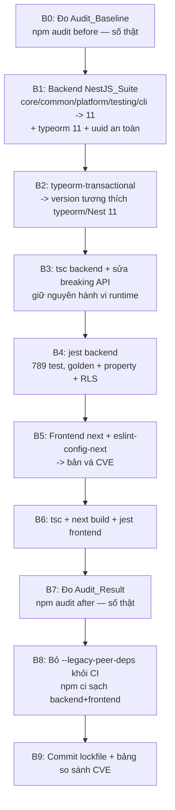

# Design Document

## Overview

Feature này nâng cấp dependency mang tính **breaking** để đóng các CVE mức HIGH còn lại của dự án ZeplaoPrint, đồng thời chứng minh KHÔNG hồi quy theo bốn trục bắt buộc của `audit-rules.md`: parity giá, cô lập tenant/RLS, test xanh, build tái lập.

Bản chất công việc là **quản lý phụ thuộc + verification**, không phải viết logic nghiệp vụ mới. Vì vậy thiết kế tập trung vào:

1. **Thứ tự nâng cấp an toàn** để gỡ xung đột peer (`@nestjs/swagger@11` vs `@nestjs/common@10`) đang phải né bằng `--legacy-peer-deps`.
2. **Ma trận version mục tiêu** cho `NestJS_Suite`, `uuid`, `typeorm-transactional`, `next`, `eslint-config-next`.
3. **Quy trình đo lường before/after** bằng `npm audit` với số thật.
4. **Cổng xác minh không-hồi-quy** dựa trên bộ test golden/property/unit ĐÃ tồn tại (789 test backend) + build + typecheck.

Nguyên tắc xuyên suốt (theo `audit-rules.md`): mọi nhận định "đã đóng / đã xanh / không hồi quy" chỉ được gắn `[VERIFIED]` khi kèm output lệnh thật, chưa chỉnh sửa.

### Phát hiện nền tảng (đã trace từ codebase)

- `backend/package.json`: `@nestjs/typeorm@^10.0.0`, nhưng `@nestjs/swagger@^11.2.6` trong khi `@nestjs/common`/`@nestjs/core`/`@nestjs/platform-*`/`@nestjs/testing`/`@nestjs/cli` đều `^10.4.0` → **đây là gốc xung đột peer** buộc CI dùng `--legacy-peer-deps`. `uuid@^11.1.0` đã ở major 11.
- `frontend/package.json`: `next@16.1.6`, `eslint-config-next@16.1.6` (pin cứng), `react@19.2.3`. Đã có `overrides.ws@^8.21.0` (vá non-breaking từ phiên trước).
- `RLS_Layer` phụ thuộc trực tiếp vào `typeorm-transactional@^0.5.0` tại bốn điểm sống:
  - `src/main.ts` → `initializeTransactionalContext()`
  - `src/app.module.ts` → `addTransactionalDataSource(ds)` trong `dataSourceFactory`
  - `src/common/tenant/tenant-connection.interceptor.ts` → `runInTransaction(...)`
  - `src/modules/messages/message-processor.service.ts` → `runInTransaction(...)`
- `.github/workflows/ci.yml`: cả job backend và frontend dùng `npm ci --legacy-peer-deps || npm install --legacy-peer-deps`.
- Pricing parity được khoá bởi golden/property test thật, ví dụ `src/quote/plugins/__tests__/price-preservation.golden.spec.ts` (Property 8, zero-tolerance), `src/quote/break-even.property.spec.ts` (Property 11), `src/modules/pricing/offset-engine/__tests__/offset-price-preservation.golden.spec.ts`.

## Architecture

### Chiến lược nâng cấp (thứ tự bắt buộc)

Thứ tự được chọn để mỗi bước có một cổng xác minh độc lập, giảm blast radius và cho phép rollback từng cụm.



### Bốn trục xác minh không-hồi-quy

| Trục | Cơ chế hiện có | Cổng xác minh | Requirement |
|------|----------------|---------------|-------------|
| Parity giá | Golden test zero-tolerance + property VAT/break-even | `npx jest --runInBand` xanh, không sửa expected/tolerance | Req 3 |
| Cô lập tenant/RLS | `tenant-connection.interceptor`, `tenant-context.service`, `tenant-transaction` + `typeorm-transactional` | Test RLS xanh; API `runInTransaction` giữ nguyên hợp đồng | Req 4 |
| Test xanh | Toàn bộ suite backend (789) + frontend | passed ≥ 789, failed = 0; ghi output thật | Req 5 |
| Build tái lập | Lockfile commit + `npm ci` không legacy flag + `next build` | `npm ci` sạch, build/typecheck pass | Req 7 |

### Nguyên tắc gỡ xung đột peer

Gốc xung đột là sự lệch major giữa `@nestjs/swagger@11` và phần còn lại của Nest đang ở `10`. Hướng giải quyết là **kéo toàn bộ `NestJS_Suite` lên cùng major 11** (thay vì hạ swagger về 10), vì:

- `@nestjs/typeorm@11` (Req 1.1) yêu cầu nền tảng Nest 11 để khớp peer `@nestjs/common`/`@nestjs/core`.
- Đưa tất cả về 11 cho phép `npm install` KHÔNG cần `--legacy-peer-deps` (Req 1.3, Req 7.4), là tiền đề để dọn CI.

## Components and Interfaces

### C1. Backend manifest (`backend/package.json`)

Thành phần cấu hình, không phải code. Thay đổi:

- Đồng bộ `NestJS_Suite` lên major 11: `@nestjs/core`, `@nestjs/common`, `@nestjs/platform-express`, `@nestjs/platform-socket.io`, `@nestjs/websockets`, `@nestjs/testing`, `@nestjs/cli` (+ `@nestjs/schematics` tương thích).
- `@nestjs/typeorm` → `^11` (Req 1.1).
- `@nestjs/swagger` giữ ở 11 (đã sẵn), nay khớp peer với phần còn lại.
- `uuid` xác nhận ở version ngoài danh sách CVE_High của baseline (Req 1.4) — hiện đã `^11.1.0`, cần verify lại bằng audit after.
- `typeorm-transactional` → version tương thích `typeorm`/Nest 11 (Req 4.2, 4.4), bắt buộc giữ export `initializeTransactionalContext`, `addTransactionalDataSource`, `runInTransaction`.

Các gói NestJS phụ trợ (`@nestjs/bullmq`, `@nestjs/config`, `@nestjs/jwt`, `@nestjs/passport`, `@nestjs/schedule`, `@nestjs/serve-static`, `@nestjs/throttler`, `@nestjs/event-emitter`, `@nestjs/axios`) được kiểm tra peer-range; chỉ bump khi peer của chúng yêu cầu Nest 11.

### C2. Frontend manifest (`frontend/package.json`)

- `next` → bản vá CVE_High gần nhất tương thích `react@19.2.3` (Req 2.1).
- `eslint-config-next` → khớp đúng version `next` đã chọn (Req 2.2).
- Giữ `overrides.ws`.

### C3. Mã nguồn thích ứng breaking API (Req 1.6, 2.5, 4.4)

Đây là phần code-touch DUY NHẤT, và mục tiêu là **giữ nguyên hành vi runtime**. Vùng rủi ro đã trace:

- `src/main.ts`, `src/app.module.ts` — chữ ký `initializeTransactionalContext`/`addTransactionalDataSource` của `typeorm-transactional`.
- `src/common/tenant/tenant-connection.interceptor.ts`, `src/modules/messages/message-processor.service.ts` — chữ ký `runInTransaction`.
- `src/config/typeorm.config.ts` và `TypeOrmModule.forRootAsync` `dataSourceFactory` — khả năng đổi option giữa `@nestjs/typeorm` 10→11.
- Khả năng đổi decorator/metadata của `@nestjs/swagger@11` (đã ở 11, ít rủi ro).

Quy tắc: nếu API đổi, điều chỉnh call-site để **giữ contract** `runInTransaction(fn)` và hành vi `SET LOCAL app.current_tenant` / `app.bypass` nguyên vẹn (xem `tenant-transaction.ts`). Không đổi ngữ nghĩa transaction.

### C4. CI workflow (`.github/workflows/ci.yml`)

- Sau khi đồng bộ version thành công (Req 7.4): bỏ `--legacy-peer-deps` ở cả hai job, chuyển về `npm ci` thuần.
- Fallback (Req 7.5): nếu bỏ cờ làm bước cài đặt fail, giữ nguyên cờ và ghi xung đột peer còn lại làm việc tồn đọng — KHÔNG ép buộc.

### C5. Tài liệu đo lường (artifact bằng chứng)

Một mục ghi chép (trong tasks/PR hoặc file bằng chứng) chứa:
- `Audit_Baseline` (before) và `Audit_Result` (after) — output thật chưa chỉnh sửa + timestamp (Req 6.2, 6.5).
- Bảng so sánh CVE_High before/after cho cả Backend và Frontend (Req 6.6).
- Output thật của `jest`/`tsc`/`next build`/`npm ci` (Req 5.3).

## Data Models

Đây là feature cấu hình; "data model" là các cấu trúc bản ghi version và đo lường, không phải entity DB.

### Ma trận version mục tiêu

| Package | Current | Target | Ràng buộc | Req |
|---------|---------|--------|-----------|-----|
| `@nestjs/typeorm` | ^10.0.0 | ^11 | peer Nest 11 | 1.1 |
| `@nestjs/core` | ^10.4.0 | ^11 | đồng bộ suite | 1.2 |
| `@nestjs/common` | ^10.4.0 | ^11 | đồng bộ suite | 1.2 |
| `@nestjs/swagger` | ^11.2.6 | ^11 (giữ) | khớp common 11 | 1.2 |
| `@nestjs/platform-express` | ^10.4.0 | ^11 | đồng bộ suite | 1.2 |
| `@nestjs/platform-socket.io` | ^10.4.22 | ^11 | đồng bộ suite | 1.2 |
| `@nestjs/websockets` | ^10.4.0 | ^11 | đồng bộ suite | 1.2 |
| `@nestjs/testing` | ^10.4.0 | ^11 | đồng bộ suite | 1.2 |
| `@nestjs/cli` | ^10.4.0 | ^11 | đồng bộ suite | 1.2 |
| `typeorm-transactional` | ^0.5.0 | tương thích typeorm/Nest 11 | giữ API `runInTransaction` | 4.2, 4.4 |
| `uuid` | ^11.1.0 | ngoài CVE_High | verify bằng audit after | 1.4 |
| `next` (frontend) | 16.1.6 | bản vá CVE_High | tương thích react 19.2.3 | 2.1 |
| `eslint-config-next` | 16.1.6 | = version next | khớp next | 2.2 |

> Version cụ thể của các mục "^11"/"bản vá" sẽ được chốt bằng `npm view`/`npm install` tại thời điểm thực thi và khoá vào `package-lock.json`; bảng này định nghĩa ràng buộc, không hardcode số minor/patch.

### Bản ghi đo lường audit (định dạng bằng chứng)

```
AuditRecord {
  scope: "backend" | "frontend"
  phase: "baseline" | "result"
  timestamp: ISO-8601
  command: string            // vd "npm audit --omit=dev" (backend) | "npm audit" (frontend)
  counts: { critical: int, high: int, moderate: int, low: int }
  rawOutput: string          // output thật, chưa chỉnh sửa
}
```

### Baseline đã biết (Req 6.2 — sẽ tái đo để khoá [VERIFIED])

- Backend (`npm audit --omit=dev`): 18 lỗ hổng / 5 high / 13 moderate.
- Frontend (`npm audit`): 2–3 high.

### Bảng so sánh CVE_High (Req 6.6 — điền sau khi đo)

| Scope | High (before) | High (after) | Lệnh đo |
|-------|---------------|--------------|---------|
| Backend | 5 | 0 (mục tiêu) | `npm audit --omit=dev` |
| Frontend | 2–3 | 0 (mục tiêu) | `npm audit` |

### Bản ghi CVE tồn đọng (Req 6.7 — chỉ khi còn HIGH không đóng được)

```
ResidualCVE {
  id: string                 // mã CVE / GHSA
  reason: string             // vì sao không đóng được bằng nâng cấp
  reachability: string       // đường khai thác để đánh giá rủi ro
}
```

## Error Handling

Vì đây là quy trình nâng cấp, "error handling" là chiến lược xử lý thất bại từng cổng và rollback.

| Tình huống | Phát hiện qua | Xử lý |
|------------|---------------|-------|
| `npm install` còn `ERESOLVE` sau đồng bộ | Bước B1/B3 | Trace gói nào còn peer-range cũ (`npm ls`), bump tiếp; nếu một gói chưa có bản tương thích Nest 11 → ghi tồn đọng, cân nhắc giữ `--legacy-peer-deps` (Req 7.5). |
| `tsc --noEmit` lỗi type (Req 1.5, 2.4) | B3/B6 | Sửa call-site theo API mới, **giữ hành vi runtime** (Req 1.6, 2.5). Không dùng `@ts-ignore` để giấu lỗi. |
| Golden/property test giá fail (Req 3.6) | B4 | Truy nguyên root cause trong mã nguồn/cấu hình; **CẤM** sửa expected, nâng tolerance, hoặc skip (Req 3.5). |
| Test RLS fail (Req 4.1) | B4 | Kiểm tra tương thích `typeorm-transactional`; nếu do đổi API → nâng version tương thích giữ contract `runInTransaction` (Req 4.4). |
| Tổng số test < 789 (Req 4.4, 5.4) | B4 | Truy nguyên test bị mất/skip (so test list before/after), khôi phục trước khi kết luận. |
| `next build` fail (Req 2.3) | B6 | Sửa breaking API frontend giữ hành vi; nếu do CVE-patch đổi behavior → điều chỉnh code, không downgrade về bản dính CVE. |
| Còn CVE_High sau nâng cấp (Req 6.7) | B7 | Ghi `ResidualCVE` (id + lý do + reachability); đánh giá rủi ro thay vì giấu. |
| Bỏ `--legacy-peer-deps` làm CI fail cài đặt (Req 7.5) | B8 | Giữ cờ, ghi rõ xung đột peer còn lại làm việc tồn đọng. |

### Chiến lược rollback

- Mỗi cụm bump là một commit độc lập; `package.json` + `package-lock.json` đều tracked nên rollback bằng `git checkout` an toàn (theo `audit-rules.md` §4: tracked = rủi ro thấp).
- KHÔNG commit lockfile cho tới khi cổng test/build của cụm đó xanh, tránh khoá một cây phụ thuộc gãy.

## Testing Strategy

### Vì sao KHÔNG dùng Property-Based Testing cho feature này

Theo hướng dẫn PBT của workflow, property-based testing chỉ phù hợp khi ta viết **logic mới** (pure function, parser, serializer, transformation) có tính chất "for all input X, P(X) holds". Feature này:

- KHÔNG thêm logic nghiệp vụ mới — chỉ thay đổi version dependency, lockfile, CI, và sửa call-site cho khớp API.
- Các "tính chất" cần bảo toàn (parity giá, cô lập RLS) ĐÃ được phủ bởi property/golden test SẴN CÓ thuộc các spec khác (`print-method-unification` Property 8/11, `resource-scope-config` Property 11). Vai trò của feature này là **chạy lại** chúng để chứng minh không-hồi-quy, không phải viết property mới.
- Các acceptance criteria còn lại là kiểm tra cấu hình/cài đặt/đo lường (`npm install` không ERESOLVE, `tsc` pass, `npm audit` = 0 high, `npm ci` sạch) — thuộc loại SMOKE/INTEGRATION, không phải "for all input".

Do đó **bỏ section Correctness Properties** và dùng chiến lược verification + regression bên dưới.

### Cổng xác minh (mọi kết quả phải [VERIFIED] bằng output thật)

1. **Cài đặt sạch (SMOKE)** — Req 1.3, 7.2, 7.3
   - `cd backend && npm install` (KHÔNG `--legacy-peer-deps`) → 0 lỗi `ERESOLVE`.
   - `npm ci` từ lockfile cho cả backend và frontend → thành công.

2. **Typecheck (SMOKE)** — Req 1.5, 2.4
   - Backend: `npx tsc --noEmit -p tsconfig.json` → 0 lỗi.
   - Frontend: `npx tsc --noEmit` → 0 lỗi.

3. **Regression suite backend (REGRESSION)** — Req 3, 4, 5
   - `npx jest --runInBand` tại `backend/`.
   - Tiêu chí: passed ≥ 789, failed = 0, skipped = 0 ở các golden/property test giá.
   - Bao phủ trục giá: `price-preservation.golden.spec.ts`, `offset-price-preservation.golden.spec.ts`, `break-even.property.spec.ts`, `phase3-migration.verify.spec.ts`, `quote-*.integration.spec.ts`.
   - Bao phủ trục RLS: `tenant-connection.interceptor.spec.ts`, `tenant-context.service.spec.ts`, `tenant-transaction.spec.ts`.
   - Ràng buộc cứng (Req 3.5): KHÔNG sửa expected, KHÔNG nâng tolerance, KHÔNG skip/disable để ép pass.
   - Lưu ý PBT seed (`audit-rules.md` §14.2): các property test dùng `fast-check` không pin seed — nếu xuất hiện fail flaky, coi là tín hiệu lỗi thật, truy tới cùng; không dập bằng cách giảm `NUM_RUNS`/nâng tolerance.

4. **Frontend (REGRESSION + SMOKE)** — Req 2.3, 5.2
   - `npm run build` → thành công.
   - `npx jest` (frontend) → failed = 0.

5. **Đo CVE before/after (INTEGRATION/measurement)** — Req 6
   - Before (B0): `npm audit --omit=dev` (backend), `npm audit` (frontend) → lưu `Audit_Baseline` + timestamp.
   - After (B7): lặp lại → lưu `Audit_Result`; tiêu chí backend high = 0, frontend high = 0.
   - Ghi bảng so sánh (Req 6.6); nếu còn HIGH → ghi `ResidualCVE` (Req 6.7).

6. **Build tái lập + CI (SMOKE)** — Req 7
   - Commit lockfile backend + frontend.
   - Sửa `ci.yml` bỏ `--legacy-peer-deps`; xác minh `npm ci` thuần pass (hoặc kích hoạt fallback Req 7.5).

### Đối chiếu test count (chống mất test — Req 5.4)

Ghi lại danh sách/tổng số test trước nâng cấp (789) và sau nâng cấp; nếu lệch, truy nguyên test bị mất/skip và khôi phục trước khi kết luận hoàn tất. Không chấp nhận "ít test hơn nhưng vẫn xanh".

### Quy ước bằng chứng (theo audit-rules.md)

Mỗi kết luận trong tasks/PR phải gắn `[VERIFIED]` kèm: lệnh đã chạy (đúng cwd `backend/` hoặc `frontend/`), output thật chưa chỉnh sửa, timestamp. Không gắn "đã đóng / đã xanh" từ suy đoán bề mặt.
