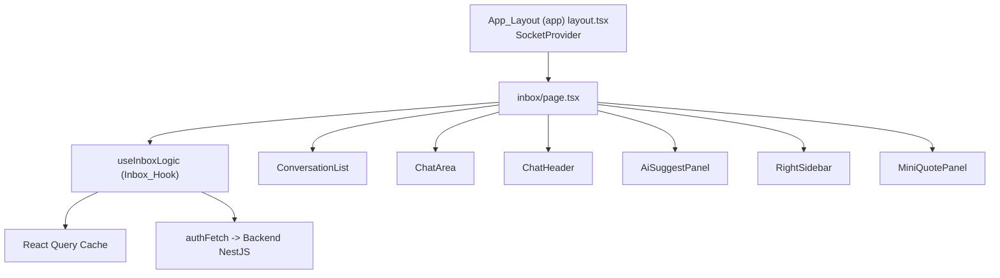
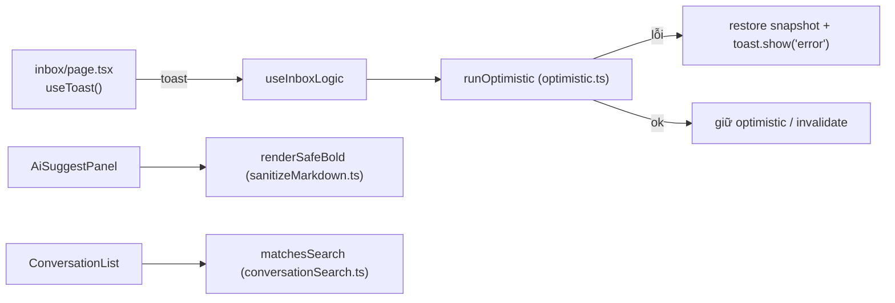

# Design Document: inbox-cskh-ux

## Overview

Spec này khắc phục các vấn đề chức năng, dữ liệu, an toàn và a11y cho module Inbox/CSKH theo 16 requirement đã duyệt. Toàn bộ thay đổi nằm ở **frontend** (Next.js + React Query). Backend KHÔNG đổi: không sửa schema PostgreSQL (`synchronize=false`), không đổi API hiện có, giữ nguyên FrozenRouteGuard, cấu trúc route, RBAC gating và logic pricing.

Nguyên tắc thiết kế:

- **Tái dùng hạ tầng UX đã có**: `ToastProvider`/`useToast` (`lib/ui/toast.tsx`), `ConfirmModal` (`lib/ui/ConfirmModal.tsx`), `formatVND` (`lib/format/currency.ts`), `useDebouncedValue` (`lib/hooks/useDebouncedValue.ts`), `DeleteConfirmModal` (`inbox/_components/DeleteConfirmModal.tsx`). Không tạo lại.
- **Tối thiểu, không over-engineer**: tối ưu cho tiệm in nhỏ. Trích xuất các hàm thuần nhỏ (sanitize HTML, khớp tìm kiếm, rollback cache) để vừa dễ test property-based vừa giữ phần UI mỏng.
- **An toàn frontend chỉ là UX**: backend vẫn là biên giới bảo mật thật; mọi thay đổi ở client chỉ cải thiện trải nghiệm và phòng vệ chiều sâu (vd. escape HTML cho output AI).

Kết quả: các Inbox_Action báo lỗi rõ ràng và rollback khi thất bại; gợi ý AI render an toàn; mọi `alert`/`confirm` native được thay bằng Toast/Modal; xóa hội thoại thống nhất một modal; đồng bộ Zalo không reload; tìm kiếm rộng hơn; tiền tệ nhất quán; hằng số được tách; bảng màu trạng thái đầy đủ; a11y được bổ sung.

## Architecture

### Bối cảnh hiện tại



### Thay đổi kiến trúc đề xuất

1. **Mount Toast_System cho Inbox.** App_Layout hiện CHƯA bọc `ToastProvider`. Inbox cần `useToast`, nên đặt `ToastProvider` bao quanh nội dung Inbox. Chọn mount tại `inbox/page.tsx` (bọc nội dung trang) để không ảnh hưởng các route khác trong group `(app)` và tránh phụ thuộc thứ tự với `SocketProvider`. Nếu sau này nhiều route `(app)` cần toast, có thể nâng lên App_Layout — ngoài phạm vi spec này.

2. **Lớp hàm thuần dùng cho Inbox** đặt tại `inbox/_lib/`:
   - `sanitizeMarkdown.ts` — `escapeHtml(text)` và `renderSafeBold(text)` (escape rồi mới chuyển `**bold**`).
   - `conversationSearch.ts` — `matchesSearch(conv, query)` khớp tên hiển thị, nội dung tin nhắn cuối, SĐT/externalId, không phân biệt hoa thường.
   - `optimistic.ts` — helper `withOptimistic` (hoặc `runOptimistic`) bao bọc: chụp snapshot cache, áp optimistic, gọi API, rollback + toast khi lỗi.
   - `constants.ts` — `STICKER_URLS`, và tái dùng `AUTO_DISMISS_MS` (đã có trong toast) cho các magic number cục bộ của Inbox nếu cần.

3. **Inbox_Hook nhận `toast` qua tham số** để không phá tách biệt logic/UI: `useInboxLogic(token, authFetch, toast)` — `toast` là API `useToast()` được trang truyền vào. Điều này giữ hook testable và tránh phụ thuộc cứng vào provider.



## Components and Interfaces

### Lớp hàm thuần (mới, trong `inbox/_lib/`)

**`sanitizeMarkdown.ts`**
```ts
/** Escape các ký tự HTML đặc biệt thành thực thể an toàn. */
export function escapeHtml(text: string): string;

/**
 * Render an toàn cú pháp **đậm**: escape toàn bộ HTML trước,
 * sau đó chuyển các cặp **...** đã escape thành <strong>...</strong>.
 * Kết quả không chứa thẻ thực thi nào ngoài <strong> hợp lệ.
 */
export function renderSafeBold(text: string): string;

/** Bỏ cú pháp markdown đậm/nghiêng, trả văn bản thuần (dùng cho "Sửa & Gửi"). */
export function stripMarkdown(text: string): string;
```

**`conversationSearch.ts`**
```ts
export interface SearchableConversation {
  contact?: { displayName?: string; phone?: string; externalUserId?: string } | null;
  lastMessage?: { content?: string } | string | null;
}

/** Khớp không phân biệt hoa thường theo tên hiển thị, nội dung tin cuối, SĐT/externalId. */
export function matchesSearch(conv: SearchableConversation, query: string): boolean;
```

**`optimistic.ts`**
```ts
import type { QueryClient, QueryKey } from '@tanstack/react-query';

export interface OptimisticOptions<T> {
  queryClient: QueryClient;
  queryKey: QueryKey;
  /** Biến đổi dữ liệu cache hiện tại thành trạng thái optimistic. */
  apply: (prev: T) => T;
  /** Thao tác bất đồng bộ gọi API; ném lỗi nếu thất bại. */
  commit: () => Promise<void>;
  /** Gọi khi lỗi để báo người dùng. */
  onError: (err: unknown) => void;
}

/**
 * Chụp snapshot cache, áp optimistic, chạy commit; nếu commit ném lỗi
 * thì khôi phục snapshot và gọi onError. Trả về true nếu thành công.
 */
export async function runOptimistic<T>(opts: OptimisticOptions<T>): Promise<boolean>;
```

**`constants.ts`**
```ts
/** Danh sách URL sticker hiển thị trong ChatArea. */
export const STICKER_URLS: readonly string[];
/** (Tùy chọn) Hằng số thời gian cục bộ nếu cần, tái dùng AUTO_DISMISS_MS từ toast. */
```

### Inbox_Hook (`_hooks/useInboxLogic.ts`) — sửa đổi

- Thêm tham số `toast: ToastApi`.
- Các action không-optimistic (`addNote`, `togglePinNote`, `transferConversation`, `collabActions.*`, `updateStatus`, `updatePriority`, `deleteNote`, `deleteConversation`, message actions): thay `catch { /* ignore */ }` và `alert()` bằng `toast.show('error', <thông điệp>)`, vẫn `console.error`.
- Các action optimistic (`toggleTag`, `togglePinConversation`, `markAsUnread`, `markAllRead`): chuyển sang dùng `runOptimistic` để rollback + toast khi lỗi.
- `deleteConversation`: bỏ `confirm()` native — việc xác nhận do UI (Delete_Confirm_Modal) đảm nhiệm; hook chỉ thực hiện xóa và báo lỗi qua toast khi thất bại.
- `recallMessage`, `pinMessage`, `starMessage`, `deleteLocalMessage`: thay `alert()` bằng `toast.show('error', ...)`.

### `AiSuggestPanel.tsx` — sửa đổi

- Thay `renderMarkdown` (không escape) bằng `renderSafeBold` từ `sanitizeMarkdown.ts` cho `dangerouslySetInnerHTML`; hoặc render bằng cách tách đoạn an toàn không dùng `dangerouslySetInnerHTML`. Thiết kế chọn `renderSafeBold` (escape trước) để giữ thay đổi tối thiểu nhưng an toàn.
- Thêm state pending theo `reply` đang gửi (`pendingReplyKey: string | null`, key = `${suggestionId}:${index}`); nút "Gửi"/"Sửa & Gửi" `disabled` khi đang gửi reply tương ứng; hiển thị nhãn "Đang gửi…".
- Bổ sung `aria-label` cho các nút.

### `ConversationList.tsx` — sửa đổi

- Bổ sung `STATUS_COLORS.waiting_file` và mọi khóa có trong `STATUS_LABELS`; dùng màu mặc định `'#94a3b8'` khi thiếu khóa.
- Thay biểu thức lọc tìm kiếm bằng `matchesSearch(conv, searchQuery)`.
- A11y: thêm `aria-label`/`title` cho nút chỉ-icon; thêm `role="button"`, `tabIndex={0}`, `onKeyDown` (Enter/Space) cho `div` đóng vai nút (vd. nút sync Zalo, hàng hội thoại nếu là `div`); thêm nhãn văn bản/`aria-label` cho ưu tiên, SLA, trạng thái.
- Nút sync Zalo: bỏ `alert()` → `toast`; gọi callback `onSyncZalo` đã invalidate query.

### `ChatArea.tsx` / `ChatHeader.tsx` — sửa đổi

- ChatArea: thay `alert()` (gửi sticker lỗi, file quá lớn, gửi tin thất bại, nút chọn ảnh sai loại) bằng `toast.show('error', ...)`; dùng `STICKER_URLS` thay mảng nội tuyến; xóa hội thoại từ khung chat dùng Delete_Confirm_Modal (state + render modal) thay `confirm()`.
- ChatHeader: thay `alert()` (không gọi nhóm Zalo) bằng `toast.show('info'|'error', ...)`; bổ sung `aria-label` cho nút chỉ-icon.

### `MiniQuotePanel.tsx` (+ `components/quote/*`) — sửa đổi

- Thay mọi `Number(...).toLocaleString('vi-VN') + 'đ'`/`'đ'` bằng `formatVND` cho hiển thị tiền tệ (option phụ kiện/gia công, dòng đã chọn). Không đổi logic tính giá; chỉ đổi tầng hiển thị.

### `inbox/page.tsx` — sửa đổi

- Bọc nội dung trong `ToastProvider`; lấy `const toast = useToast()` trong một component con bên trong provider và truyền vào `useInboxLogic(token, authFetch, toast)`.
- Thay `alert()` + `window.location.reload()` của luồng sync Zalo bằng `toast` + invalidate query (`queryClient.invalidateQueries({ queryKey: ['conversations'] })`).

## Data Models

Không có thay đổi mô hình dữ liệu phía server. Các kiểu phía client tái dùng từ `inbox/types.ts` (`Conversation`, `ChatMessage`, `Suggestion`, `Note`, `Participant`, `User`). Kiểu mới chỉ phục vụ hàm thuần:

- `SearchableConversation` (tập con của `Conversation` đủ cho `matchesSearch`).
- `OptimisticOptions<T>` (tham số cho `runOptimistic`).
- `pendingReplyKey: string | null` (state cục bộ trong Ai_Suggest_Panel).

Cấu trúc Query_Cache giữ nguyên: `['conversations', tagFilter]`, `['messages', selectedId]`, `['notes', selectedId]`, `['participants', selectedId]`, `['suggestions', selectedId]`.

**Ghi nhận giới hạn (Requirement 12, 16):**
- Truy vấn `['messages', selectedId]` gọi `.../messages?limit=100` và chưa phân trang. Phân trang tin nhắn cũ là cải thiện tùy chọn, chỉ thực hiện nếu không phá vỡ socket cập nhật realtime và thứ tự hiển thị hiện có.
- Bố cục 3 cột kéo-thả của Inbox hiện chỉ tối ưu cho desktop; responsive màn hình nhỏ là hạng mục tùy chọn ưu tiên thấp.

## Correctness Properties

*Một property là đặc tính hoặc hành vi phải đúng trên mọi lần thực thi hợp lệ của hệ thống — về bản chất là một phát biểu hình thức về điều phần mềm phải làm. Property là cầu nối giữa đặc tả con người đọc được và bảo đảm đúng đắn kiểm chứng được bằng máy.*

Chỉ phần **logic thuần** của Inbox phù hợp với property-based testing: render an toàn HTML (`sanitizeMarkdown.ts`), rollback optimistic (`optimistic.ts`), và khớp tìm kiếm (`conversationSearch.ts`). Các tiêu chí còn lại (tích hợp UI, a11y, refactor, ghi nhận) được phủ bằng component/unit/smoke test (xem Testing Strategy).

### Property 1: Render gợi ý AI an toàn (chống XSS)

*Với mọi* chuỗi đầu vào, kết quả của `renderSafeBold` SHALL không chứa thẻ HTML thực thi nào ngoài thẻ `<strong>`/`</strong>` được sinh từ cặp `**...**` hợp lệ; mọi ký tự `<`, `>`, `&` xuất hiện trong văn bản gốc phải bị escape thành thực thể HTML trong kết quả.

**Validates: Requirements 3.1, 3.2, 3.3**

### Property 2: Escape HTML là idempotent trên ký tự đã escape

*Với mọi* chuỗi đầu vào, `escapeHtml` SHALL không tạo ra chuỗi chứa ký tự `<` hoặc `>` thô, và áp dụng `escapeHtml` lần thứ hai lên một chuỗi đã được escape SHALL không thay đổi các thực thể đã escape (không escape kép `&amp;` thành `&amp;amp;` ngoài quy ước nhất quán đã chọn).

**Validates: Requirements 3.2, 3.3**

### Property 3: Rollback optimistic khôi phục trạng thái khi thất bại

*Với mọi* trạng thái Query_Cache ban đầu và hàm biến đổi `apply`, nếu `commit` ném lỗi thì sau khi `runOptimistic` kết thúc, Query_Cache SHALL bằng đúng trạng thái ban đầu (rollback hoàn toàn) và `onError` được gọi; nếu `commit` thành công thì Query_Cache SHALL bằng `apply(trạng thái ban đầu)`.

**Validates: Requirements 2.1, 2.2, 2.3**

### Property 4: Khớp tìm kiếm đa trường, không phân biệt hoa thường

*Với mọi* hội thoại và *với mọi* chuỗi con (không phân biệt hoa thường) của một trong các trường {tên hiển thị, nội dung tin nhắn cuối, số điện thoại, externalId}, `matchesSearch(conv, query)` SHALL trả về `true`; và *với mọi* truy vấn không phải chuỗi con của bất kỳ trường nào trong các trường đó, `matchesSearch(conv, query)` SHALL trả về `false`. Truy vấn rỗng SHALL trả về `true`.

**Validates: Requirements 7.1, 7.2, 7.3, 7.4**

## Error Handling

- **Lỗi gọi API trong Inbox_Action**: bắt lỗi (phản hồi không OK hoặc ngoại lệ mạng), `console.error` để chẩn đoán, và `toast.show('error', <thông điệp tiếng Việt rõ ràng>)`. Với action optimistic, `runOptimistic` rollback cache về snapshot trước khi báo lỗi (Req 1, 2).
- **Lỗi tải/gửi sticker, file quá lớn, gửi tin thất bại**: `toast.show('error', ...)` thay `alert()`; khôi phục ô nhập khi gửi tin thất bại (giữ hành vi hiện có) (Req 4).
- **Xóa hội thoại**: xác nhận qua Delete_Confirm_Modal; nếu API xóa thất bại → `toast.show('error', ...)`, không thay đổi cache (Req 5).
- **Đồng bộ Zalo**: thành công → invalidate query + `toast.show('success'|'info', ...)`; không có tài khoản/lỗi → `toast.show('error', ...)`; không bao giờ `window.location.reload()` (Req 6).
- **Nội dung AI độc hại**: phòng vệ chiều sâu bằng `escapeHtml` trước khi render; không tin tưởng output AI (Req 3).
- **Trạng thái hội thoại lạ**: `STATUS_COLORS[status] ?? '#94a3b8'` để tránh màu không xác định (Req 11).

Backend vẫn là biên giới bảo mật thật; mọi xử lý lỗi phía client chỉ cải thiện UX và không thay thế kiểm tra phía server.

## Testing Strategy

Cách tiếp cận kép: **property test** cho logic thuần, **component/unit/smoke test** cho phần còn lại.

### Property-based tests (fast-check, jest + ts-jest)

- Thư viện: `fast-check` (đã dùng trong các spec trước). Mỗi property test chạy **tối thiểu 100 iteration**.
- Mỗi test gắn tag theo định dạng: `Feature: inbox-cskh-ux, Property {n}: {mô tả}`.
- Mỗi property trong "Correctness Properties" được hiện thực bằng **một** property test:
  - Property 1 & 2 → `inbox/_lib/sanitizeMarkdown.test.ts` (generator chuỗi tùy ý gồm payload XSS `<script>`, `&`, `"`, `'`, và cặp `**`).
  - Property 3 → `inbox/_lib/optimistic.test.ts` (generator trạng thái cache tùy ý + hàm `apply`; `commit` thành công và `commit` ném lỗi; dùng `QueryClient` thật hoặc store giả lập).
  - Property 4 → `inbox/_lib/conversationSearch.test.ts` (generator hội thoại + chọn trường + substring đổi hoa thường; kèm case phủ định).

### Component / Unit tests (jest + @testing-library/react)

- **Inbox_Hook báo lỗi (Req 1)**: mock `authFetch` trả lỗi cho `toggleTag`, `addNote`, `markAllRead` → assert `toast.show('error', ...)` được gọi và `console.error` được gọi.
- **Thay alert/confirm (Req 4, 5)**: kích hoạt thu hồi/ghim/sao/xóa tin, xóa hội thoại → assert Confirm_Modal/Delete_Confirm_Modal hiển thị, `window.confirm`/`window.alert` KHÔNG được gọi.
- **Đồng bộ Zalo (Req 6)**: mock `queryClient.invalidateQueries`; assert được gọi và `window.location.reload` KHÔNG được gọi; toast hiển thị.
- **Pending nút gửi gợi ý AI (Req 8)**: dùng promise điều khiển được → assert nút `disabled` khi pending, click thứ hai bị chặn, enable lại sau khi resolve.
- **MiniQuotePanel tiền tệ (Req 9)**: render số tiền → khớp định dạng `formatVND` (một ký hiệu thống nhất).
- **STATUS_COLORS (Req 11)**: unit test lặp qua mọi khóa `STATUS_LABELS` → có màu; trạng thái lạ → fallback `#94a3b8`.
- **A11y (Req 13, 14, 15)**: nút chỉ-icon có accessible name; `div`-button có `role="button"`/`tabIndex`, `keyDown` Enter/Space gọi handler; priority/SLA/status có nhãn văn bản hoặc `aria-label`.

### Smoke / Review (không cần test runtime)

- Tách hằng số `STICKER_URLS` (Req 10) và ghi nhận giới hạn phân trang/responsive (Req 12, 16) — xác nhận qua review và export hằng số.

### Ghi chú vận hành

- Không chạy test ở chế độ watch; dùng `--ci`/`--runInBand` khi cần chạy một lần.
- Lỗi pre-existing không liên quan được phép bỏ qua: `src/app/(app)/inbox/_components/ChatArea.spec.tsx(18,17): TS2740`.
- Không thêm thư viện property test mới ngoài `fast-check`.
