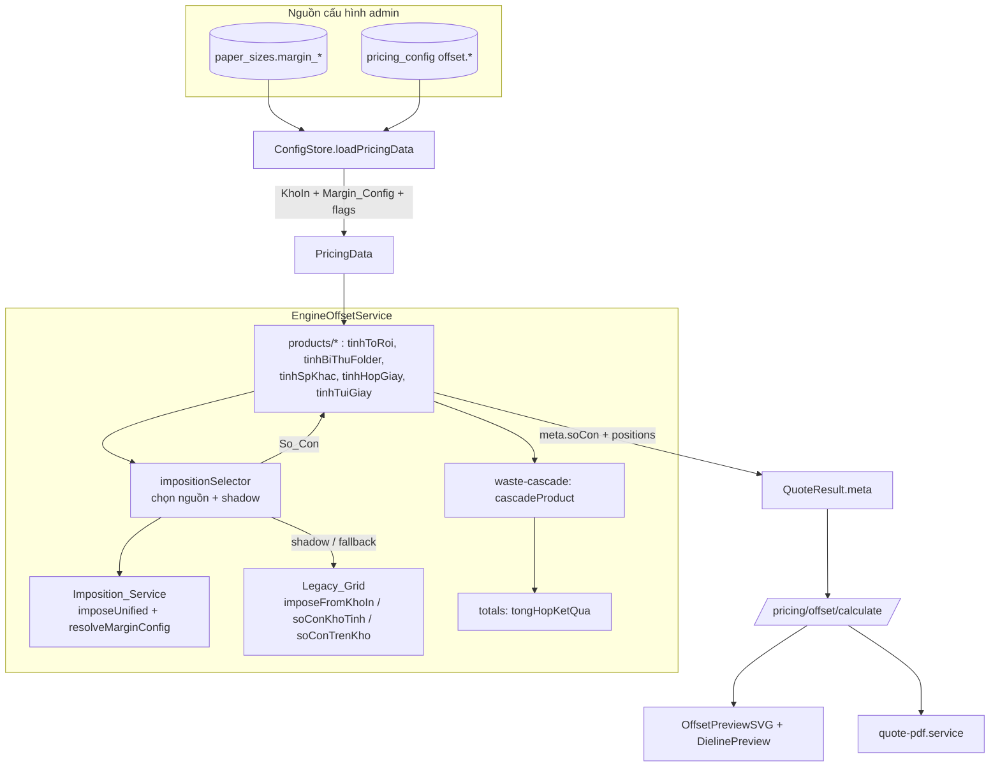

# Design Document

## Overview

Tính năng này thống nhất việc tính **số con/tờ** (imposition) của engine offset về **một nguồn sự thật duy nhất** — một hàm dàn khuôn vật lý có trừ lề tay-kê, cắn-nhíp (gripper) và gutter — để **giá ≡ preview ≡ sản lượng máy in thực tế**.

Hiện trạng (đã xác minh khi đọc mã nguồn):

- `offset-engine/lookups.ts` chứa `soConTrenKho()`, `imposeFromKhoIn()`, `soConKhoTinh()` (gọi chung là **Legacy_Grid**). Các hàm này CÓ trừ lề tay-kê (`KhoIn.marginLeft/Right/Top/Bottom` map từ `paper_sizes.margin_*`) nhưng dùng **một khe hở phẳng** `Gap_Cm` (mặc định 0.3cm) cho cả gutter, và **KHÔNG mô hình hóa cắn-nhíp (gripper) như một lề riêng ở một cạnh**.
- `dieline/nesting.ts` (`nestRectOnSheet()` / `nestOnSheet()`, cấu hình `DEFAULT_NESTING_CONFIG`) là **Nesting_Tool** mô hình hóa đúng máy in offset: lề `10mm` mỗi cạnh, `gripperMargin 12mm` ở cạnh đáy (landscape), `gutter 3mm`. Đây là mô hình vật lý mà preview hình học dùng.
- Hệ quả audit: cùng một sản phẩm + khổ giấy cho ra số con/tờ khác nhau giữa cơ sở tính giá (`meta.soConToLon`), tab `DielinePreview` (`countPerSheet`) và lưới `OffsetPreviewSVG`; giá lại tính trên con số lạc quan nhất.

Giải pháp: tạo **Imposition_Service** — một hàm thuần, tất định, là **API imposition duy nhất** mà cả tính giá (5 hàm `tinh*` trong `products/*`), preview và PDF cùng gọi. Hàm này:

1. Đọc **Margin_Config** (lề trái/phải/trên/dưới + gripper + gutter) cho mỗi `Kho_In` từ nguồn cấu hình admin sửa được (không hardcode).
2. Tính `So_Con` (số con/tờ giấy lớn) và `So_Con_Bai_In` (số con/khổ bài in) bằng mô hình vật lý: trừ lề mọi cạnh, trừ gripper ở một cạnh, dùng gutter giữa các con; thử cả 2 hướng đặt (0°/90°), chọn hướng nhiều con hơn.
3. Tất định: cùng input → cùng `So_Con` qua mọi lần gọi (chuẩn hóa đơn vị về milimet nội bộ, snap biên nhất quán).

Để giảm rủi ro (đây là vùng tới hạn về giá theo audit-rules §4/§7/§8), thay đổi được bảo vệ bởi: **Shadow_Mode** (chạy song song Legacy_Grid và Imposition_Service, đính kèm số liệu so sánh mà không đổi giá xuất), **cờ chọn nguồn imposition mặc định** (Legacy_Grid ↔ Imposition_Service) có đường rollback, **re-baseline Golden_Test có giải trình**, **giữ VAT một nguồn**, và **cổng kiểm chứng nghiệp vụ ±2%** đối chiếu 5–10 báo giá xưởng thật.

### Mục tiêu thiết kế

| # | Mục tiêu | Requirement |
|---|----------|-------------|
| G1 | Margin_Config (lề/gripper/gutter) cấu hình được theo từng Kho_In, đơn vị mm, không hardcode | 1 |
| G2 | Một hàm imposition duy nhất dùng chung cho giá + preview + PDF | 2, 10 |
| G3 | Giá tính trên `So_Con` đã tôn trọng lề/gripper (sheets tăng khi con giảm) | 3 |
| G4 | Giữ bất biến VAT một nguồn | 4 |
| G5 | Shadow_Mode đối chiếu không đổi giá | 5 |
| G6 | Đổi nguồn mặc định an toàn + rollback bằng cấu hình | 6 |
| G7 | Re-baseline golden có giải trình, không nới tolerance | 7 |
| G8 | Cổng kiểm chứng nghiệp vụ ±2% | 8 |
| G9 | Áp dụng nhất quán mọi Product_Type, gồm tui_giay | 9 |

### Phi mục tiêu

- KHÔNG đổi mô hình bù hao cascade (`waste-cascade.ts`) — chỉ đổi **nguồn `So_Con`** mà cascade tiêu thụ.
- KHÔNG đổi cách áp VAT, chiết khấu, markup ở `totals.ts`.
- KHÔNG đổi công thức khổ trải từng sản phẩm (`khoTraiTui`, kích thước hộp/tờ rơi…) — chỉ đổi cách số con/tờ được suy ra từ khổ trải đó.
- KHÔNG xóa Legacy_Grid trong đợt này (giữ để shadow + rollback).

## Architecture

### Sơ đồ thành phần



Nguyên tắc kiến trúc cốt lõi: **đường đọc của tính giá và đường vẽ của preview/PDF trỏ về CÙNG một con số `So_Con`** do Imposition_Service tính, được trả ra trong `QuoteResult.meta`. Preview/PDF KHÔNG được tự tính lại số con bằng đường riêng.

### Luồng dữ liệu khi tính giá một sản phẩm

1. `EngineOffsetService.calculate(input)` định tuyến tới `tinh*` theo `input.type`.
2. Hàm sản phẩm suy ra **khổ trải thực** (cm) của sản phẩm và bản ghi `Kho_In`.
3. Hàm sản phẩm gọi `impositionSelector.soCon({ item, kho, productType, data })`:
   - `resolveMarginConfig(kho, params)` → `Margin_Config` (mm).
   - Tính `So_Con` theo **nguồn mặc định** (`ImpositionSource`).
   - Nếu `ShadowMode` bật: tính thêm bằng nguồn còn lại, đính kèm `meta.shadow` (so_con cũ/mới, chênh lệch giá ước tính) — KHÔNG đổi `So_Con` trả ra.
4. `So_Con` đưa vào `buildWaste` → `cascadeProduct` → `Sheets_Net = ceil(piecesIntoPress / So_Con)` → `sheetsGross`.
5. Dòng chi phí tính như hiện tại; `tongHopKetQua` áp VAT/chiết khấu **không đổi**.
6. `res.meta` ghi `soConBaiIn`, `soConToLon`, `soToLon`, kèm hình học (`sheetW/H`, `itemW/H`, `positions`, `marginConfig`) để preview/PDF render đồng nhất.

### Đơn vị và tất định

- **Đơn vị nội bộ chuẩn của Imposition_Service = milimet (mm).** Khổ giấy/khổ in trong `PricingData` ở dạng chuỗi cm ("43cm x 65cm") và lề ở cm; Imposition_Service chuyển đổi **một lần** sang mm ở biên vào (×10) và làm việc hoàn toàn bằng mm.
- Tất định đạt được bằng: (a) chuyển đổi cm→mm rồi **làm tròn về số nguyên mm với epsilon snap** trước khi `floor`, để nhiễu thứ tự phép tính float không làm lệch số ô; (b) thứ tự thử hướng cố định; (c) không phụ thuộc trạng thái toàn cục.

### Cờ cấu hình (pricing_config, key `offset.*`)

| Key | Kiểu | Mặc định | Ý nghĩa | Requirement |
|-----|------|----------|---------|-------------|
| `offset.ImpositionSource` | `'legacy' \| 'unified'` | `'legacy'` (đến khi qua cổng nghiệp vụ) | Nguồn imposition mặc định cho giá xuất ra | 6.1, 6.2, 6.3 |
| `offset.ShadowMode` | `0 \| 1` | `0` | Bật chạy song song để đối chiếu | 5.1, 5.4 |
| `offset.Gripper_Cm` | number | `1.2` (=12mm) | Gripper mặc định khi Kho_In thiếu | 1.3 |
| `offset.Gutter_Cm` | number | `0.3` (=3mm) | Gutter mặc định khi Kho_In thiếu | 1.3 |

Các cờ này nạp qua `ConfigStore.loadPricingData()` (đã có cơ chế ghép `pricing_config` key `offset.*` lên `params`), nên đổi được **không cần triển khai lại mã** (Req 6.4, 5.4, 1.4).

### Quyết định thiết kế & lý do

- **D1 — Imposition_Service là hàm thuần trong `offset-engine`, không gọi trực tiếp `dieline/nesting.ts`.** Lý do: engine offset là lõi thuần, tất định, dễ property-test; `nesting.ts` phụ thuộc `generateDieline`/`calculateNesting` (nặng, hướng preview hình học). Ta tái dùng **cùng mô hình tham số vật lý** (margin/gripper/gutter mm như `DEFAULT_NESTING_CONFIG`) nhưng cài bằng grid thuần để đảm bảo tất định và hiệu năng (Req 2.6). Preview tiếp tục có thể dùng `nesting.ts` để vẽ vị trí, nhưng **con số `So_Con` phải lấy từ meta** (Req 10).
- **D2 — Giữ Legacy_Grid nguyên vẹn.** Cần cho Shadow_Mode (Req 5) và rollback (Req 6.3). Khi `ImpositionSource='legacy'` hành vi giá phải **tương đương trước thay đổi** → golden cũ vẫn xanh trước khi flip.
- **D3 — tui_giay giữ đường khổ trải riêng nhưng dùng chung primitive imposition.** `khoTraiTui` (công thức khổ trải túi) là đặc thù và đúng; ta KHÔNG hợp nhất phần đó. Nhưng bước cuối "số con/bài + số bài/tờ" sẽ áp **cùng Margin_Config (lề/gripper/gutter)** qua Imposition_Service primitive thay cho `soConBai`/`heSo` dùng khe hở phẳng (Req 9.2, 9.3).
- **D4 — Selector tập trung ở một chỗ** (`impositionSelector`) thay vì rải `if (source)` trong 5 sản phẩm, để bật/tắt shadow và đổi nguồn nhất quán (Req 5, 6, 9.4).

## Components and Interfaces

### 1. `offset-engine/imposition.ts` (MỚI) — Imposition_Service

Hàm thuần, là nguồn sự thật duy nhất.

```ts
/** Margin_Config đã chuẩn hóa về mm. */
export interface MarginConfig {
  left: number;    // mm
  right: number;   // mm
  top: number;     // mm
  bottom: number;  // mm
  gripper: number; // mm — cộng vào MỘT cạnh (cạnh nhíp)
  gutter: number;  // mm — khe giữa các con
}

export interface ImpositionInput {
  itemWmm: number;   // bề rộng con (mm)
  itemHmm: number;   // bề cao con (mm)
  sheetWmm: number;  // khổ giấy lớn (mm)
  sheetHmm: number;
  pressWmm?: number; // khổ bài in (mm) — để tính soConBaiIn; thiếu → chỉ tính soConToLon
  pressHmm?: number;
  margins: MarginConfig;
}

export interface ImpositionResult {
  soConToLon: number;          // số con / tờ giấy lớn
  soConBaiIn: number;          // số con / khổ bài in (0 nếu không có press*)
  orientation: 0 | 90;         // hướng đặt cho kết quả tối ưu (tờ lớn)
  usableArea: { width: number; height: number }; // mm, sau khi trừ lề + gripper
  positions: Array<{ x: number; y: number; w: number; h: number }>; // mm, để preview
}

/**
 * Tính số con/tờ theo mô hình dàn khuôn vật lý.
 * - Trừ left+right khỏi bề rộng, top+bottom+gripper khỏi bề cao (gripper ở 1 cạnh).
 * - Thử hướng 0° và 90°, chọn hướng cho nhiều con hơn (tie → 0°).
 * - Tất định: chuyển về mm nguyên (snap epsilon) trước khi floor.
 * @throws OffsetPricingError nếu vùng in khả dụng ≤ 0.
 */
export function imposeUnified(input: ImpositionInput): ImpositionResult;

/** Lấy Margin_Config (mm) cho một Kho_In, áp mặc định gripper/gutter khi thiếu. */
export function resolveMarginConfig(
  kho: Pick<KhoIn, 'marginLeft'|'marginRight'|'marginTop'|'marginBottom'|'gripperCm'|'gutterCm'>,
  params: Params,
): MarginConfig;
```

Logic `imposeUnified` (một hướng):

```
usableW = sheetW - margins.left - margins.right
usableH = sheetH - margins.top - margins.bottom - margins.gripper
if (usableW <= 0 || usableH <= 0) throw OffsetPricingError(...)  // Req 1.6, 3.4 (qua soCon=0 ⇒ engine chặn)
cols = floor( (usableW + gutter) / (itemW + gutter) )   // n con cần (n-1) gutter
rows = floor( (usableH + gutter) / (itemH + gutter) )
count = max(0, cols) * max(0, rows)
```

Thử `(itemW,itemH)` và `(itemH,itemW)`, lấy max; `soConBaiIn` tính tương tự trên `press*`.

`resolveMarginConfig`: `left/right/top/bottom` từ `kho.margin*` (cm→mm ×10, thiếu→0); `gripper` từ `kho.gripperCm ?? params.Gripper_Cm` (mặc định 1.2cm=12mm); `gutter` từ `kho.gutterCm ?? params.Gutter_Cm` (mặc định 0.3cm=3mm). Giá trị <0 → `OffsetPricingError` mô tả khổ + thông số (Req 1.6).

### 2. `offset-engine/imposition-selector.ts` (MỚI) — chọn nguồn + shadow

```ts
export interface SoConRequest {
  itemWmm: number; itemHmm: number;
  sheetWmm: number; sheetHmm: number;
  pressWmm?: number; pressHmm?: number;
  kho: KhoIn;
  data: PricingData;
  /** Số con bảng (fallback Legacy khi hình học không tính được). */
  fallbackToLon?: number;
  fallbackBaiIn?: number;
}

export interface SoConOutcome {
  soConToLon: number;
  soConBaiIn: number;
  source: 'legacy' | 'unified';
  /** Chỉ có khi ShadowMode bật — số liệu đối chiếu (không ảnh hưởng giá). */
  shadow?: {
    legacyToLon: number; unifiedToLon: number;
    legacyBaiIn: number; unifiedBaiIn: number;
    deltaToLon: number;  // unified - legacy
  };
  positions?: ImpositionResult['positions'];
  marginConfig?: MarginConfig;
}

/** Nguồn So_Con duy nhất cho mọi sản phẩm. */
export function resolveSoCon(req: SoConRequest): SoConOutcome;
```

`resolveSoCon`:
- Đọc `source = data.tyLe.params.ImpositionSource ?? 'legacy'`, `shadow = !!data.tyLe.params.ShadowMode`.
- Tính `unified` qua `imposeUnified`; tính `legacy` qua `imposeFromKhoIn` (cùng input cm).
- `So_Con` trả ra theo `source`. Nếu `shadow`, đính `shadow{}` để hàm sản phẩm gắn vào `meta`.
- Ghi log so sánh (Req 5.3) qua `Logger` khi shadow bật.

### 3. `offset-engine/products/*` — điểm tích hợp

Mỗi hàm `tinh*` thay lời gọi imposition trực tiếp bằng `resolveSoCon(...)`:

- `to-roi.ts`, `bi-thu-folder.ts`, `sp-khac.ts`, `hop-giay.ts`: thay `imposeFromKhoIn` / `soConKhoTinh` bằng `resolveSoCon` (giữ fallback bảng tĩnh qua `fallback*`). (Req 9.1)
- `tui-giay.ts`: trong `buildTuiOptions`/`soConBai`, áp `Margin_Config` (lề/gripper/gutter) cho phép tính số con/bài và `heSo` qua `imposeUnified` primitive thay khe hở phẳng (Req 9.2, 9.3). Giữ `khoTraiTui` đặc thù.
- Mọi hàm gắn `meta.shadow`, `meta.positions`, `meta.marginConfig` khi có (Req 5.2, 10).

`So_Con` trả về được dùng **đồng thời** cho `buildWaste(...soCon...)` (giá) và `res.meta.soConToLon` (preview/PDF) — đảm bảo parity (Req 10.1).

### 4. `KhoIn` + `ConfigStore` — Margin_Config

- `KhoIn` thêm `gripperCm?`, `gutterCm?` (cm). `ConfigStore.loadPricingData` map `paper_sizes` lề (đã có) + đọc gripper/gutter từ cột mới (nếu có) hoặc từ `params.Gripper_Cm`/`Gutter_Cm`.
- Endpoint cấu hình: `paper_sizes.margin_*` đã sửa được qua màn **Khổ Giấy**; bổ sung gripper/gutter qua `cfg/kho-in` (mở rộng body) hoặc param toàn cục `cfg/param` (`offset.Gripper_Cm`, `offset.Gutter_Cm`). (Req 1.4)

### 5. Frontend Preview + PDF — tiêu thụ `meta`

- `OffsetPreviewSVG.tsx` / `DielinePreview.tsx`: render từ `meta.soConToLon` + `meta.positions` (nếu có) thay vì tự gọi nesting riêng để đếm số con. (Req 2.3, 10.2)
- `quote-pdf.service.ts`: in `meta.soConToLon` từ kết quả engine (Req 2.4, 10.3).

### 6. Shadow analytics + Business_Validation_Gate

- **Shadow log**: khi `ShadowMode` bật, `resolveSoCon` ghi `{productType, kho, legacy, unified, delta}` (Req 5.3). API trả `meta.shadow` để công cụ phân tích thu thập.
- **Business_Validation_Gate**: test harness `__tests__/business-validation.gate.spec.ts` chứa 5–10 ca báo giá xưởng thật (input + giá thật). So `khachTra` (unified) với giá thật; `|Δ%| ≤ 2%` → đạt; vượt → đánh dấu `review`. Ghi bảng kết quả (sản phẩm, khổ, giá thật, giá mới, %Δ). (Req 8)

### 7. Golden re-baseline

- Khi flip `ImpositionSource='unified'`, cập nhật `GOLDEN` trong `offset-price-preservation.golden.spec.ts` bằng số tính lại, kèm **bảng giải trình** trong mô tả test/`verification.md` cho từng giá đổi (Req 7.1, 7.2); giữ `PRECISION=6` (Req 7.3).

## Data Models

### `KhoIn` (mở rộng)

```ts
export interface KhoIn {
  khoIn: string;
  chiaTo: string;
  soConBaiIn: number;
  soConToLon: number;
  khoGiayLon: string;
  dienTichM2: number;
  loaiKem: LoaiKem;
  marginLeft?: number;   // cm (từ paper_sizes.margin_left / 10)
  marginRight?: number;
  marginTop?: number;
  marginBottom?: number;
  gripperCm?: number;    // MỚI — cắn-nhíp 1 cạnh; thiếu → params.Gripper_Cm (mặc định 1.2)
  gutterCm?: number;     // MỚI — khe giữa các con; thiếu → params.Gutter_Cm (mặc định 0.3)
}
```

### `Params` (thêm khóa imposition)

```ts
export interface Params {
  // ... hiện có ...
  ImpositionSource?: 'legacy' | 'unified'; // nguồn mặc định (Req 6)
  ShadowMode?: number;                      // 0|1 (Req 5)
  Gripper_Cm?: number;                      // mặc định 1.2 (=12mm) (Req 1.3)
  Gutter_Cm?: number;                       // mặc định 0.3 (=3mm) (Req 1.3)
  [key: string]: number | string | undefined;
}
```

> Lưu ý: `params` hiện là `[key: string]: number`. Mở rộng để chứa `ImpositionSource` (chuỗi) → đọc qua helper ép kiểu, hoặc lưu `ImpositionSourceUnified: 0|1` để giữ kiểu số. Thiết kế chọn **`offset.ImpositionSource` lưu chuỗi trong `pricing_config.config_value` (TEXT)** và đọc tách khỏi `params` số (giống cách `WasteStages` được tách trong `loadPricingData`).

### `QuoteMeta` (mở rộng cho parity + shadow)

```ts
export interface QuoteMeta {
  // ... hiện có: khoBinh, khoGiayLon, soConBaiIn, soConToLon, soToLon, luotIn, soKem, loaiKem, sheetW/H, itemW/H ...
  impositionSource?: 'legacy' | 'unified';   // nguồn đã dùng cho So_Con này
  marginConfig?: MarginConfig;               // mm — để preview vẽ vùng in/gripper
  positions?: Array<{ x: number; y: number; w: number; h: number }>; // mm
  shadow?: {                                  // chỉ khi ShadowMode bật (Req 5.2)
    legacyToLon: number; unifiedToLon: number;
    legacyBaiIn: number; unifiedBaiIn: number;
    deltaToLon: number;
  };
}
```

### Bất biến dữ liệu

- `So_Con` (`meta.soConToLon`) dùng cho giá = `So_Con` trả cho preview/PDF (cùng một giá trị, một lần tính).
- `Margin_Config` mọi trường ≥ 0; `usableW>0 && usableH>0` mới hợp lệ.
- Đơn vị: mọi giá trị Margin_Config nội bộ là mm; chuyển đổi cm→mm đúng một lần ở biên.

## Correctness Properties

*A property is a characteristic or behavior that should hold true across all valid executions of a system — essentially, a formal statement about what the system should do. Properties serve as the bridge between human-readable specifications and machine-verifiable correctness guarantees.*

Imposition là toán học thuần (lưới hình học) + tích hợp cascade tất định, nên property-based testing áp dụng tốt. Mỗi property dưới đây được suy từ phần prework, đã loại bỏ trùng lặp.

### Property 1: Margin_Config được suy từ nguồn cấu hình (mapping + mặc định + đổi đơn vị)

*For any* `Kho_In` với lề `(left,right,top,bottom)` cho ở cm và `Params` có `Gripper_Cm`/`Gutter_Cm` tùy chọn, `resolveMarginConfig` trả về Margin_Config theo mm trong đó mỗi cạnh = giá-trị-cm × 10 (cạnh thiếu = 0), `gripper` = `(kho.gripperCm ?? params.Gripper_Cm ?? 1.2) × 10` và `gutter` = `(kho.gutterCm ?? params.Gutter_Cm ?? 0.3) × 10`; không có hằng số mã hóa cứng nào khác lọt vào.

**Validates: Requirements 1.1, 1.2, 1.3, 1.5**

### Property 2: Lề/gripper/gutter không hợp lệ bị từ chối bằng lỗi mô tả

*For any* input mà một giá trị Margin_Config < 0 hoặc khiến vùng in khả dụng (`usableW = sheetW − left − right` hoặc `usableH = sheetH − top − bottom − gripper`) ≤ 0, `imposeUnified` / `resolveMarginConfig` ném `OffsetPricingError` nêu rõ khổ in và thông số sai, và KHÔNG trả về số con.

**Validates: Requirements 1.6**

### Property 3: Imposition chọn hướng đặt nhiều con hơn

*For any* kích thước con `(itemW,itemH)`, khổ `(sheetW,sheetH)` và Margin_Config hợp lệ, `imposeUnified().soConToLon` bằng `max(count(0°), count(90°))` và do đó ≥ số con của bất kỳ hướng đơn lẻ nào; kết quả luôn là số nguyên không âm.

**Validates: Requirements 2.1, 2.5**

### Property 4: Imposition tất định, không nhạy thứ tự phép tính float

*For any* input hợp lệ, gọi `imposeUnified` nhiều lần — kể cả khi hoán đổi thứ tự cộng/trừ float tương đương ở biên — trả về cùng `soConToLon`, `soConBaiIn` và `orientation`. Việc snap cm→mm nguyên đảm bảo nhiễu float không làm lệch số ô giữa đường tính giá và đường preview.

**Validates: Requirements 2.6, 10.4**

### Property 5: Tăng lề/gripper/gutter không làm tăng số con

*For any* input hợp lệ, nếu tăng bất kỳ thành phần Margin_Config nào (left/right/top/bottom/gripper/gutter) trong khi giữ nguyên các tham số khác, thì `soConToLon` không tăng. Đây là bằng chứng "lề và gripper thực sự bị trừ khỏi vùng in" (giá tôn trọng ràng buộc máy in vật lý).

**Validates: Requirements 1.1, 3.2**

### Property 6: Sheets_Net đúng công thức và đơn điệu theo So_Con; bất biến ranh giới cascade được giữ

*For any* số lượng tốt `Q > 0` và `So_Con` từ Imposition_Service, `Sheets_Net = ceil(piecesIntoPress / So_Con)`; nếu `So_Con₁ ≤ So_Con₂` thì `Sheets_Net(So_Con₁) ≥ Sheets_Net(So_Con₂)` (số con giảm ⇒ số tờ không giảm ⇒ chi phí giấy không giảm); và luôn `sheetsGross ≥ sheetsNet ≥ ceil(Q / So_Con)`.

**Validates: Requirements 3.1, 3.2, 3.3**

### Property 7: So_Con = 0 dẫn tới lỗi mô tả, không chia cho 0

*For any* sản phẩm mà Imposition_Service trả `So_Con = 0` (sản phẩm quá khổ hoặc vùng in không đủ), engine trả `success=false` với `OffsetPricingError` mô tả, KHÔNG trả `Sheets_Net = Infinity` hay giá bằng 0.

**Validates: Requirements 3.4**

### Property 8: VAT một nguồn, áp đúng một lần, tỉ lệ bất biến theo imposition

*For any* tập dòng chi phí và `vatRate`, `tongHopKetQua` cho `vat = tongChuaVAT × (vatRate ?? 0)` và `tongGomVAT = tongChuaVAT + vat` (đúng một lần); với cùng `vatRate`, tỉ lệ `vat / tongChuaVAT` bằng `vatRate` bất kể `So_Con` (và do đó bất kể imposition) thay đổi; thiếu `vatRate` ⇒ VAT = 0 (không có nguồn VAT nào khác).

**Validates: Requirements 4.1, 4.2, 4.3**

### Property 9: Shadow_Mode không làm đổi giá xuất ra

*For any* input và nguồn mặc định cố định, bật `ShadowMode` cho ra cùng `tongChuaVAT`, `vat`, `khachTra`, `donGia1SP` như khi tắt `ShadowMode`; khi bật, kết quả còn đính kèm `meta.shadow` chứa số con của cả hai phương pháp mà không tác động tới giá.

**Validates: Requirements 5.2**

### Property 10: Cờ nguồn mặc định quyết định So_Con cho mọi loại sản phẩm

*For any* Product_Type ∈ {to_roi, bi_thu_folder, sp_khac, hop_giay, tui_giay} và cờ `ImpositionSource`: khi cờ = `unified`, `So_Con` dùng để tính giá bằng đúng kết quả của `imposeUnified`; khi cờ = `legacy`, `So_Con` bằng đúng kết quả Legacy_Grid (`imposeFromKhoIn`/bảng) — tái lập hành vi trước thay đổi; `meta.impositionSource` luôn khớp cờ.

**Validates: Requirements 6.1, 6.2, 6.3, 9.1**

### Property 11: Một nguồn So_Con duy nhất cho cả giá và preview (parity)

*For any* sản phẩm offset được tính giá, `So_Con` dùng làm cơ sở `Sheets_Net` bằng đúng `meta.soConToLon` trả ra cho preview/PDF (cùng một giá trị, được tính một lần) — không tồn tại hai con số khác nhau cho cùng input.

**Validates: Requirements 2.2, 9.4, 10.1**

### Property 12: tui_giay tôn trọng cùng mô hình lề/gripper/gutter

*For any* input túi giấy, số con/tờ của `tui_giay` được tính qua cùng primitive imposition với Margin_Config; tăng gripper (hoặc lề/gutter) không làm tăng số con/tờ của túi — chứng minh đường tui_giay không còn dùng số con lạc quan bỏ qua ràng buộc máy in.

**Validates: Requirements 9.2, 9.3**

### Tiêu chí không phủ bằng property (xử lý bằng loại test khác)

- **Req 1.4, 5.4, 6.4** (đổi cấu hình không cần redeploy): integration test — sửa `pricing_config`/`paper_sizes`, gọi `refreshFromConfigStore`, xác nhận giá trị mới được dùng.
- **Req 2.3, 10.2** (preview hiển thị số con từ service): frontend component test cho `OffsetPreviewSVG` + `DielinePreview` render `meta.soConToLon`.
- **Req 2.4, 10.3, 10.5** (PDF + đối chiếu artifact): example test cho `quote-pdf.service` đọc `meta.soConToLon`; một ca end-to-end đối chiếu giá/preview/PDF cùng số con.
- **Req 5.1, 5.3** (shadow tính cả hai + ghi log): example + smoke (mock logger).
- **Req 7.1–7.5** (re-baseline golden): golden regression + tài liệu giải trình; chạy lại các property suite hiện có (`totals.property`, `lookups.property`, `vat.property`, cascade property) ở nguyên số vòng/tolerance.
- **Req 8.1–8.4** (cổng nghiệp vụ ±2%): example-based gate harness với 5–10 ca thật, ghi bảng kết quả.

## Error Handling

| Tình huống | Phát hiện ở | Hành vi | Requirement |
|-----------|-------------|---------|-------------|
| Margin_Config có giá trị < 0 | `resolveMarginConfig` | `OffsetPricingError("Khổ in {kho}: thông số lề/gripper/gutter âm: {field}={value}")` | 1.6 |
| Vùng in khả dụng ≤ 0 (lề/gripper nuốt hết khổ) | `imposeUnified` | `OffsetPricingError("Khổ in {kho}: vùng in khả dụng ≤ 0 sau khi trừ lề/gripper")` | 1.6 |
| So_Con = 0 (sản phẩm quá khổ) | hàm `tinh*` sau `resolveSoCon` | `OffsetPricingError("Sản phẩm quá lớn cho khổ in đã chọn — số con/tờ = 0")`; engine trả `success=false` | 3.4 |
| Khổ in không tra cứu được | `timKhoIn`/`resolveSoCon` | `OffsetPricingError("Khổ in không tồn tại: {khoIn}")` | 2.1 |
| `ImpositionSource` giá trị lạ trong config | đọc cấu hình | Mặc định an toàn về `'legacy'` + cảnh báo log; không vỡ tính giá | 6.1 |
| Imposition_Service lỗi hình học khi `unified` đang bật | `resolveSoCon` | Ném lỗi mô tả; KHÔNG âm thầm rơi về Legacy_Grid (tránh giá sai lặng lẽ). Rollback là hành động cấu hình có chủ đích | 6.3 |

Nguyên tắc: lỗi imposition là **lỗi cứng** (fail fast) ở tầng tính giá vì đây là vùng tới hạn về giá — thà từ chối báo giá còn hơn xuất giá sai. Mọi lỗi dùng `OffsetPricingError` để `EngineOffsetService.calculate` bắt và trả `{ success: false, error }` đồng nhất với hiện tại.

## Testing Strategy

### Cách tiếp cận kép

- **Property tests** (lõi thuần): phủ 12 property ở trên cho `imposition.ts`, `imposition-selector.ts`, tích hợp cascade và VAT. Đây là phần có giá trị nhất vì imposition là toán học có không gian input lớn.
- **Unit/example tests**: ca cụ thể (gripper 12mm trên khổ 79×109 cho ra số con đã biết), biên (sản phẩm vừa khít, sản phẩm quá khổ), và các điểm tích hợp (selector đọc cờ, meta chứa shadow).
- **Integration tests**: cấu hình reload (Req 1.4/5.4/6.4), parity preview/PDF (Req 2.3/2.4/10.2/10.3/10.5).
- **Golden regression**: `offset-price-preservation.golden.spec.ts` — xanh với `legacy` trước khi flip; re-baseline có giải trình khi flip sang `unified`.
- **Business validation gate**: `__tests__/business-validation.gate.spec.ts` — 5–10 ca thật, ngưỡng ±2%.

### Thư viện và cấu hình property test

- Dùng **fast-check** (đã có trong dự án — xem các `*.property.spec.ts` hiện hữu). KHÔNG tự cài property testing.
- Tối thiểu **100 vòng** mỗi property (`fc.assert(..., { numRuns: 100 })` trở lên; nhiều suite hiện dùng mặc định ≥100).
- Mỗi property test gắn comment tham chiếu design property, định dạng:
  `// Feature: offset-imposition-gripper-unification, Property {n}: {mô tả ngắn}`
- Mỗi correctness property cài bằng **một** property-based test.

### Bản đồ property → file test (dự kiến)

| Property | File test |
|----------|-----------|
| P1, P2, P5 | `offset-engine/__tests__/imposition.property.spec.ts` |
| P3, P4 | `offset-engine/__tests__/imposition.property.spec.ts` |
| P6 | `offset-engine/__tests__/waste-cascade.property.spec.ts` (mở rộng) |
| P7 | `offset-engine/__tests__/imposition-selector.property.spec.ts` + engine error case |
| P8 | `offset-engine/__tests__/totals.property.spec.ts` (mở rộng) / `quote/vat.property.spec.ts` (giữ nguyên) |
| P9, P10, P11 | `offset-engine/__tests__/imposition-selector.property.spec.ts` |
| P12 | `offset-engine/__tests__/tui-imposition.property.spec.ts` |

### Generator chú ý (edge cases dựa vào generator)

- Kích thước con/khổ: số dương có thập phân (cm), gồm ca con vừa khít và quá khổ.
- Margin_Config: gồm 0, giá trị lớn nuốt hết khổ (kích hoạt P2), và giá trị mặc định khi thiếu (P1).
- Số lượng `Q`: từ 1 tới hàng triệu (đơn điệu sheets, P6).
- vatRate: `undefined`, 0, 0.08, 0.1 (P8).
- ImpositionSource: cả `legacy` và `unified`; ShadowMode 0/1 (P9, P10).

### Trình tự kiểm chứng khi phát hành (gắn rollout an toàn)

1. Cài Imposition_Service + selector với `ImpositionSource='legacy'` (mặc định) → golden + mọi property xanh, **giá live không đổi** (Req 6.3, 7).
2. Bật `ShadowMode=1` trên môi trường thật → thu `meta.shadow`, phân tích chênh lệch (Req 5).
3. Chạy Business_Validation_Gate với 5–10 đơn thật; xử lý các ca > ±2% (Req 8).
4. Khi đạt, flip `ImpositionSource='unified'` (cấu hình, không redeploy) → re-baseline golden có giải trình (Req 7).
5. Đường rollback: đặt lại `ImpositionSource='legacy'` qua cấu hình (Req 6.3, 6.4).
