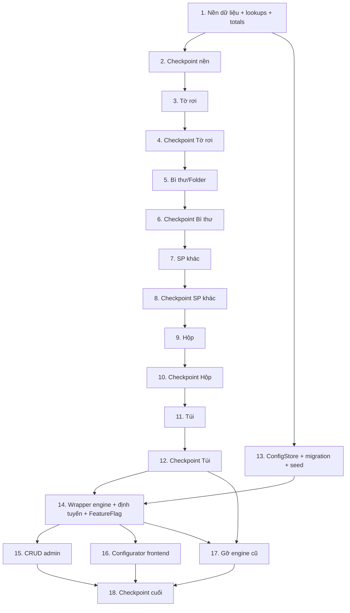

# Implementation Plan: offset-pricebook-revamp

## Overview

Hiện thực `EngineOffset` bằng **TypeScript** (khớp NestJS backend + Next.js frontend). Lõi tính giá là
hàm thuần đặt tại `backend/src/modules/pricing/offset-engine/`, nhận `PricingData`, không phụ thuộc DB —
để chạy **property test** (fast-check, ≥100 iteration, tag `Feature: offset-pricebook-revamp, Property {n}`)
và **golden test** (so `donGia1SP` với Excel ±1đ) thật nhanh.

Thứ tự port theo độ khó tăng dần và **golden checkpoint chặn giữa các loại**: nền dữ liệu/lookups →
Tờ rơi → Bì thư/Folder → SP khác → Hộp → Túi → frontend → endpoint/admin → gỡ engine cũ. Mỗi loại chỉ
được coi là xong khi golden test của loại đó khớp Excel.

Lưu trữ cấu hình: **bảng `offset_cfg_*` mới trong DB + migration SQL idempotent + seed từ `data/*.json`**;
engine nạp `PricingData` từ `ConfigStore` lúc chạy, nạp trực tiếp JSON khi golden test. Engine cũ
(`offset-loose-calculator`, `offset-box-calculator`, `offset-helper`) giữ sau `FeatureFlag` tới khi 5
golden khớp rồi mới gỡ. Không đụng schema/engine digital.

## Tasks

- [x] 1. Nền dữ liệu, PricingData và hàm tra cứu chung
  - [x] 1.1 Đóng gói dữ liệu và định nghĩa PricingData
    - Copy `báo giá/data/*.json` vào `backend/src/modules/pricing/offset-engine/data/`; tạo `pricing-data.ts` với toàn bộ interface (`PricingData`, `OffsetMaterial`, `KhoIn`, `GiaCong`, ...) và hàm `loadPricingDataFromJson()` cho test
    - _Requirements: 1.1, 1.5_

  - [x] 1.2 Implement lookups giá vật liệu, khổ và chuẩn hóa khổ trong `lookups.ts`
    - `giaGiay(code)` (code + alias, ném lỗi nếu thiếu), `chuanHoaKho(s)`, `dienTichKho(khoBinh)` (tra `kho_in` sau chuẩn hóa, ném lỗi nếu không khớp)
    - _Requirements: 2.1, 2.2, 2.3, 9.1, 9.2, 9.3_

  - [x]* 1.3 Property test cho tra vật liệu code/alias
    - **Property 9: tra giá vật liệu theo code và alias là nhất quán**
    - **Validates: Requirements 2.1, 2.2**
    - File `offset-engine/__tests__/material-lookup.property.test.ts`; fast-check ≥100 iteration; tag `Feature: offset-pricebook-revamp, Property 9`

  - [x]* 1.4 Property test cho chuẩn hóa khổ (round-trip)
    - **Property 6: chuẩn hóa khổ giúp tra cứu nhất quán (round-trip)**
    - **Validates: Requirements 9.1, 9.2**
    - tag `Feature: offset-pricebook-revamp, Property 6`

  - [x] 1.5 Implement pickRate, chiPhiGiaCong, haoHut trong `lookups.ts`
    - `pickRate(sl, tiers, mocSoLuong)` (chọn theo 17 mốc, KHÔNG theo min/max), `chiPhiGiaCong(code, sl)` theo `billingMode` (minCharge/perUnit/external), `haoHut(sl)`
    - _Requirements: 3.1, 3.2, 3.3, 4.1, 4.2, 4.3, 4.4, 8.1, 8.2_

  - [x]* 1.6 Property test cho pickRate
    - **Property 1: pickRate chọn đúng bậc theo MocSoLuong**
    - **Validates: Requirements 3.1, 3.2, 3.3**
    - tag `Feature: offset-pricebook-revamp, Property 1`

  - [x]* 1.7 Property test cho chiPhiGiaCong
    - **Property 2: chiPhiGiaCong đúng theo BillingMode**
    - **Validates: Requirements 4.1, 4.2, 4.3**
    - tag `Feature: offset-pricebook-revamp, Property 2`

  - [x]* 1.8 Property test cho haoHut
    - **Property 7: haoHut chọn đúng bậc và đơn điệu không tăng theo số lượng**
    - **Validates: Requirements 8.1**
    - tag `Feature: offset-pricebook-revamp, Property 7`

  - [x] 1.9 Implement kẽm, ép kim, cán màng, soConTrenKho trong `lookups.ts`
    - `chiPhiLamKem`, `chiPhiBinhBai` (scale theo luotIn/MOQ_BinhBai), `chiPhiEpKim` (đơn vị hỗn hợp), `chiPhiCanMang` (diện tích×kg×mặt×tờ, ×2 nếu loại "2m"), `soConTrenKho(khoW,khoH,baiW,baiH,gap=0.3)`
    - _Requirements: 5.1, 5.2, 5.3, 5.4, 6.1, 6.2, 6.3, 6.4, 6.5, 7.1, 7.2, 7.3, 10.1, 10.2, 10.3_

  - [x]* 1.10 Property test cho chiPhiEpKim (đơn vị hỗn hợp)
    - **Property 3: chiPhiEpKim tôn trọng đơn vị hỗn hợp**
    - **Validates: Requirements 6.1, 6.2, 6.3, 6.4, 6.5**
    - tag `Feature: offset-pricebook-revamp, Property 3`

  - [x]* 1.11 Property test cho chiPhiBinhBai
    - **Property 4: chiPhiBinhBai scale theo lượt in quanh MOQ**
    - **Validates: Requirements 5.2, 5.3, 5.4**
    - tag `Feature: offset-pricebook-revamp, Property 4`

  - [x]* 1.12 Property test cho chiPhiCanMang
    - **Property 10: chiPhiCanMang tỷ lệ với diện tích, số mặt và số tờ**
    - **Validates: Requirements 7.1, 7.2**
    - tag `Feature: offset-pricebook-revamp, Property 10`

  - [x]* 1.13 Property test cho soConTrenKho
    - **Property 5: soConTrenKho không âm, đối xứng hai chiều và đơn điệu theo khổ**
    - **Validates: Requirements 10.1, 10.3**
    - tag `Feature: offset-pricebook-revamp, Property 5`

  - [x] 1.14 Implement tổng cuối trong `totals.ts`
    - `tongHopKetQua(lines, baseSXTK, sl, data, chietKhauRate?)`: tổng chưa VAT, VAT, chiết khấu (chỉ trên base SX+TK, trần `TyLe_ChietKhau_Max`), khách trả, donGia1SP
    - _Requirements: 11.1, 11.2, 11.3, 11.4, 11.5_

  - [x]* 1.15 Property test cho chiết khấu và tổng cuối
    - **Property 8: chiết khấu chỉ áp trên chi phí sản xuất và thiết kế, có trần**
    - **Validates: Requirements 11.3, 11.4, 11.5**
    - tag `Feature: offset-pricebook-revamp, Property 8`

- [x] 2. Checkpoint nền — Ensure all tests pass, ask the user if questions arise.
  - Chạy toàn bộ property test (Property 1–10); xác nhận lib lookups + totals ổn định trước khi port sản phẩm.

- [x] 3. Báo giá Tờ rơi / Tờ gấp / Letter
  - [x] 3.1 Implement `tinhToRoi` trong `products/to-roi.ts`
    - Tra `fixed_sizes.toRoi`; dựng lines: lượt in, số tờ lớn, giấy, kẽm, cán màng, khuôn, bình bài, XLBM, bế, TP gấp (tc/may), cắt xén, đóng gói, thiết kế; gọi `tongHopKetQua`
    - _Requirements: 12.1, 12.2, 12.3_

  - [x]* 3.2 Golden test Tờ rơi khớp Excel (CHẶN)
    - Bộ input mặc định sheet tờ rơi; so `donGia1SP` ±1đ; nếu chưa có số kỳ vọng để `TODO`
    - File `__tests__/golden-to-roi.test.ts`
    - _Requirements: 12.4, 20.1, 20.2, 20.3_

- [x] 4. Checkpoint Tờ rơi — Ensure all tests pass, ask the user if questions arise.
  - Golden Tờ rơi phải khớp Excel mới được sang loại kế.

- [x] 5. Báo giá Bì thư / Folder
  - [x] 5.1 Implement `tinhBiThuFolder` trong `products/bi-thu-folder.ts`
    - Tra `fixed_sizes.biThuFolder` (dùng `soConKhoGiayLon`); công đoạn **dán** (`TP_TC`) thay cho gấp; logic kẽm folder; gọi `tongHopKetQua`
    - _Requirements: 13.1, 13.2, 13.3_

  - [x]* 5.2 Golden test Bì thư/Folder khớp Excel (CHẶN)
    - Bộ input mặc định sheet bì thư + folder; so `donGia1SP` ±1đ
    - _Requirements: 13.4, 20.1, 20.2, 20.3_

- [x] 6. Checkpoint Bì thư/Folder — Ensure all tests pass, ask the user if questions arise.

- [x] 7. Báo giá Sản phẩm khác
  - [x] 7.1 Implement `tinhSpKhac` trong `products/sp-khac.ts`
    - Nhập `khoIn` trực tiếp, tra `kho_in` (số con, khổ giấy lớn, số con khổ lớn); thêm ép kim (đơn vị hỗn hợp); thiết kế nhập tay; gọi `tongHopKetQua`
    - _Requirements: 14.1, 14.2, 14.3_

  - [x]* 7.2 Golden test SP khác khớp Excel (CHẶN)
    - Bộ input mặc định sheet SP khác; so `donGia1SP` ±1đ
    - _Requirements: 14.4, 20.1, 20.2, 20.3_

- [x] 8. Checkpoint SP khác — Ensure all tests pass, ask the user if questions arise.

- [x] 9. Báo giá Hộp giấy
  - [x] 9.1 Implement khổ trải hộp + `tinhHopGiay` trong `products/hop-giay.ts`
    - Khổ trải theo loại hộp (đáy thường: `dọc=cao+hông*2+3`; đáy gài/dán: `dọc=cao+hông+1.5+hông*0.75`; `ngang=rộng*2+hông*2+1.5`); chọn khổ bằng `soConTrenKho`; khuôn `Gia_Khuon_Hop`; dán hộp `DANTD` (minCharge `GiaMin_DanHop`); bồi 2 lớp; gọi `tongHopKetQua`
    - _Requirements: 15.1, 15.2, 15.3_

  - [x]* 9.2 Golden test Hộp giấy khớp Excel (CHẶN)
    - Bộ input mặc định sheet hộp; so `donGia1SP` ±1đ
    - _Requirements: 15.4, 20.1, 20.2, 20.3_

- [x] 10. Checkpoint Hộp — Ensure all tests pass, ask the user if questions arise.

- [x] 11. Báo giá Túi giấy
  - [x] 11.1 Implement khổ trải túi + `tinhTuiGiay` trong `products/tui-giay.ts`
    - Khổ trải: `caoTrai=cao+mi+hong*0.85`, `rongTrai=rong*2+hong*2+1.5`; chọn khổ bằng `soConTrenKho`; `TP_TUI`; thiết kế `Gia_ThietKe`; cộng dây xách + thùng caton; xử lý khổ "(dán nối)" thủ công; gọi `tongHopKetQua`
    - _Requirements: 16.1, 16.2, 16.3, 16.4_

  - [x]* 11.2 Golden test Túi giấy khớp Excel (CHẶN)
    - Bộ input mặc định sheet túi; so `donGia1SP` ±1đ
    - _Requirements: 16.5, 20.1, 20.2, 20.3_

- [x] 12. Checkpoint Túi (kết thúc 5 loại) — Ensure all tests pass, ask the user if questions arise.
  - Toàn bộ 5 golden + 10 property phải pass; đây là điều kiện để gỡ engine cũ ở task 17.

- [x] 13. Tầng lưu trữ cấu hình (ConfigStore) + migration + seed
  - [x] 13.1 Viết migration `offset_pricebook_config.sql` (idempotent) + seed
    - `CREATE TABLE IF NOT EXISTS offset_cfg_*` cho 10 bảng; seed `INSERT ... ON CONFLICT DO NOTHING` từ `data/*.json`; KHÔNG xóa bảng engine cũ
    - _Requirements: 1.1, 1.2, 1.3, 1.4_

  - [x] 13.2 Implement `ConfigStore` (`config-store.service.ts`)
    - `loadPricingData()` dựng `PricingData` từ các bảng `offset_cfg_*`; CRUD theo nhóm; ném lỗi mô tả khi thiếu nhóm cấu hình
    - _Requirements: 1.5, 18.2, 18.3_

  - [x]* 13.3 Integration test migration idempotent + loadPricingData
    - Chạy migration 2 lần không nhân bản ghi; `loadPricingData` trả đủ 8 nhóm khớp JSON gốc
    - _Requirements: 1.2, 1.3, 1.5_

- [x] 14. Wrapper engine + định tuyến + FeatureFlag
  - [x] 14.1 Implement `engine-offset.service.ts`
    - Nạp `PricingData` từ `ConfigStore`; định tuyến theo `type` ∈ {to_roi, bi_thu_folder, sp_khac, hop_giay, tui_giay} tới hàm sản phẩm; ném lỗi type không hợp lệ
    - _Requirements: 17.2, 17.4, 21.2_

  - [x] 14.2 Cập nhật `OffsetController` calculate + master-data + FeatureFlag
    - `POST /pricing/offset/calculate` đọc `FeatureFlag` (mới/cũ), trả breakdown đầy đủ; `GET master-data` trả cấu hình từ `ConfigStore`; giữ EngineCu khả dụng
    - _Requirements: 17.1, 17.3, 18.1, 21.1, 21.2_

  - [x]* 14.3 Integration test định tuyến + master-data
    - Mỗi `type` gọi đúng hàm; type sai trả lỗi; master-data trả đủ dropdown
    - _Requirements: 17.2, 17.3, 17.4, 18.1_

- [x] 15. CRUD admin cấu hình offset
  - [x] 15.1 Thêm endpoint CRUD `offset_cfg_*` vào `OffsetController` + `ConfigStore`
    - CRUD cho material, kho_in, fixed_size, gia_cong, kem, vat_tu_be_mat, ep_kim, hao_hut, param, phi_co_dinh; `AuthGuard('jwt')`
    - _Requirements: 18.2, 18.3, 18.4_

  - [ ]* 15.2 Integration test CRUD + auth
    - Tạo/sửa/xóa lưu DB; thay đổi phản ánh ở lần tính kế; endpoint yêu cầu xác thực
    - _Requirements: 18.2, 18.3, 18.4_

- [x] 16. Dựng lại Configurator frontend (5 form)
  - [x] 16.1 Dựng lại `OffsetQuoteConfigurator.tsx` theo 5 loại
    - Chọn loại → render form tương ứng (kích thước cố định/khổ tùy chỉnh, số kẽm in, vật tư bề mặt, khuôn, thành phẩm, ép kim, thiết kế, dây xách/thùng caton cho túi); đổ dropdown từ master-data; gọi `/pricing/offset/calculate` với `type`+input; hiển thị lines + donGia1SP
    - _Requirements: 19.1, 19.2, 19.3, 19.4_

  - [x]* 16.2 Component test render form theo loại + submit
    - Mỗi loại render đúng trường; submit gọi đúng payload; hiển thị donGia1SP từ QuoteResult
    - _Requirements: 19.2, 19.3, 19.4_

- [x] 17. Gỡ engine cũ sau khi 5 golden khớp
  - [x] 17.1 Chuyển FeatureFlag mặc định sang EngineOffset và gỡ EngineCu
    - Xác nhận 5 golden + 10 property pass; bỏ EngineCu khỏi luồng `calculate`; gỡ `offset-loose-calculator`, `offset-box-calculator`, `offset-helper` và đăng ký module liên quan; dọn import chết
    - _Requirements: 21.3, 21.4_

  - [x]* 17.2 Integration test engine duy nhất
    - `calculate` chỉ còn EngineOffset; smoke 5 loại trả QuoteResult hợp lệ
    - _Requirements: 21.3, 21.4_

- [x] 18. Checkpoint cuối — Ensure all tests pass, ask the user if questions arise.

## Task Dependency Graph



### Waves (chạy song song trong mỗi wave)

```json
{
  "waves": [
    { "wave": 1, "tasks": ["1"], "note": "Nền lookups+totals; ConfigStore (13) có thể bắt đầu song song vì độc lập file." },
    { "wave": 2, "tasks": ["2", "13"], "note": "Checkpoint nền; migration+ConfigStore độc lập với chuỗi sản phẩm." },
    { "wave": 3, "tasks": ["3", "4"], "note": "Tờ rơi + golden (chặn)." },
    { "wave": 4, "tasks": ["5", "6"], "note": "Bì thư/Folder + golden (chặn)." },
    { "wave": 5, "tasks": ["7", "8"], "note": "SP khác + golden (chặn)." },
    { "wave": 6, "tasks": ["9", "10"], "note": "Hộp + golden (chặn)." },
    { "wave": 7, "tasks": ["11", "12"], "note": "Túi + golden (chặn); kết thúc 5 loại." },
    { "wave": 8, "tasks": ["14"], "note": "Wrapper engine + định tuyến + FeatureFlag (cần 12 và 13)." },
    { "wave": 9, "tasks": ["15", "16"], "note": "CRUD admin và Configurator frontend chạy song song." },
    { "wave": 10, "tasks": ["17"], "note": "Gỡ engine cũ sau khi 5 golden khớp." },
    { "wave": 11, "tasks": ["18"], "note": "Checkpoint cuối." }
  ]
}
```

## Notes

- Task gắn `*` là optional (property/golden/integration test) — có thể bỏ khi chạy nhanh MVP nhưng golden test là chuẩn nghiệm thu, nên giữ.
- Mỗi loại sản phẩm có golden checkpoint riêng (CHẶN): port xong loại nào phải khớp Excel mới sang loại kế.
- Sửa đổi cùng một file được gộp trong một task; file độc lập tách riêng để chạy song song theo wave.
- Property test: fast-check ≥100 iteration, tag `Feature: offset-pricebook-revamp, Property {n}`.
- Engine cũ chỉ gỡ ở task 17 sau khi 5 golden + 10 property pass; không phá vỡ runtime trong lúc chuyển.
