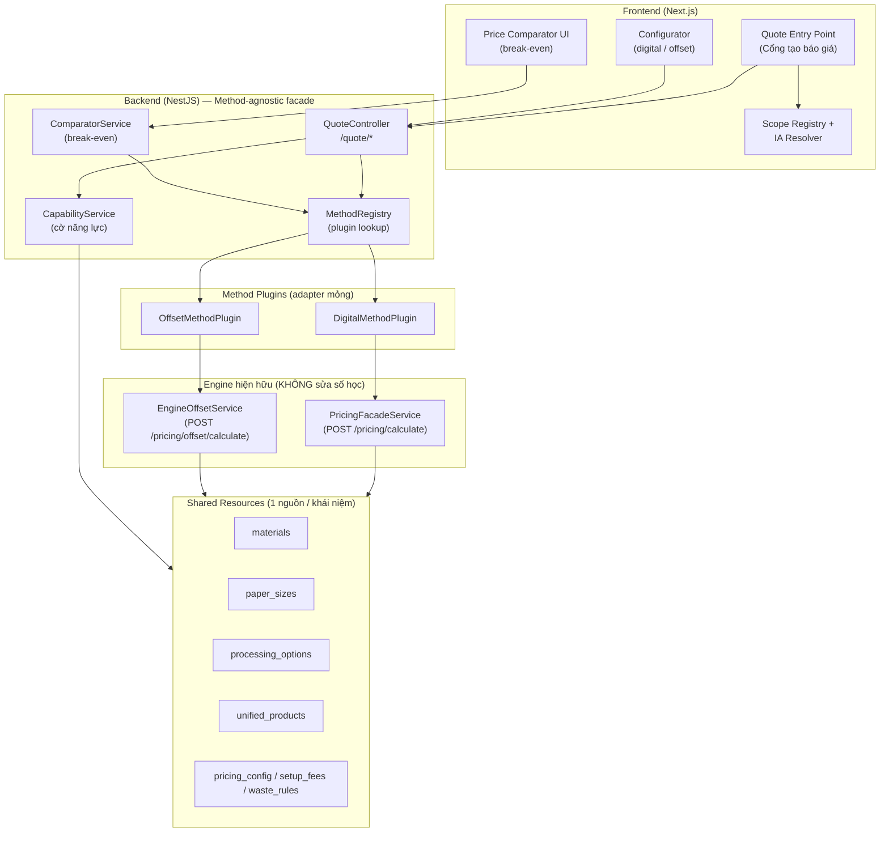
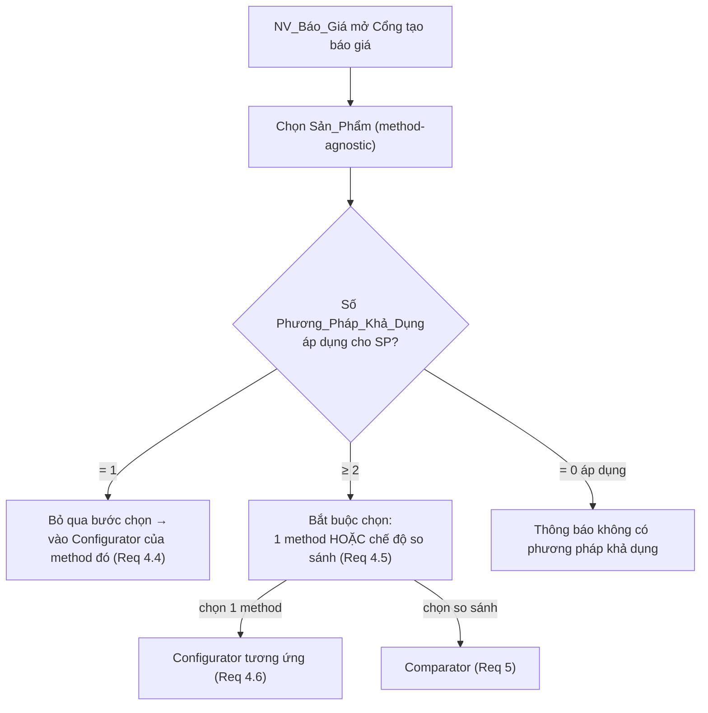
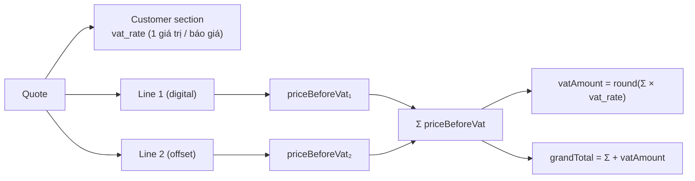

# Design Document — Hợp nhất Phương pháp in (Print Method Unification)

## Overview

Tài liệu này đặc tả thiết kế kỹ thuật cho việc hợp nhất hai engine báo giá rời rạc của ZeplaoPrint — **In nhanh (digital)** qua `POST /pricing/calculate` và **Offset** qua `POST /pricing/offset/calculate` — thành **một công cụ báo giá hợp nhất**. Thiết kế bám sát bốn trụ cột trong requirements:

1. **Cờ Năng lực sản xuất (Capability Flag)** ở cấp Đơn_Vị, bật/tắt từng Phương_Pháp_In.
2. **Tách bốn tầng** Sản phẩm / Thông số / Phương pháp in / Giá, dùng chung tài nguyên không nhân đôi.
3. **Một Cổng tạo báo giá hợp nhất** (single entry point).
4. **So sánh giá đa phương pháp** với điểm hoà vốn (north star).

### Nguyên tắc thiết kế cốt lõi

- **KHÔNG viết lại engine.** Hai engine hiện hữu được **bọc** (wrap) thành Method Plugin:
  - `PricingFacadeService` (digital — `calculatePrice`) → `DigitalMethodPlugin`.
  - `EngineOffsetService` (offset — `calculate`, định tuyến 5 loại) → `OffsetMethodPlugin`.
- **Bảo toàn giá đang đúng.** Lớp bọc là *adapter mỏng* không đổi số học. Offset có golden test (`__tests__/`), digital có facade — dung sai bằng không cho các case đã khoá golden (Req 6.2, 6.4).
- **Mọi thứ cấu hình được.** Plugin đọc VAT/chiết khấu/markup/định mức từ `pricing_config` / `setup_fees` / `waste_rules` (digital) và `pricing_config` key `offset.*` (offset) — không hardcode (Req 7).
- **Tái sử dụng Scope Registry + IA Resolver** (`frontend/src/lib/scope/`) để suy dẫn menu theo capability, không xây cơ chế ẩn menu mới (Req 2.3).
- **VAT là giá trị chung cấp báo giá** thuộc mục khách hàng, áp một lần trên giá sau chiết khấu (Req 8).
- **Di trú theo 4 phase**, rủi ro tăng dần, mỗi phase giao được độc lập (Req 9).

### Phạm vi theo phase

| Phase | Nội dung | Rủi ro | Đầu ra giao được |
|-------|----------|--------|------------------|
| 1 | Capability flags + IA (menu phản ứng theo cờ) | THẤP | Đơn_Vị chỉ thấy phương pháp được bật |
| 2 | Cổng tạo báo giá hợp nhất (chọn sản phẩm → phương pháp) | TRUNG-THẤP | Một entry point, định tuyến tới Configurator hiện có |
| 3 | Hợp nhất mô hình sản phẩm (5 loại offset vào catalog method-agnostic) | TRUNG-CAO | `unified_products` chứa cả digital + offset |
| 4 | So sánh giá đa phương pháp + điểm hoà vốn | CAO | Bảng so sánh + break-even |

## Architecture

### Sơ đồ tầng (4-layer separation)



### Các thành phần kiến trúc

- **MethodPlugin (interface)** — hợp đồng chung cho mọi Phương_Pháp_In. Nhận `(product, specification, config)` trả `PriceResult`. Hai hiện thực: `DigitalMethodPlugin`, `OffsetMethodPlugin`. Cho phép thêm `LargeFormatMethodPlugin` về sau mà không đổi tầng Sản_Phẩm (Req 1.5, 3.6).
- **MethodRegistry** — bảng đăng ký plugin theo `methodId` ∈ `{digital, offset}` (mở rộng được). Cung cấp `getPlugin(methodId)`, `appliesTo(methodId, product)`.
- **CapabilityService** — quản lý Cờ_Năng_Lực `(unitId, methodId) → enabled`. Cung cấp `getEnabledMethods(unitId)`, `setFlag(...)` với ràng buộc "không tắt phương pháp cuối" (Req 1.6).
- **QuoteController** (`/quote/*`) — entry point hợp nhất method-agnostic; định tuyến tính giá qua MethodRegistry; chặn truy cập phương pháp không khả dụng (Req 2.4, 4.7).
- **ComparatorService** — tính giá đa phương pháp trên cùng Thông_Số, dò điểm hoà vốn (Req 5).
- **IA mapping (frontend)** — bổ sung lớp lọc capability lên trên `resolveMenu()` của IA Resolver hiện có (Req 2.1, 2.3).

### Định nghĩa "Đơn_Vị" trong mô hình hiện tại

Requirements định nghĩa Đơn_Vị = một nhà in/công ty. Hệ có `tenants` (nhà in, có `settings` JSONB) nhưng multi-tenant đang ở trạng thái frozen theo spec `product-rescope-cskh-quote`. Để không bật lại multi-tenant (giữ rủi ro Phase 1 ở mức THẤP), thiết kế dùng **`unitId` trừu tượng**:

- Khi multi-tenant tắt (mặc định hiện tại): tồn tại đúng một Đơn_Vị ngầm định `unitId = 'default'`.
- Khi multi-tenant bật lại trong tương lai: `unitId = tenant.code`, không đổi lược đồ capability.

Capability flags lưu ở bảng riêng `method_capabilities` khoá theo `unit_id` — độc lập với việc multi-tenant bật/tắt (Req 1.1, "một cài đặt phục vụ một hoặc nhiều Đơn_Vị").

## Components and Interfaces

### MethodPlugin interface

```typescript
/** Định danh phương pháp in — mở rộng được (Req 1.5). */
export type MethodId = 'digital' | 'offset' | string;

/** Tham chiếu method-agnostic tới một sản phẩm trong catalog hợp nhất. */
export interface ProductRef {
  code: string;            // UnifiedProduct.code
  quoteType: string;       // loose | bound | large_format | to_roi | ... (gợi ý plugin)
}

/** Thông số dùng chung — không phụ thuộc phương pháp (Req 3.2). */
export interface Specification {
  quantity: number;
  dimensions?: { width?: number; height?: number; depth?: number };
  materialCode?: string;
  paperSizeCode?: string;
  processing?: { code: string; side?: string }[];
  accessories?: { id: number; qty?: number }[];
  attributes?: Record<string, unknown>; // tham số riêng method (vd soKemIn, boxType)
}

/** Tham số giá đọc từ cấu hình (Req 7). VAT KHÔNG nằm ở đây — VAT cấp báo giá (Req 8). */
export interface PricingConfigView {
  discountRate?: number;
  markupPercent?: number;
  // các định mức khác đọc nội bộ engine từ config store
}

/** Kết quả tính giá trước VAT (VAT áp ở tầng báo giá). */
export interface PriceResult {
  ok: boolean;
  methodId: MethodId;
  costSubtotal: number;       // giá vốn
  sellingSubtotal: number;    // giá bán trước chiết khấu/VAT
  discountAmount: number;     // chiết khấu (cấu hình)
  priceBeforeVat: number;     // sellingSubtotal - discountAmount  ← cơ sở tính VAT
  pricePerItem: number;
  breakdown: Record<string, unknown>;
  unavailableReason?: string; // khi ok=false (Req 5.5)
}

export interface MethodPlugin {
  readonly methodId: MethodId;
  /** Plugin có áp dụng được cho sản phẩm + thông số này không (Req 5.1, 5.5). */
  appliesTo(product: ProductRef, spec: Specification): boolean;
  /** Tính giá; bọc engine hiện hữu, KHÔNG đổi số học (Req 6.1, 6.2). */
  calculate(product: ProductRef, spec: Specification, cfg: PricingConfigView): Promise<PriceResult>;
}
```

### DigitalMethodPlugin (bọc PricingFacadeService)

- Ánh xạ `Specification` → `CalculatePriceInput` của facade (`type`, `material_id`, `paper_size_id`, `quantity`, `item_width/height`, `processing`, `accessories`…).
- Gọi `pricingFacade.calculatePrice(input)`; **tách VAT ra**: facade hiện cộng VAT bên trong (`grand_total`). Plugin chỉ lấy `selling_subtotal` (sau markup, trước VAT) và `cost_subtotal`; VAT do tầng báo giá áp lại để tránh VAT chồng VAT (Req 8.4). Số học markup/giá vốn giữ nguyên facade.
- `appliesTo`: digital phục vụ `quoteType ∈ {loose, bound, large_format}`.

### OffsetMethodPlugin (bọc EngineOffsetService)

- Ánh xạ `Specification` → một trong `{ToRoiInput, BiThuFolderInput, SpKhacInput, HopGiayInput, TuiGiayInput}` theo `quoteType`.
- Gọi `engineOffset.calculate(input)`. Engine trả `QuoteResult` đã gồm `tongChuaVAT`, `vat`, `chietKhau`, `khachTra`. Plugin **lấy `tongChuaVAT` (sau chiết khấu, trước VAT)** làm `priceBeforeVat`, và để VAT cho tầng báo giá. Engine vẫn nhận `vatRate`/`chietKhauRate` từ config — adapter truyền `vatRate = 0` ở chế độ so sánh/hợp nhất để VAT chỉ áp một lần ở tầng báo giá; ở chế độ tương thích ngược (gọi trực tiếp `/pricing/offset/calculate`) hành vi cũ được giữ nguyên (Req 6.2).
- `appliesTo`: offset phục vụ 5 loại; trả `false` + lý do nếu thiếu tham số bắt buộc hoặc giá trị ngoài whitelist `productConfig` (Req 5.5).

### CapabilityService

```typescript
export interface MethodCapability {
  unitId: string;
  methodId: MethodId;
  enabled: boolean;
}

export interface CapabilityService {
  getEnabledMethods(unitId: string): Promise<MethodId[]>;
  isEnabled(unitId: string, methodId: MethodId): Promise<boolean>;
  /** Bật/tắt; ném lỗi nếu tắt phương pháp khả dụng cuối cùng của Đơn_Vị đang vận hành (Req 1.6). */
  setFlag(unitId: string, methodId: MethodId, enabled: boolean): Promise<MethodCapability>;
  listFlags(unitId: string): Promise<MethodCapability[]>;
}
```

Quy tắc nghiệp vụ:
- Mỗi cặp `(unitId, methodId)` có đúng một trạng thái; mặc định `enabled = false` khi chưa có bản ghi (Đơn_Vị mới có thể tồn tại với 0 phương pháp — Req 1.7).
- `setFlag(..., false)` bị từ chối nếu đó là phương pháp khả dụng cuối cùng **và** Đơn_Vị đã có ≥1 phương pháp khả dụng (Req 1.6). Đơn_Vị 0-phương-pháp không vướng ràng buộc này.

### Quote Entry Point flow (frontend)



### IA capability filtering (frontend)

`resolveMenu()` hiện lọc theo `scope='core'` + trục app. Bổ sung một bước lọc thuần phía sau:

```typescript
/** Lọc menu theo Phương_Pháp_Khả_Dụng của Đơn_Vị (Req 2.1, 2.2, 2.3). */
export function filterMenuByCapability(
  items: MenuItem[],
  enabledMethods: MethodId[],
  methodOfNavItem: (navItem: string) => MethodId | null,
): MenuItem[] {
  return items.filter((it) => {
    const m = methodOfNavItem(it.navItem);
    return m === null || enabledMethods.includes(m); // mục không gắn method luôn giữ
  });
}
```

- `methodOfNavItem` ánh xạ navItem → method (vd `offset-config → offset`); nguồn ánh xạ khai báo trong scope-registry (thêm trường tuỳ chọn `method`), không tạo cơ chế ẩn riêng (Req 2.3).
- Route guard tái dùng mẫu `isFrozenRoute`: thêm `isMethodRoute(path) → methodId`; nếu method không khả dụng → redirect về Cổng tạo báo giá (Req 2.4, 2.5).

### REST API (method-agnostic)

| Method | Path | Mục đích | Req |
|--------|------|----------|-----|
| GET | `/quote-tool/capabilities` | Liệt kê cờ năng lực + tập khả dụng của Đơn_Vị hiện hành | 1, 2.1 |
| PUT | `/quote-tool/capabilities/:methodId` | Admin bật/tắt một phương pháp (ràng buộc Req 1.6) | 1.2, 1.3, 1.6 |
| GET | `/quote-tool/methods?productCode=` | Phương pháp khả dụng & áp dụng được cho 1 sản phẩm | 4.3, 4.4, 5.6 |
| POST | `/quote-tool/calculate` | Tính giá 1 phương pháp (định tuyến qua plugin) | 4.6, 6.1 |
| POST | `/quote-tool/compare` | So sánh đa phương pháp + break-even | 5.1–5.6 |

> **Prefix `quote-tool` (không phải `quote`):** QuoteController CRUD cũ (`modules/quote`) đã chiếm `@Controller('quote')` với route `GET /quote/:id`. Nếu controller mới cũng đặt `quote`, các path tĩnh `/quote/capabilities`, `/quote/methods` sẽ bị `:id` nuốt (coi "capabilities"/"methods" là id → query sai → HTTP 500). Vì vậy tầng method-agnostic dùng namespace riêng `quote-tool/*`.

Hai route cũ `/pricing/calculate` và `/pricing/offset/calculate` **giữ nguyên** suốt cả 4 phase để không phá luồng đang chạy (Req 9.3, 9.4); chúng dần được `/quote-tool/*` thay thế ở tầng UI.

## Data Models

### method_capabilities (mới — Phase 1)

```sql
CREATE TABLE method_capabilities (
  id          SERIAL PRIMARY KEY,
  unit_id     VARCHAR(50)  NOT NULL DEFAULT 'default',
  method_id   VARCHAR(30)  NOT NULL,           -- 'digital' | 'offset' | ...
  enabled     BOOLEAN      NOT NULL DEFAULT false,
  updated_at  TIMESTAMP    NOT NULL DEFAULT NOW(),
  UNIQUE (unit_id, method_id)                  -- đúng một trạng thái / cặp (Req 1.1)
);
```

### unified_products (mở rộng — Phase 3)

Catalog method-agnostic đã có (`UnifiedProduct`). Phase 3 đưa 5 loại offset vào đây mà không gắn cứng engine:

- Thêm bản ghi cho `to_roi, bi_thu_folder, sp_khac, hop_giay, tui_giay` với `quoteType` tương ứng (giá trị này là **gợi ý định tuyến plugin**, không phải "loại sản phẩm cứng").
- `allowed_materials / allowed_paper_sizes / allowed_processing` trỏ tới Tài_Nguyên_Dùng_Chung (Req 3.4); không nhân đôi danh mục.
- Không thêm trường khoá-engine vào sản phẩm (Req 3.1, 3.6). Việc một sản phẩm dùng được phương pháp nào suy ra từ `appliesTo` của plugin + capability, không lưu cứng trên sản phẩm.

### Tài nguyên dùng chung (đã tồn tại — không nhân đôi)

| Khái niệm | Bảng nguồn duy nhất | Ghi chú |
|-----------|--------------------|---------|
| Vật tư/giấy | `materials` | cờ `scope_offset / scope_loose / scope_bound / scope_large_format` phân loại phạm vi; offset đọc `scope_offset=true` |
| Khổ giấy | `paper_sizes` | offset dùng `scope_offset` + cột `kho_giay_lon/chia_to/...` |
| Gia công | `processing_options` (+ `processing_pricing`) | offset đọc `scope_offset=true` |
| Hệ màu / số kẽm | `pricing_config` (offset), facade nội bộ | |
| Sản phẩm | `unified_products` | method-agnostic |

### Tham số giá (cấu hình được — Req 7)

| Tham số | Nguồn | Phương pháp |
|---------|-------|-------------|
| VAT (`vat_rate`) | `pricing_config` (digital) / `offset.TyLe_VAT` (offset) → **thống nhất cấp báo giá** | cả hai |
| Chiết khấu | `offset.TyLe_ChietKhau(_Max)`; digital chưa có → bổ sung key `discount_rate` | cả hai |
| Markup/margin | `pricing_config` (`default_markup`, `min_margin`, `pricing_method`, `price_rounding`) | digital |
| Định mức hao | `waste_rules` (digital), `offset.WasteStages` + `waste_rules(offset,'pricebook')` | cả hai |
| Phí cố định (khuôn/thiết kế) | `setup_fees` (offset) | offset |

Mặc định nạp sẵn trong nguồn cấu hình (`getPricingConfig()` defaults, `loadDefaultPricingData()`), đánh dấu là giá trị mặc định khi Admin chưa đặt (Req 7.4).

### Mô hình VAT cấp báo giá (Req 8)



- VAT là một giá trị duy nhất trên báo giá (thuộc mục khách hàng), áp **một lần** trên tổng giá sau chiết khấu của mọi dòng/phương pháp (Req 8.1–8.4). Plugin trả `priceBeforeVat`; tầng báo giá cộng VAT.

## Correctness Properties

*Một property là đặc tính/hành vi phải đúng với mọi lần thực thi hợp lệ của hệ — một phát biểu hình thức về điều hệ thống phải làm. Properties là cầu nối giữa đặc tả cho người đọc và bảo đảm đúng đắn kiểm chứng được bằng máy.*

### Property 1: Toggle capability round-trip

*For any* Đơn_Vị và bất kỳ Phương_Pháp_In nào, bật rồi tắt (hoặc tắt rồi bật) Cờ_Năng_Lực trả Đơn_Vị về đúng tập Phương_Pháp_Khả_Dụng ban đầu; và sau khi bật, phương pháp đó thuộc tập khả dụng, sau khi tắt thì không thuộc.

**Validates: Requirements 1.2, 1.3**

### Property 2: Đúng một trạng thái cho mỗi cặp (Đơn_Vị, Phương_Pháp)

*For any* dãy thao tác bật/tắt trên một cặp `(unitId, methodId)`, trạng thái lưu trữ luôn là đúng một giá trị bật/tắt bằng giá trị của thao tác cuối cùng (không tồn tại hai bản ghi mâu thuẫn).

**Validates: Requirements 1.1**

### Property 3: Không tắt được phương pháp khả dụng cuối cùng

*For any* Đơn_Vị có đúng một Phương_Pháp_Khả_Dụng, thao tác tắt phương pháp đó bị từ chối và tập Phương_Pháp_Khả_Dụng không đổi; với Đơn_Vị có ≥2 phương pháp khả dụng, tắt một phương pháp luôn thành công và làm tập đó giảm đúng một phần tử.

**Validates: Requirements 1.6**

### Property 4: Menu suy dẫn chỉ chứa phương pháp khả dụng

*For any* Scope Registry và bất kỳ tập Phương_Pháp_Khả_Dụng nào, menu sau khi lọc capability không chứa mục nào gắn với một Phương_Pháp_In ngoài tập khả dụng, và giữ nguyên mọi mục không gắn phương pháp.

**Validates: Requirements 2.1, 2.2**

### Property 5: Chặn truy cập route phương pháp không khả dụng

*For any* path điều hướng trỏ tới một Phương_Pháp_In và bất kỳ tập Phương_Pháp_Khả_Dụng nào, guard cho phép truy cập khi và chỉ khi phương pháp đó thuộc tập khả dụng; ngược lại trả quyết định redirect về Cổng_Tạo_Báo_Giá.

**Validates: Requirements 2.4, 2.5**

### Property 6: Định tuyến entry point theo số phương pháp khả dụng

*For any* Sản_Phẩm và tập Phương_Pháp_Khả_Dụng áp dụng được cho sản phẩm đó: nếu tập có đúng một phần tử thì luồng đi thẳng vào Configurator của phương pháp đó (bỏ bước chọn); nếu có ≥2 phần tử thì luồng yêu cầu một lựa chọn rõ ràng (method hoặc so sánh) trước khi vào Configurator.

**Validates: Requirements 4.4, 4.5**

### Property 7: Entry point chỉ cho chọn phương pháp khả dụng

*For any* Đơn_Vị, tập phương pháp mà Cổng_Tạo_Báo_Giá trình cho người dùng là tập con của Phương_Pháp_Khả_Dụng của Đơn_Vị đó.

**Validates: Requirements 4.7**

### Property 8: Bảo toàn giá khi bọc engine (zero-tolerance trên golden)

*For any* bộ đầu vào đã được Golden_Test khoá (digital và offset), giá `priceBeforeVat` tính qua Method Plugin bằng đúng giá engine tương ứng tính trực tiếp trước hợp nhất (dung sai bằng không).

**Validates: Requirements 6.1, 6.2, 9.5**

### Property 9: So sánh dùng chung một bộ Thông số

*For any* Sản_Phẩm, một bộ Thông_Số và một số lượng, mọi Phương_Pháp_In trong kết quả so sánh đều nhận đúng cùng bộ Thông_Số đầu vào (không có phương pháp nào được tính với thông số khác).

**Validates: Requirements 5.4**

### Property 10: Comparator chọn đúng phương pháp rẻ hơn và loại phương pháp lỗi

*For any* tập kết quả tính giá của ≥2 Phương_Pháp_In tại một số lượng, phương pháp được đánh dấu "rẻ hơn" là phương pháp có `priceBeforeVat` nhỏ nhất trong các phương pháp tính được; mọi phương pháp không tính được giá bị loại khỏi so sánh kèm lý do, và các phương pháp còn lại vẫn hiển thị.

**Validates: Requirements 5.2, 5.5**

### Property 11: Tính đúng điểm hoà vốn

*For any* hai Phương_Pháp_In có hàm chi phí theo số lượng đơn điệu không giảm trên một dải số lượng, nếu thứ tự rẻ-hơn-đắt-hơn đảo chiều trong dải đó thì Bộ_So_Sánh_Giá báo cáo một Điểm_Hoà_Vốn `q*` sao cho tại các số lượng < `q*` một phương pháp rẻ hơn và tại các số lượng > `q*` phương pháp kia rẻ hơn; nếu không có đảo chiều thì báo cáo không có điểm hoà vốn trong dải.

**Validates: Requirements 5.3**

### Property 12: VAT áp đúng một lần trên giá sau chiết khấu

*For any* báo giá gồm một hay nhiều dòng thuộc bất kỳ phương pháp nào và bất kỳ giá trị VAT cấp báo giá nào, số tiền VAT bằng `round((Σ priceBeforeVat) × vat_rate)` và tổng gồm VAT bằng `Σ priceBeforeVat + vatAmount` — VAT không bị cộng chồng theo từng phương pháp.

**Validates: Requirements 8.2, 8.3, 8.4**

### Property 13: Tham số giá đọc từ cấu hình

*For any* tham số giá (VAT, chiết khấu, markup, định mức) và bất kỳ giá trị cấu hình hợp lệ nào, kết quả tính giá của Plugin khi đặt tham số bằng giá trị đó phản ánh đúng giá trị cấu hình; thay đổi giá trị cấu hình làm thay đổi kết quả một cách nhất quán (không có hằng số bị gán cứng ghi đè).

**Validates: Requirements 7.2, 7.3**

### Property 14: Tài nguyên dùng chung phản ánh cho mọi plugin

*For any* Tài_Nguyên_Dùng_Chung (vật tư/khổ/gia công) và bất kỳ thay đổi giá trị nào của nó, mọi Plugin_Phương_Pháp tham chiếu tài nguyên đó đều đọc giá trị mới ở lần tính kế tiếp (không có bản sao cục bộ theo engine).

**Validates: Requirements 3.4, 3.5**

## Error Handling

- **Phương pháp không khả dụng (UI/route):** guard chặn và redirect về Cổng tạo báo giá; nếu mục menu lọt do tranh chấp, vẫn chặn tại điểm sử dụng (Req 2.5, 2.4).
- **Tắt phương pháp cuối:** `CapabilityService.setFlag` ném `LastEnabledMethodError` → API trả 409 với thông báo rõ (Req 1.6).
- **Plugin không tính được giá:** `calculate` trả `PriceResult { ok:false, unavailableReason }` thay vì ném; Comparator loại phương pháp đó, nêu lý do, vẫn hiển thị phần còn lại (Req 5.5). Khi chỉ còn một phương pháp áp dụng được → hiển thị giá đơn, không bảng so sánh (Req 5.6).
- **Giá trị ngoài whitelist (offset `productConfig`):** engine ném `OffsetPricingError`; plugin chuyển thành `ok:false` + lý do.
- **Thiếu đơn giá (vd m² khổ lớn, tier giấy):** giữ hành vi engine hiện tại — trả lỗi rõ thay vì 0đ âm thầm.
- **Golden test thất bại ngoài dự kiến:** coi thay đổi là chưa đạt, chặn phát hành tới khi giải trình (Req 6.3, 6.4) — thực thi ở tầng CI, không phải runtime.
- **Đầu vào không hợp lệ tại `/quote/*`:** validation DTO (class-validator) trả 400 với thông báo trường lỗi.

## Testing Strategy

### Cách tiếp cận kép

- **Property-based tests** cho logic thuần có tính phổ quát: capability toggle, lọc menu, route guard, định tuyến entry point, comparator/break-even, VAT, đọc cấu hình, bảo toàn giá. Tối thiểu **100 vòng** mỗi property, dùng thư viện PBT có sẵn của hệ (`fast-check`, đã dùng trong `frontend/src/lib/scope/*.spec.ts` và `offset-engine/__tests__/*.property.spec.ts`).
- **Golden tests** (giữ và mở rộng bộ hiện có ở `offset-engine/__tests__/`): khoá zero-tolerance cho Property 8. Bổ sung golden cho digital facade dựa trên các case đại diện hiện đang đúng.
- **Unit/example tests** cho: ràng buộc "tắt phương pháp cuối", Đơn_Vị 0-phương-pháp, ánh xạ Specification→input từng plugin, edge case dimension/quantity, ánh xạ navItem→method.
- **Integration tests** (1–3 ví dụ, không PBT): wiring `/quote/calculate` và `/quote/compare` end-to-end qua MethodRegistry tới engine thật với DB seed; xác nhận `/pricing/calculate` và `/pricing/offset/calculate` cũ vẫn hoạt động suốt 4 phase (Req 9.3, 9.4).
- **Migration verification (Phase 3):** test rằng 5 loại offset đã vào `unified_products` và giá qua catalog method-agnostic khớp golden offset (Req 9.5, 9.6).

### Cấu hình property test

- Mỗi property test gắn tag: **Feature: print-method-unification, Property {number}: {property_text}**.
- Mỗi correctness property hiện thực bằng **một** property-based test.
- Tối thiểu 100 iteration; dùng generator tái hiện edge case (số lượng biên, thông số rỗng/cực trị, tập capability rỗng/đầy).

### Phân tầng theo phase

| Phase | Trọng tâm test |
|-------|----------------|
| 1 | Property 1–5 (capability + IA), unit ràng buộc, integration menu |
| 2 | Property 6–7 (entry point), integration `/quote/calculate` định tuyến |
| 3 | Property 8 + golden zero-tolerance, Property 14, migration verification |
| 4 | Property 9–12 (comparator, break-even, VAT) |
