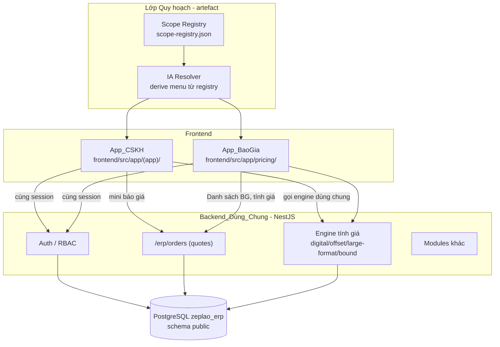
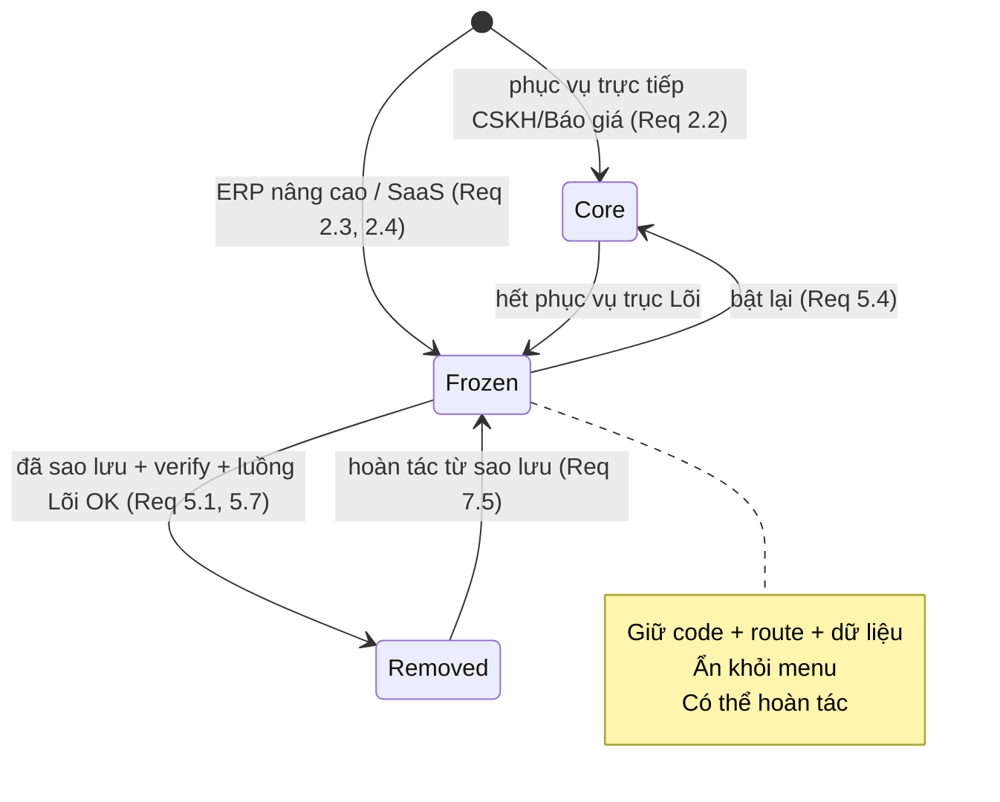
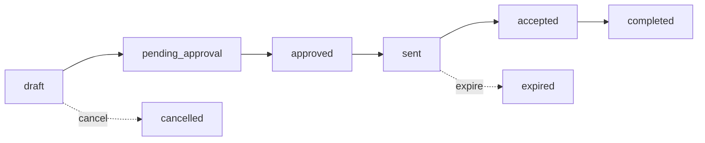

# Design Document

## Overview

Tài liệu thiết kế này hiện thực hoá spec **tái quy hoạch sản phẩm (product rescope)** đã chốt ở `requirements.md`. Đây là một spec **định hướng/scoping**: phần lớn nội dung là *quyết định phân loại phạm vi*, *nguyên tắc rút gọn an toàn* và *kiến trúc thông tin (IA)* cho hai app dùng chung backend, kèm **một thay đổi code cụ thể** (Requirement 8 — tách Báo giá và Đơn hàng thành **hai route/điểm điều hướng riêng** ở frontend, dùng chung logic danh sách trên cùng một thực thể Báo_Giá_Đơn_Hàng).

Thiết kế gồm bốn trụ cột:

1. **Scope Registry (Đăng_Ký_Phạm_Vi)** — một artefact dữ liệu có cấu trúc (`scope-registry.json` + bảng trình bày) là *nguồn sự thật duy nhất* cho việc phân loại mọi tính năng vào ba nhóm `core | frozen | removed`, kèm lý do, tiêu chí áp dụng, phụ thuộc và điều kiện bật lại.
2. **Cơ chế Đóng băng (Freeze) an toàn** — quy ước ẩn tính năng khỏi menu mà giữ nguyên code/route/dữ liệu, có thể hoàn tác, theo nguyên tắc "ẩn trước – gỡ sau".
3. **Information Architecture (IA) dẫn xuất** — menu của `App_CSKH` và `App_BaoGia` được suy ra (derive) từ Scope Registry, đảm bảo chỉ hiển thị `core` và ẩn `frozen`/`removed`.
4. **Hai route Báo giá / Đơn hàng (Requirement 8)** — Báo giá và Đơn hàng được trình bày qua **hai route frontend riêng** và **hai điểm điều hướng riêng**, nhưng dùng chung một logic danh sách và cùng các hàm thuần `statusGroup` / `filterByView` trên cùng nguồn dữ liệu Báo_Giá_Đơn_Hàng (qua `GET /erp/orders` với tham số `status` + lọc phía client). Không thêm bảng/route/endpoint backend. Một seam kiểm soát truy cập RBAC ở cấp route được đặt sẵn (mặc định cho phép) để chuẩn bị phân quyền tương lai.

Nguyên tắc xuyên suốt: **không phá vỡ schema, không mất dữ liệu, mọi bước có thể hoàn tác**. Backend NestJS dùng chung PostgreSQL `zeplao_erp` schema `public`, `synchronize=false`.

### Phạm vi & ngữ cảnh code đã khảo sát

- `App_CSKH` tại `frontend/src/app/(app)/` (Inbox, Contacts, KB, AI, Reports, Settings, Super-admin).
- `App_BaoGia` tại `frontend/src/app/pricing/`; menu định nghĩa trong `frontend/src/app/pricing/_components/PricingSidebar.tsx`.
- "Danh sách BG" (Báo giá) tại `frontend/src/app/pricing/quotes/page.tsx` gọi `GET /erp/orders?status=...&page=...&limit=30`.
- Vòng đời báo giá ↔ đơn hàng (backend `backend/src/modules/pricing/services/orders.service.ts`): `draft → pending_approval → approved → sent → accepted → completed`, cộng `cancelled`, `expired`.
- Path `/pricing/orders` trước đây CHỈ là một entry title-map mồ côi trong `frontend/src/app/pricing/layout.tsx` (không có trang thật) — rác điều hướng. Title-map mồ côi đó đã được gỡ (Req 2.8); path `/pricing/orders` nay được **tái lập thành một trang Tính_Năng_Lõi thật** (Đơn hàng) theo Requirement 8, nên không còn là rác điều hướng. PricingSidebar nay render **hai mục trên trục Báo giá** (Báo giá → `/pricing/quotes`, Đơn hàng → `/pricing/orders`) đều dẫn xuất từ `resolveMenu`.

## Architecture

### Sơ đồ tổng thể hai app + Scope Registry



### Phân tách trách nhiệm (Req 3.9, 3.10)

| Khía cạnh | App_CSKH | App_BaoGia |
|---|---|---|
| Trách nhiệm chính | Giao tiếp, tiếp nhận yêu cầu khách | Tính giá, quản lý dữ liệu giá |
| Nguồn Customer | Dùng chung qua Backend_Dùng_Chung | Dùng chung qua Backend_Dùng_Chung |
| Tính giá | **Gọi engine dùng chung**, không tự tính | Sở hữu engine tính giá |
| Lưu báo giá | Ghi vào `quotes` qua `/erp/orders` | Đọc/ghi `quotes` qua `/erp/orders` |

### Vòng đời phân loại tính năng (state machine)



**Bất biến quan trọng:** không có cạnh trực tiếp `Core → Removed` hay `[*] → Removed`. Mọi tính năng phải qua `Frozen` trước khi `Removed` (Req 5.1).

## Components and Interfaces

### 1. Scope Registry (`scope-registry.json`)

Artefact trung tâm. Là nguồn sự thật cho phân loại. Được dùng để (a) sinh IA menu, (b) kiểm chứng bất biến phân loại, (c) lưu lý do và quy trình hoàn tác/bật lại.

```typescript
type ScopeClass = 'core' | 'frozen' | 'removed';
type Axis = 'cskh' | 'baogia' | 'shared' | 'none';
type ClassificationRule = '2.2' | '2.3' | '2.4'; // tiêu chí đã áp dụng

interface ScopeEntry {
  id: string;                 // định danh duy nhất của tính năng
  title: string;              // nhãn người đọc
  scope: ScopeClass;          // đúng MỘT trong ba nhóm (Req 2.1)
  axis: Axis;                 // trục phục vụ
  rule: ClassificationRule;   // tiêu chí phân loại đã áp dụng (Req 2.5)
  reason: string;             // lý do phân loại (Req 2.5)
  featureRef: string;         // tham chiếu code/route/menu (Req 2.5)
  navItem?: string;           // mục menu tương ứng (nếu có) — dùng cho IA
  backendRoutes?: string[];   // route backend liên quan (Req 6.6)
  dependsOnFrozen?: string[]; // phụ thuộc thành phần Phụ (Req 2.6)
  reenable?: {                // BẮT BUỘC khi scope='frozen' (Req 2.4, 5.8)
    trigger: string;          // điều kiện kích hoạt (quan sát được)
    steps: string[];          // các bước bật lại
    expected: string;         // kết quả mong đợi khi bật lại
    perTenant?: string[];     // bước cho từng tenant (Multi_Tenant, Req 5.8)
  };
  backup?: {                  // BẮT BUỘC khi scope='removed' (Req 5.7)
    codeBackupRef: string;
    dataBackupRef: string;
    restoreVerified: boolean;
  };
  unauthEndpointRisk?: 'high' | 'medium' | 'low'; // Req 7.3
}

interface ScopeRegistry {
  baseline: { app: 'cskh' | 'baogia'; mainMenuCount: number }[]; // Req 1.5
  entries: ScopeEntry[];
}
```

#### Phân loại ban đầu (theo Req 2.2/2.3/2.4/2.7/2.8)

| id | scope | rule | Ghi chú |
|---|---|---|---|
| inbox, contacts-crm, knowledge-base, ai-suggestions, mini-quote | core | 2.2 | Trục CSKH |
| pricing-engine (digital/offset/large-format/bound) | core | 2.2 | Trục Báo giá |
| quotes (navItem `quotes`, route `/pricing/quotes`) | core | 2.2 | Trục Báo giá — khung nhìn Báo giá; backend `/erp/orders` |
| orders (navItem `orders`, route `/pricing/orders`) | core | 2.2 | Trục Báo giá — khung nhìn Đơn hàng; backend `/erp/orders` |
| inventory (`createInventorySlip`, `POST /erp/inventory`, `StockActionModal`) | frozen | 2.3 | ERP nâng cao |
| rfm-scoring, production-cost, setup-fee, plate-pricing, offset-machine-advanced | frozen | 2.3 | ERP nâng cao |
| multi-tenant, super-admin, subscription-plans, payments | frozen | 2.4 | SaaS — cần `reenable` |
| settings/ai-quote, settings/api-keys, settings/api-docs, settings/webhooks, settings/product-configs | (mỗi trang đúng 1 nhóm) | 2.3/2.4 | Trang Cài đặt đang ẩn (Req 2.7) |
| titlemap-pricing-orders | removed | — | Title-map mồ côi cũ (chỉ title-map, không trang thật) — rác điều hướng đã gỡ, KHÔNG đụng API `/erp/orders` (Req 2.8). Khác với entry `orders` ở trên là trang thật tái lập tại cùng path. |

> Bảng phân loại đầy đủ và lý do từng mục được lưu trong `scope-registry.json`. Việc gán cuối cùng cho 5 trang Cài đặt là quyết định của Người_Quy_Hoạch và phải thoả bất biến "đúng một nhóm".
>
> **Tách Báo giá / Đơn hàng (Req 2.2, 4.4, 4.7):** thực thể Báo_Giá_Đơn_Hàng vẫn là **một** thực thể duy nhất ở backend (bảng `quotes`, controller `/erp/orders`), nhưng được mô hình hoá thành **hai entry `core` riêng biệt** trên trục `baogia` trong registry: `quotes` và `orders`. Mỗi entry có `navItem` và `route` riêng, cùng tham chiếu `/erp/orders`. Hai entry này ánh xạ 1:1 tới hai mục menu trên trục Báo giá (Req 4.4, 4.7).
>
> **Tương thích Property 9 (menu shrink):** baseline `mainMenuCount` cho `baogia` là số mục menu **trước rút gọn** (toàn bộ menu ERP cũ). Sau rút gọn, trục Báo giá có hai mục `core` (`quotes`, `orders`) thay vì một, nhưng tổng số mục `core` vẫn nhỏ hơn nghiêm ngặt baseline vì nhiều mục ERP nâng cao/SaaS đã chuyển `frozen`. Do đó Property 9 vẫn thoả: chỉ cần đảm bảo `baseline.mainMenuCount` của `baogia` lớn hơn số mục `core` sau rút gọn (bao gồm cả hai entry mới).

### 2. IA Resolver

Hàm thuần suy ra menu hiển thị từ Scope Registry. Đây là cầu nối giữa Registry và sidebar của hai app.

```typescript
interface MenuItem { navItem: string; href: string; axis: Axis; }

// Chỉ giữ entry core có navItem thuộc đúng trục của app; loại frozen/removed.
function resolveMenu(registry: ScopeRegistry, app: 'cskh' | 'baogia'): MenuItem[];

// Một route có bị đóng băng không? Dùng cho guard điều hướng trực tiếp (Req 4.6).
function isFrozenRoute(registry: ScopeRegistry, path: string): boolean;
```

- `App_CSKH` (`frontend/src/app/(app)/layout.tsx` + sidebar) và `App_BaoGia` (`PricingSidebar.tsx`) render menu từ kết quả `resolveMenu`.
- `PricingSidebar` nay render **hai mục trên trục Báo giá** dẫn xuất từ `resolveMenu(registry, 'baogia')`: **Báo giá** (`navItem: 'quotes'` → `/pricing/quotes`) và **Đơn hàng** (`navItem: 'orders'` → `/pricing/orders`). Hai mục ánh xạ 1:1 tới hai entry `core` `quotes`/`orders` trong registry (Req 4.7, 8.1).
- Route guard: khi người dùng truy cập trực tiếp route `frozen`, hiển thị thông báo "tính năng không khả dụng", giữ nguyên session, không ném lỗi chưa xử lý (Req 4.6).

### 2b. QuoteOrderListView (shared list component — Requirement 8)

Để tránh trùng lặp giữa hai trang danh sách, logic danh sách được trích xuất thành **một component dùng chung** `QuoteOrderListView`. Cả `frontend/src/app/pricing/quotes/page.tsx` và trang mới `frontend/src/app/pricing/orders/page.tsx` đều render component này, chỉ khác `defaultView`.

```typescript
interface QuoteOrderListViewProps {
  defaultView: ViewKey;          // 'quote' cho /pricing/quotes, 'order' cho /pricing/orders
  // (tuỳ chọn) nhãn/tiêu đề trang để hiển thị
  title?: string;
}

// Component dùng chung: nạp từ GET /erp/orders với tham số status (theo defaultView),
// áp dụng filterByView phía client. KHÔNG có bộ tab chuyển khung nhìn nội bộ — khung nhìn
// cố định theo `defaultView` của trang; việc tách Báo giá ↔ Đơn hàng do hai mục menu/route
// top-level đảm nhiệm.
function QuoteOrderListView(props: QuoteOrderListViewProps): JSX.Element;
```

- Cả hai trang dùng **cùng** logic tải dữ liệu và **cùng** các hàm thuần `statusGroup` / `filterByView` từ `frontend/src/lib/scope/quote-view.ts` (Req 8.3).
- `/pricing/quotes` truyền `defaultView='quote'`; `/pricing/orders` truyền `defaultView='order'`. Khung nhìn **cố định** theo trang — KHÔNG còn bộ tab "Báo giá | Đơn hàng | Tất cả" nội trang (đã bỏ để khỏi trùng với hai mục menu top-level). Các trạng thái ngoài nhóm mặc định (`cancelled`, `expired`, `rejected`...) truy cập qua **dropdown lọc trạng thái** đã có sẵn, nên không ẩn mất dữ liệu (Req 8.7).
- Không trang nào gọi endpoint mới; cả hai nạp từ `GET /erp/orders` với tham số `status` rồi lọc client (Req 8.2, 8.3, 8.6).

### 2c. RouteAccessGuard (seam RBAC cấp route — Requirement 8.8)

Một wrapper/guard nhỏ ở cấp route đặt sẵn **seam** kiểm soát truy cập để chuẩn bị phân quyền theo vai trò trong tương lai. Hiện tại **mặc định cho phép tất cả** (permissive); chưa có chính sách vai trò nào được thực thi.

```typescript
interface RouteAccessGuardProps {
  requiredCapability?: string;   // ví dụ 'order:view', 'quote:create' — placeholder cho RBAC tương lai
  requiredRole?: string;
  children: React.ReactNode;
}

// Hiện tại: permissive — luôn render children bất kể props.
// Tương lai: điểm DUY NHẤT để cắm policy RBAC (kiểm tra capability/role rồi cho phép hoặc từ chối).
function RouteAccessGuard(props: RouteAccessGuardProps): JSX.Element;
```

- Áp dụng độc lập tại các route: `/pricing/orders` (ví dụ `requiredCapability='order:view'`) và `/pricing/quotes` hoặc route tạo báo giá (ví dụ `requiredCapability='quote:create'`), để quyền xem đơn hàng và quyền tạo báo giá có thể kiểm soát riêng (Req 8.8).
- **Quan hệ với `FrozenRouteGuard`/`isFrozenRoute`:** hai guard tách biệt và bổ sung nhau. `FrozenRouteGuard` chặn route thuộc tính năng `frozen` (Req 4.6); `RouteAccessGuard` là seam RBAC cấp route cho các route `core`. Thứ tự đề xuất: `FrozenRouteGuard` (ngoài) → `RouteAccessGuard` (trong). Vì `/pricing/quotes` và `/pricing/orders` đều là `core`, `FrozenRouteGuard` luôn cho qua; `RouteAccessGuard` hiện cũng cho qua (permissive), chỉ tồn tại như điểm chèn policy sau này.
- **Lưu ý:** chưa có policy vai trò nào được enforce — chỉ có seam. Mặc định permissive không thay đổi hành vi hiện tại.

### 3. Freeze/Unfreeze mechanism

- **Freeze** = (a) gỡ `navItem` khỏi menu (set `scope='frozen'` trong registry → IA tự ẩn), (b) giữ nguyên code + route backend + dữ liệu, (c) route backend được bảo vệ bởi RBAC hoặc cờ vô hiệu hoá (Req 6.6).
- **Unfreeze** = đảo `scope` về `core` (hoặc theo `reenable.steps`); không cần khôi phục dữ liệu từ sao lưu ngoài (Req 5.4).
- Không thao tác DDL/DML phá huỷ dữ liệu khi freeze (Req 5.2, 5.3).

### 4. Quote/Order View Filter & Two Routes (Requirement 8)

Thay đổi code khu trú: tách thành **hai route frontend** dùng chung logic, cộng các hàm thuần đặt tại `frontend/src/lib/scope/quote-view.ts`.

- `/pricing/quotes` — trang Danh sách BG hiện có (Báo giá), mặc định khung nhìn nhóm trạng thái **Báo giá** (`defaultView='quote'`).
- `/pricing/orders` — trang **MỚI, là trang thật** (Đơn hàng), mặc định khung nhìn nhóm trạng thái **Đơn hàng** (`defaultView='order'`).

Cả hai trang render `QuoteOrderListView` (mục 2b) và dùng chung các hàm dưới đây:

```typescript
type ViewKey = 'quote' | 'order' | 'all';

// Ánh xạ cố định: mỗi trạng thái thuộc TỐI ĐA một nhóm mặc định (Req 8.4)
const QUOTE_STATUSES = ['draft', 'pending_approval', 'approved', 'sent'] as const;
const ORDER_STATUSES = ['accepted', 'completed'] as const;
// 'cancelled', 'expired' và mọi trạng thái lạ → không thuộc nhóm nào → chỉ hiện ở view 'all' (Req 8.7)

function statusGroup(status: string): ViewKey {
  if ((QUOTE_STATUSES as readonly string[]).includes(status)) return 'quote';
  if ((ORDER_STATUSES as readonly string[]).includes(status)) return 'order';
  return 'all';
}

// Lọc client-side trên danh sách đã tải; KHÔNG gọi endpoint mới (Req 8.3, 8.6)
function filterByView(items: QuoteItem[], view: ViewKey): QuoteItem[];
```

- KHÔNG có bộ tab chuyển khung nhìn nội trang: mỗi trang cố định một khung nhìn theo `defaultView` (Báo giá hoặc Đơn hàng); việc tách do hai mục menu/route top-level đảm nhiệm.
- Mỗi trang nạp từ `GET /erp/orders` với tham số `status` và lọc phía client trên cùng dữ liệu Báo_Giá_Đơn_Hàng; không thêm route/bảng/endpoint (Req 8.2, 8.3, 8.6).
- Trang Báo giá chỉ hiển thị bản ghi có trạng thái thuộc nhóm `quote`; trang Đơn hàng chỉ hiển thị bản ghi thuộc nhóm `order` (Req 8.5). Các trạng thái ngoài nhóm (`cancelled`, `expired`, `rejected`...) truy cập qua dropdown lọc trạng thái để không ẩn mất dữ liệu (Req 8.7).
- Mỗi route được bọc bởi `RouteAccessGuard` (mục 2c) làm seam RBAC độc lập (Req 8.8).

## Data Models

### Không thay đổi schema

Theo Req 6.1–6.4: dùng nguyên schema hiện có; `synchronize=false`; không xoá/đổi tên/đổi kiểu cột đang dùng. Bảng `quotes` (phục vụ qua `/erp/orders`) giữ nguyên cột `status: text`.

### Scope Registry artefact

`scope-registry.json` là *artefact quy hoạch*, không phải bảng DB. Vị trí đề xuất: `.kiro/specs/product-rescope-cskh-quote/scope-registry.json` (hoặc thư mục docs của repo). Cấu trúc theo `ScopeRegistry` ở trên.

### Tập trạng thái vòng đời Báo_Giá_Đơn_Hàng



| Nhóm hiển thị | Trạng thái | Nguồn |
|---|---|---|
| Báo giá (quote) | draft, pending_approval, approved, sent | đầu vòng đời |
| Đơn hàng (order) | accepted, completed | đã chốt |
| Tất cả (all) | cancelled, expired, + trạng thái không ánh xạ | fallback Req 8.7 |

Bất biến ánh xạ: tập `quote` và tập `order` **rời nhau** (mỗi trạng thái thuộc tối đa một nhóm mặc định — Req 8.4). Hai trang `/pricing/quotes` và `/pricing/orders` dùng chung ánh xạ này, chỉ khác `defaultView`.

## Correctness Properties

*A property is a characteristic or behavior that should hold true across all valid executions of a system — essentially, a formal statement about what the system should do. Properties serve as the bridge between human-readable specifications and machine-verifiable correctness guarantees.*

Phần lớn spec này là quyết định quy hoạch (không phải code), nên nhiều acceptance criteria được kiểm chứng bằng integration/smoke/doc-review (xem Testing Strategy). Các property dưới đây bao phủ những phần **có logic thuần** kiểm thử được bằng property-based testing: bất biến của Scope Registry, suy dẫn IA từ registry, vòng đời phân loại, và ánh xạ/lọc trạng thái Báo giá ↔ Đơn hàng.

### Property 1: Registry well-formedness (phân loại trọn vẹn, không trùng)

*For any* Scope Registry, mỗi entry có `scope` thuộc đúng một trong `{core, frozen, removed}`, mọi `id` là duy nhất (không entry nào bị bỏ sót hay gán nhiều nhóm), và mỗi entry có `rule`, `reason`, `featureRef` không rỗng.

**Validates: Requirements 2.1, 2.5**

### Property 2: Classification rule soundness

*For any* entry, nếu entry phục vụ một bề mặt Lõi (Inbox, Contacts/CRM, KB, AI suggestions, mini báo giá, engine tính giá, vòng đời `/erp/orders`) thì bộ phân loại gán `scope = core`; nếu entry thuộc nhóm ERP nâng cao hoặc SaaS thì bộ phân loại gán `scope = frozen`.

**Validates: Requirements 2.2, 2.3**

### Property 3: Frozen entries luôn kèm điều kiện bật lại

*For any* entry có `scope = frozen`, tồn tại khối `reenable` với `trigger` và `expected` không rỗng và `steps` không rỗng; và nếu entry là Multi_Tenant thì `reenable.perTenant` không rỗng.

**Validates: Requirements 2.4, 5.8**

### Property 4: Removed entries luôn kèm sao lưu đã kiểm chứng

*For any* entry có `scope = removed`, tồn tại khối `backup` với `codeBackupRef`, `dataBackupRef` không rỗng và `restoreVerified = true`.

**Validates: Requirements 5.7**

### Property 5: Phụ thuộc giữ thành phần Phụ ở frozen, không removed

*For any* registry, nếu một entry `core` khai báo `dependsOnFrozen` trỏ tới entry X, thì X không bao giờ có `scope = removed` (X phải ở `frozen` cho tới khi phụ thuộc được gỡ và ghi nhận).

**Validates: Requirements 2.6**

### Property 6: Không gỡ bỏ khi chưa qua đóng băng

*For any* dãy chuyển trạng thái phân loại của một tính năng, nếu tính năng đạt trạng thái `removed` thì trước đó nó đã từng ở trạng thái `frozen` (không tồn tại chuyển trực tiếp `core → removed`).

**Validates: Requirements 5.1**

### Property 7: Mọi bước rút gọn đều hoàn tác được (round-trip)

*For any* registry và bất kỳ bước rút gọn khả nghịch nào (freeze, unfreeze, hay remove-with-backup), việc áp dụng bước rồi hoàn tác (`undo(apply(step, registry))`) trả về registry tương đương trạng thái ban đầu. Trường hợp đặc biệt: `unfreeze(freeze(entry))` khôi phục tính năng về `core`/khả dụng mà không cần khôi phục dữ liệu từ sao lưu ngoài.

**Validates: Requirements 5.4, 7.5**

### Property 8: IA soundness — menu chỉ chứa Core đúng trục, ẩn frozen/removed

*For any* registry và app `a ∈ {cskh, baogia}`, mọi mục trong `resolveMenu(registry, a)`: (1) ứng với đúng một entry `core` trong registry, (2) có trục khớp với `a`, và (3) không có entry nào ở `frozen` hoặc `removed` xuất hiện trong menu của bất kỳ app nào.

**Validates: Requirements 4.1, 4.2, 4.3, 4.4**

### Property 9: Rút gọn làm menu nhỏ lại

*For any* registry có baseline cho app `a`, số mục của `resolveMenu(registry, a)` nhỏ hơn nghiêm ngặt `baseline.mainMenuCount` của `a`.

**Validates: Requirements 1.5**

### Property 10: Đánh giá rút gọn phát hiện rò rỉ Tính_Năng_Phụ

*For any* danh sách mục menu bất kỳ (kể cả menu rò rỉ), hàm đánh giá trả về KHÔNG ĐẠT khi và chỉ khi tồn tại ít nhất một mục không thuộc `core`, và danh sách vi phạm trả về bằng đúng tập các mục không thuộc `core`.

**Validates: Requirements 1.7**

### Property 11: Chức năng chính tiếp cận trong tối đa 3 nhấp

*For any* cây menu suy ra từ registry, mọi nhiệm vụ chính (`core`) đạt được trong tối đa 3 thao tác chọn (độ sâu đường dẫn ≤ 3).

**Validates: Requirements 7.1**

### Property 12: Endpoint không-auth luôn được ghi phân loại rủi ro

*For any* registry, mọi entry có endpoint không-auth đều có `unauthEndpointRisk` thuộc `{high, medium, low}`.

**Validates: Requirements 7.3**

### Property 13: Ánh xạ trạng thái Báo giá/Đơn hàng rời nhau

*For any* trạng thái `status`, `statusGroup(status)` trả về tối đa một trong `{quote, order}` (hai tập `QUOTE_STATUSES` và `ORDER_STATUSES` rời nhau); mọi trạng thái không nằm trong hai tập đó được phân vào `all`.

**Validates: Requirements 8.4**

### Property 14: Lọc khung nhìn vừa đúng vừa không mất dữ liệu

*For any* danh sách bản ghi Báo_Giá_Đơn_Hàng: (1) với view `quote` hoặc `order`, mọi bản ghi hiển thị có `statusGroup(status)` bằng đúng view đó (tính đúng đắn — Req 8.5); và (2) view `all` chứa mọi bản ghi của danh sách gốc, không bản ghi nào bị ẩn mất bất kể trạng thái (không mất dữ liệu — Req 8.7). Bất biến này áp dụng cho cả hai trang `/pricing/quotes` và `/pricing/orders` vì chúng dùng chung `filterByView`.

**Validates: Requirements 8.5, 8.7**

> **Về hành vi mới của Requirement 8 (hai route, shared component, RBAC seam):** logic lọc/ánh xạ cốt lõi của cả hai trang `/pricing/quotes` và `/pricing/orders` đã được Property 13 và 14 bao phủ trọn vẹn (vì cả hai dùng chung `statusGroup`/`filterByView`). Không bổ sung property mới (15+) cho component dùng chung, hành vi `defaultView` của route, hay seam RBAC permissive — đó là hành vi UI/wiring có dạng degenerate ("luôn cho qua") hoặc rendering, không phải bất biến "for all input" có giá trị. Các phần này được phủ bằng unit/integration test (xem Testing Strategy).

## Error Handling

### Điều hướng & truy cập (Req 4.6, 3.3)
- Truy cập trực tiếp route ở `frozen`: hiển thị thông báo "Tính năng hiện không khả dụng", **giữ nguyên session**, không ném lỗi chưa xử lý (không 500/crash). Dùng `isFrozenRoute` để chặn ở tầng guard điều hướng.
- Phiên hết hiệu lực/bị thu hồi khi chuyển app: chuyển hướng tới `/login`, không để lộ trang đích.

### Lưu báo giá từ App_CSKH (Req 3.8)
- Ghi `quotes` qua `/erp/orders` phải **atomic**: dùng transaction; nếu lỗi thì rollback toàn bộ, không để lại dữ liệu một phần, và trả thông báo lỗi rõ ràng cho người dùng.

### Hoàn tác & sao lưu (Req 7.5, 7.7)
- Hoàn tác một bước rút gọn dựa trên bản ghi registry + sao lưu tương ứng.
- Nếu sao lưu thiếu/hỏng: **huỷ thao tác hoàn tác**, giữ nguyên trạng thái hiện tại, báo lỗi (không khôi phục một phần).

### Bảo vệ file cấu hình runtime (Req 7.6, 7.8)
- Mọi thao tác ghi/xoá/di chuyển `backend/ai-config.json`, `backend/.env`: **chặn**, giữ nguyên file, báo lỗi.

### Tương thích schema (Req 6.4)
- Thay đổi phá vỡ tương thích entities (xoá/đổi tên cột-bảng đang dùng, đổi kiểu không tương thích): **từ chối**, giữ nguyên schema. `synchronize` luôn `false` (Req 6.3).

### Đóng băng thất bại verify (Req 5.9)
- Nếu verify luồng Lõi sau freeze thất bại: hoàn tác bước freeze, khôi phục tính năng về trạng thái ngay trước đó.

### RBAC (Req 6.5, 6.6)
- Route của tính năng `frozen` vẫn tồn tại nhưng được bảo vệ bởi RBAC hoặc cờ vô hiệu hoá; yêu cầu không có quyền bị từ chối (403).

## Testing Strategy

### Phân tầng kiểm thử

Spec này hỗn hợp: phần **logic thuần** dùng property-based testing; phần **quyết định quy hoạch / hành vi hệ thống** dùng integration/smoke/doc-review.

#### Property-based tests (logic thuần — bắt buộc)
- Thư viện: **fast-check** (TypeScript) cho cả backend (Jest) và frontend (Jest/Vitest). Không tự cài đặt PBT.
- Mỗi property ở mục Correctness Properties được hiện thực bằng **đúng một** property-based test.
- Tối thiểu **100 iteration** mỗi property test.
- Tag mỗi test theo định dạng: `Feature: product-rescope-cskh-quote, Property {number}: {property_text}`.
- Generators cần có:
  - `ScopeRegistry` ngẫu nhiên: entries với `scope`, `axis`, `rule`, `dependsOnFrozen`, `reenable`, `backup`, `unauthEndpointRisk` đa dạng — kể cả registry "rò rỉ" (cố tình đặt non-core vào menu) để kiểm Property 10.
  - Dãy chuyển trạng thái phân loại ngẫu nhiên (cho Property 6, 7).
  - Danh sách `QuoteItem` ngẫu nhiên với `status` bao trùm toàn bộ vòng đời **cộng** trạng thái lạ/không ánh xạ (cho Property 13, 14 — edge case `cancelled`, `expired`, chuỗi rỗng, giá trị ngoài tập).
- Property 13/14 (logic Requirement 8) là phần code thực thi cụ thể nhất; ưu tiên hiện thực `statusGroup` và `filterByView` như **pure functions** tách khỏi component để test thuận tiện.

#### Unit / example tests
- Trang Cài đặt ẩn được liệt kê đủ và mỗi trang đúng một nhóm (Req 2.7).
- Title-map `/pricing/orders` bị gỡ; `GET /erp/orders` vẫn hoạt động (Req 2.8).
- Định nghĩa Core/Phụ minh hoạ bằng ví dụ (Req 1.3, 1.4).
- Guard route frozen: thông báo + giữ session (Req 4.6).
- Quy ước raw SQL PostgreSQL: nháy kép camelCase, `is_active = 1` vs `= true` (Req 6.7, 6.8) — kiểm bằng ví dụ/review.
- Lỗi hoàn tác khi sao lưu hỏng; chặn ghi file cấm (Req 7.7, 7.8).
- Hai trang danh sách hiện diện và mặc định đúng khung nhìn: `/pricing/quotes` render với `defaultView='quote'`, `/pricing/orders` (trang thật mới) render với `defaultView='order'`; chuyển view không gọi endpoint mới (Req 8.1, 8.2, 8.3).
- Component dùng chung `QuoteOrderListView`: với mỗi `defaultView` truyền vào, hiển thị đúng khung nhìn của trang (cố định, không có bộ tab nội trang); trạng thái ngoài nhóm truy cập qua dropdown lọc trạng thái; nạp dữ liệu qua `GET /erp/orders` với tham số `status` (Req 8.2, 8.3, 8.5, 8.7).
- Seam `RouteAccessGuard`: mặc định permissive luôn render children (cho qua) với mọi `requiredCapability`/`requiredRole`; seam tồn tại và được áp dụng độc lập tại `/pricing/orders` và `/pricing/quotes`/route tạo báo giá; compose đúng với `FrozenRouteGuard` (frozen-guard ngoài, access-guard trong) (Req 8.8).
- PricingSidebar render đúng hai mục trên trục Báo giá (Báo giá → `/pricing/quotes`, Đơn hàng → `/pricing/orders`) dẫn xuất từ `resolveMenu`; title-map mồ côi cũ `/pricing/orders` đã gỡ và path được tái lập thành trang thật (Req 2.8, 4.7).

#### Integration tests (hành vi hệ thống — 1–3 ví dụ)
- Phiên dùng chung giữa hai app; hết phiên yêu cầu login lại (Req 3.2, 3.3).
- Customer dùng chung và giữ ngữ cảnh khi chuyển app (Req 3.5, 3.6).
- Mini báo giá round-trip: tạo ở CSKH → đọc được ở BaoGia; lỗi lưu → không lưu một phần (Req 3.7, 3.8).
- App_CSKH gọi engine tính giá dùng chung (Req 3.10).
- Freeze bảo toàn 100% bản ghi (so count + hash trước/sau); luồng Lõi e2e OK; rollback khi verify fail (Req 5.2, 5.3, 5.5, 5.6, 5.9).
- RBAC từ chối truy cập route frozen/no-permission (Req 6.5, 6.6); Multi_Tenant re-enable (Req 6.9).
- Hiệu năng luồng Lõi ≤ baseline + 5% (Req 7.2); rà soát unauth endpoint thực tế (Req 7.4).
- Không thêm bảng/route backend; không phá luồng tạo/duyệt/hoàn thành; cả hai trang `/pricing/quotes` và `/pricing/orders` đều nạp từ `GET /erp/orders` (không endpoint mới) (Req 8.2, 8.3, 8.6).

#### Smoke / doc-review
- Mục tiêu sản phẩm, nhóm người dùng, ranh giới trách nhiệm, nguồn schema, một backend dùng chung, `synchronize=false` (Req 1.1, 1.2, 3.1, 3.9, 6.1, 6.2, 6.3).
- Tiêu chí thành công và kiểm chứng hành trình Chủ_Shop tạo đúng một báo giá không chạm Phụ (Req 1.6) — kịch bản nghiệm thu thủ công.

### Lý do một phần spec không dùng PBT
Các tiêu chí về phiên đăng nhập, RBAC, bảo toàn dữ liệu DB, hiệu năng, hành vi file cấu hình, và các tuyên bố kiến trúc/tài liệu không có dạng "for all input X, P(X)" hữu ích — hành vi không biến thiên ý nghĩa theo input hoặc phụ thuộc dịch vụ ngoài (DB, session store, filesystem). Chúng được phủ bằng integration/smoke/doc-review thay vì property-based testing.
