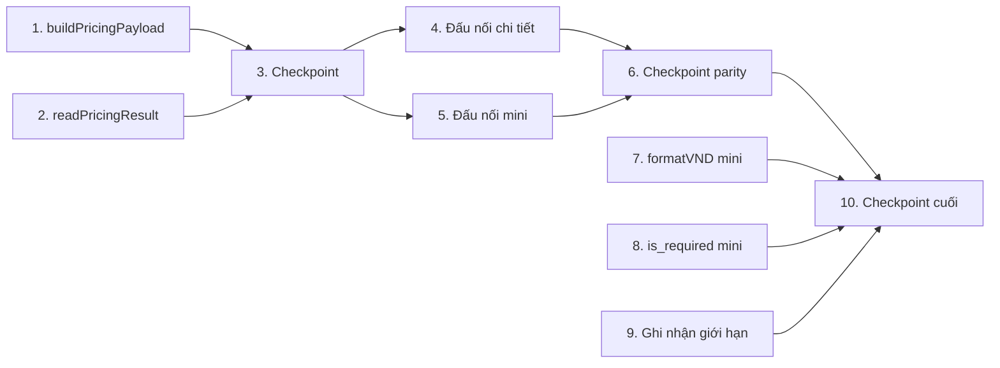

# Implementation Plan: quote-parity-mini-detailed

## Overview

Kế hoạch hiện thực hóa lớp dựng payload thuần dùng chung và bộ đọc envelope, rồi đấu nối cả hai bề mặt báo giá (mini & chi tiết) vào lớp này, kết thúc bằng đồng bộ định dạng tiền tệ và trường bắt buộc. Mỗi task là hoạt động coding cụ thể, tham chiếu requirement. Task test (`*`) là tùy chọn theo quy ước. Ngôn ngữ: TypeScript (theo design). Thư viện property test: `fast-check` (≥100 iteration).

## Tasks

- [x] 1. Tạo lớp dựng payload thuần dùng chung
  - Tạo `frontend/src/lib/quote/buildPricingPayload.ts`
  - Định nghĩa các kiểu `LengthUnit`, `Dimension`, `ProcessingInput`, `AccessoryInput`, `LooseInput`, `BoundInput`, `BoundSectionInput`, `LargeFormatInput`, `NormalizedInput`, `PricingPayload`
  - Khai báo hằng `DEFAULT_GAP_MM = 2`, `INNER_PAGE_OFFSET = 4`
  - Hiện thực `toMillimeters(d)` quy đổi tường minh (mm×1, cm×10, m×1000), không heuristic ngưỡng
  - Hiện thực `buildLoosePayload`, `buildBoundPayload`, `buildLargeFormatPayload` và `buildPricingPayload` (phân nhánh theo `product_type`)
  - Ném `InvalidPayloadError` khi bound thiếu cover/inner bắt buộc
  - _Requirements: 1.1, 1.2, 2.1, 2.2, 2.3, 2.4, 3.1, 3.2, 3.3, 3.4, 4.1, 4.2, 4.3, 5.1, 5.2, 5.3_

  - [x]* 1.1 Property test: quy đổi đơn vị tường minh
    - **Property 5: Quy đổi đơn vị tường minh là đơn điệu và đúng hệ số**
    - **Validates: Requirements 4.1, 4.2**
    - Tag: `Feature: quote-parity-mini-detailed, Property 5`

  - [x]* 1.2 Property test: bound trừ 4 trang ruột
    - **Property 2: Bound trừ 4 trang ruột**
    - **Validates: Requirements 2.1**
    - Tag: `Feature: quote-parity-mini-detailed, Property 2`

  - [x]* 1.3 Property test: bound luôn có print_type và print_side ruột
    - **Property 3: Bound luôn có print_type và print_side ruột**
    - **Validates: Requirements 2.2, 2.3**
    - Tag: `Feature: quote-parity-mini-detailed, Property 3`

  - [x]* 1.4 Property test: loose dùng gap input / mặc định thống nhất
    - **Property 4: Loose dùng gap từ input, mặc định thống nhất khi thiếu**
    - **Validates: Requirements 3.1, 3.2**
    - Tag: `Feature: quote-parity-mini-detailed, Property 4`

  - [x]* 1.5 Property test: định danh processing nhất quán theo product_type
    - **Property 6: Định danh processing nhất quán theo product_type**
    - **Validates: Requirements 5.1, 5.2, 5.3**
    - Tag: `Feature: quote-parity-mini-detailed, Property 6`

  - [x]* 1.6 Property test: đối chiếu mini ↔ chi tiết (parity)
    - **Property 1: Đối chiếu mini ↔ chi tiết (parity)**
    - **Validates: Requirements 1.3, 2.1, 3.1, 4.1**
    - Tag: `Feature: quote-parity-mini-detailed, Property 1`

  - [x]* 1.7 Unit test: edge case & input không hợp lệ
    - bound `page_count ≤ 4` → `inner.page_count = 0`; bound thiếu cover/inner → ném `InvalidPayloadError`
    - _Requirements: 2.4, 3.2_

- [x] 2. Tạo bộ đọc envelope dùng chung
  - Tạo `frontend/src/lib/quote/readPricingResult.ts`
  - Định nghĩa `NormalizedPricingResult` và hiện thực `readPricingResult(response)` xử lý `{success,data}`, object trực tiếp, và nhánh lỗi/thiếu dữ liệu
  - _Requirements: 6.1, 6.2, 6.3, 6.4_

  - [x]* 2.1 Property test: hội tụ envelope
    - **Property 7: Bộ đọc envelope hội tụ về cùng kết quả**
    - **Validates: Requirements 6.1, 6.2, 6.4**
    - Tag: `Feature: quote-parity-mini-detailed, Property 7`

  - [x]* 2.2 Property test: envelope thất bại/thiếu dữ liệu
    - **Property 8: Envelope thất bại/thiếu dữ liệu cho lỗi chuẩn hóa**
    - **Validates: Requirements 6.3**
    - Tag: `Feature: quote-parity-mini-detailed, Property 8`

- [x] 3. Checkpoint — lớp dùng chung
  - Ensure all tests pass, ask the user if questions arise.

- [x] 4. Đấu nối Báo giá chi tiết vào lớp dùng chung
  - Sửa `frontend/src/app/pricing/quotes/_hooks/useQuoteConfigurator.ts`
  - Map state UI (loose/bound/large_format) → `NormalizedInput` rồi gọi `buildPricingPayload`; xóa logic dựng payload nội bộ
  - Đọc phản hồi `POST /pricing/calculate` qua `readPricingResult`
  - _Requirements: 1.5, 6.1, 6.4_

  - [ ]* 4.1 Unit test: map state chi tiết → NormalizedInput
    - Xác nhận payload sinh khớp hợp đồng engine cho cả 3 product_type
    - _Requirements: 1.5_

- [x] 5. Đấu nối Báo giá mini vào lớp dùng chung
  - Sửa `frontend/src/app/(app)/inbox/components/quote/useQuoteCalculator.ts`
  - Map `formData + masterData + template` → `NormalizedInput` rồi gọi `buildPricingPayload`; xóa `buildLoosePayload/buildBoundPayload/buildLargeFormatPayload` nội bộ và heuristic đơn vị
  - Đọc phản hồi `POST /quote/pricing-calc` qua `readPricingResult`
  - _Requirements: 1.4, 6.2, 6.4_

  - [ ]* 5.1 Unit test: map state mini → NormalizedInput
    - Xác nhận mini & chi tiết sinh payload tương đương cho cùng input chuẩn hóa (bound page_count, loose gap, large_format đơn vị)
    - _Requirements: 1.4_

- [x] 11. Backend — giữ thông tin ruột/bìa cho parity bound (`calculateMiniQuote`)
  - Sửa nhánh `bound` trong `backend/src/modules/quote/quote.service.ts` (`calculateMiniQuote`): truyền tiếp `inner.page_count`, `inner.print_type`, `inner.processing` và `cover.print_type` khi FE cung cấp; giữ nguyên fallback khi vắng (không phá luồng khác)
  - KHÔNG đổi engine `bound-calculator`, KHÔNG đổi schema, KHÔNG đổi đường dẫn endpoint
  - _Requirements: 10.1, 10.2, 10.3, 10.4, 10.5_

  - [ ]* 11.1 Unit test: calculateMiniQuote bound truyền tiếp page_count/print_type
    - Khi `inner[].page_count` có → payload gửi engine giữ đúng giá trị; khi vắng → fallback như cũ
    - _Requirements: 10.1, 10.4, 10.5_

- [x] 6. Checkpoint — parity hai bề mặt
  - Ensure all tests pass, ask the user if questions arise.

- [x] 7. Đồng bộ định dạng tiền tệ ở Báo giá mini
  - Sửa `frontend/src/app/(app)/inbox/components/quote/QuoteResultDisplay.tsx`
  - Thay mọi `Number(x).toLocaleString('vi-VN') + 'đ'` bằng `formatVND(x)` (total, price_per_item, breakdown currency keys, văn bản copy vào chat)
  - _Requirements: 7.1, 7.2, 7.3_

  - [ ]* 7.1 Property test: formatVND một ký hiệu tiền tệ
    - **Property 9: formatVND một ký hiệu tiền tệ duy nhất**
    - **Validates: Requirements 7.1, 7.2, 7.3**
    - Tag: `Feature: quote-parity-mini-detailed, Property 9`

- [x] 8. Trường bắt buộc theo metadata template
  - Sửa `frontend/src/app/(app)/inbox/components/quote/MiniQuotePanel.tsx`
  - Thay nhánh hardcode bằng đọc cờ `is_required` của field trong metadata template; field thiếu `is_required` ⇒ không bắt buộc
  - _Requirements: 8.1, 8.2_

  - [ ]* 8.1 Unit test: xác định trường bắt buộc theo is_required
    - Template có/không `is_required` → tập trường bắt buộc đúng
    - _Requirements: 8.1, 8.2_

- [x] 9. Ghi nhận giới hạn ngoài phạm vi
  - Xác nhận mục "Ghi nhận giới hạn" trong `design.md` mô tả: độ trễ MASTER_DATA_TTL, cache loadProductTemplates auto-detect, khoảng trống pipeline đơn /erp/orders
  - _Requirements: 9.1, 9.2, 9.3_

- [x] 10. Checkpoint cuối — toàn bộ test pass
  - Ensure all tests pass, ask the user if questions arise.

## Task Dependency Graph



```json
{
  "waves": [
    { "wave": 1, "tasks": ["1", "2"], "parallel": true },
    { "wave": 2, "tasks": ["3"], "parallel": false },
    { "wave": 3, "tasks": ["4", "5"], "parallel": true },
    { "wave": 4, "tasks": ["6"], "parallel": false },
    { "wave": 5, "tasks": ["7", "8", "9"], "parallel": true },
    { "wave": 6, "tasks": ["10"], "parallel": false }
  ]
}
```

**Waves (nhóm chạy song song):**
- **Wave 1 (song song):** Task 1 (`buildPricingPayload.ts`) ‖ Task 2 (`readPricingResult.ts`) — hai file độc lập, không phụ thuộc nhau.
- **Wave 2:** Task 3 — checkpoint lớp dùng chung.
- **Wave 3 (song song):** Task 4 (`useQuoteConfigurator.ts`) ‖ Task 5 (`useQuoteCalculator.ts`) — hai file độc lập, cùng phụ thuộc Wave 1/2.
- **Wave 4:** Task 6 — checkpoint parity.
- **Wave 5 (song song):** Task 7 (`QuoteResultDisplay.tsx`) ‖ Task 8 (`MiniQuotePanel.tsx`) ‖ Task 9 (ghi nhận giới hạn, chỉ tài liệu) — ba mục độc lập.
- **Wave 6:** Task 10 — checkpoint cuối.

## Notes

- Task gắn `*` là tùy chọn (test), có thể bỏ qua khi cần MVP nhanh; task lõi không bao giờ gắn `*`.
- Mỗi task tham chiếu requirement cụ thể để truy vết.
- Property test dùng `fast-check`, tối thiểu 100 iteration, gắn tag `Feature: quote-parity-mini-detailed, Property {n}`.
- Property "đối chiếu mini ↔ chi tiết" (Property 1, task 1.6) là chốt parity quan trọng nhất.
- Mỗi sửa đổi trên cùng một file được gộp vào một task; các file độc lập tách riêng để chạy song song theo wave.

## Tình trạng test tùy chọn

- **Đã hoàn thành (property, fast-check ≥100 iter):** 1.1–1.6 + 1.7 trong `buildPricingPayload.test.ts`; 2.1–2.2 trong `readPricingResult.test.ts`. Tổng 11 test, pass.
- **7.1 (formatVND một ký hiệu):** phủ bởi `src/lib/format/currency.test.ts` đã có sẵn (spec quote-page-ux) — không tạo trùng.
- **Hoãn 4.1, 5.1, 8.1, 11.1 (unit test mức hook/component):** các hook (`useQuoteConfigurator`, `useQuoteCalculator`) và `MiniQuotePanel` phụ thuộc nặng React state + fetch; viết unit test render thật sẽ giòn. Lõi parity (cùng input ⇒ cùng payload, bound trừ 4 trang, gap thống nhất, quy đổi đơn vị, processing nhất quán) đã được phủ trực tiếp bởi property test của Lớp_Dựng_Payload; backend `calculateMiniQuote` đã được phủ bởi suite quote hiện có (33 test pass). Có thể bổ sung sau nếu cần.
