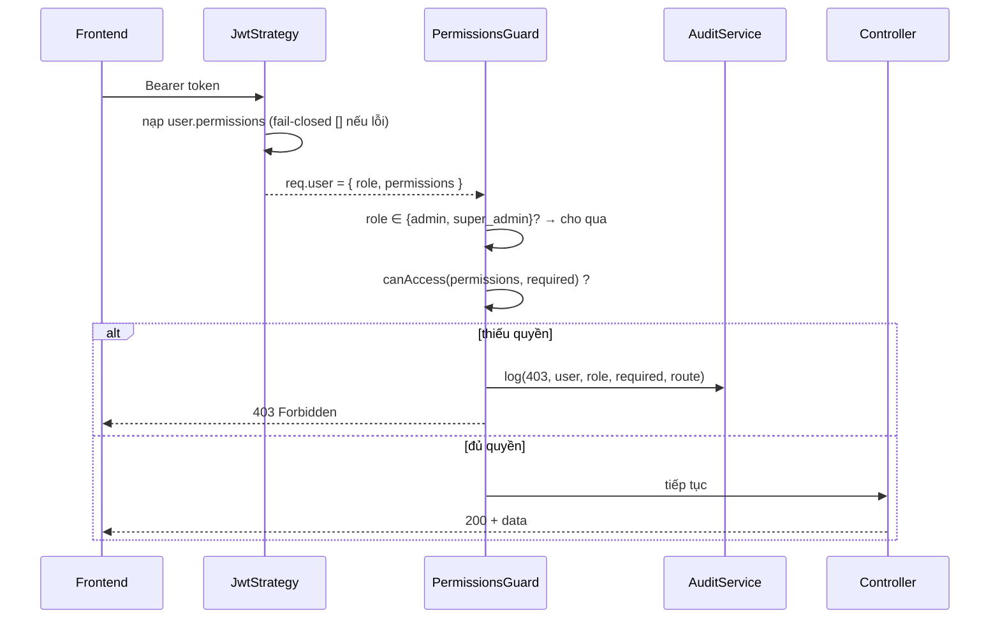

# Tài liệu Thiết kế — Phân quyền truy cập theo vai trò cho Báo giá và Đơn hàng (RBAC)

## Overview

Tính năng này biến seam phân quyền đã đặt sẵn (`RouteAccessGuard`, hiện permissive) thành **phân quyền được thực thi thật**, với nguyên tắc cốt lõi: **ranh giới bảo mật thật nằm ở backend**, còn frontend chỉ kiểm soát ở **mức trải nghiệm (UX)**.

Thiết kế bám sát mã nguồn hiện trạng và **không đổi schema** (`synchronize=false`). Cụ thể, hệ thống đã có sẵn gần như toàn bộ hạ tầng cần thiết:

- `ALL_PERMISSIONS` + `DEFAULT_ROLE_PERMISSIONS` trong `rbac.service.ts` (delimiter `.`), `RbacService.seedDefaultRoles()` seed 4 vai trò hệ thống.
- `PermissionsGuard` (`@Permissions`, logic OR, bypass `admin`/`super_admin`) và `RolesGuard` (`@Roles`).
- `jwt.strategy.ts` nạp `user.permissions` từ `role_permissions`.
- Module `audit` (`AuditService.log(...)`, `AuditLog` entity) đã tồn tại và là `@Global()`.

Phạm vi thay đổi thực tế là **nhỏ và có mục tiêu**, gom thành 6 nhóm:

1. **Trích xuất logic quyết định thành hàm thuần** (`canAccess`, `normalizeCapability`, `agentDefaultPermissions`) ở cả backend và frontend, để cùng một quy tắc được kiểm thử bằng property-based testing và dùng nhất quán hai phía.
2. **Backend**: gắn `@Permissions` lên mọi route `/erp/orders` (đang thiếu hoàn toàn — lỗ hổng chính), kiểm tra các route nhạy cảm `settings.*`/`user.*`/`role.*`.
3. **Fail-closed**: sửa `catch` của `jwt.strategy.ts` từ `['*']` (fail-open) sang `[]` (deny), kèm bảo đảm seeding để người dùng hợp lệ luôn nạp được quyền.
4. **Mô hình quyền**: xác nhận và tinh chỉnh tối thiểu `DEFAULT_ROLE_PERMISSIONS` cho split báo giá/đơn hàng; re-seed/upsert idempotent không xoá vai trò tuỳ biến.
5. **Frontend**: phơi `permissions` qua `auth-context`, biến `RouteAccessGuard` thành guard thật, hoà giải `:`→`.`, ẩn/disable nút cam kết, sửa nhãn vai trò hard-code, hoà giải từ vựng `manager/staff`→`supervisor/agent`.
6. **Audit**: tái dùng `AuditService` ghi nhận 403 (không ghi bí mật).

## Architecture

Ranh giới bảo mật thật là backend `PermissionsGuard`/`RolesGuard`. Frontend (`RouteAccessGuard` + ẩn UI) chỉ là lớp UX để tránh người dùng bấm vào thứ rồi nhận 403.

```mermaid
flowchart LR
    subgraph Client["Frontend (UX layer — KHÔNG phải bảo mật)"]
        Login[Đăng nhập] --> AC[auth-context.permissions]
        AC --> RAG[RouteAccessGuard\ncanAccess(perms, [cap])]
        AC --> UIBTN[Ẩn/disable nút\nDuyệt/Xoá/Hoàn thành/Huỷ]
        FRG[FrozenRouteGuard\n(ngoài)] --> RAG
    end

    subgraph Server["Backend (RANH GIỚI BẢO MẬT THẬT)"]
        JWT[JwtStrategy.validate\nnạp permissions\nFAIL-CLOSED = []]
        PG[PermissionsGuard\ncanAccess + bypass admin]
        RG[RolesGuard]
        Audit[AuditService.log\n403 denial]
    end

    Login -->|POST /auth/login| JWT
    RAG -->|HTTP + Bearer JWT| PG
    UIBTN -->|HTTP + Bearer JWT| PG
    PG -->|thiếu quyền| Audit
    PG -->|đủ quyền| Controller["/erp/orders, /users, /rbac, /erp/system-settings"]
    RG --> Controller
    JWT -.cấp permissions cho req.user.-> PG
```

Luồng quyết định (request đã xác thực):



**Nguyên tắc kiến trúc then chốt:**

- **Single source of truth cho quyết định**: tách hàm thuần `canAccess(permissions, required)` để `PermissionsGuard` (backend) và `RouteAccessGuard` (frontend) dùng *cùng một logic*. Điều này đảm bảo quyết định hiển thị ở frontend trùng với quyết định chặn ở backend (giảm 403 bất ngờ) mà vẫn giữ backend là nơi thực thi.
- **No per-request DB query**: kiểm tra quyền chỉ đọc `req.user.permissions` đã nạp sẵn tại `JwtStrategy` — không phát sinh truy vấn mỗi lần kiểm tra (Req 7.6).
- **Compose guard frontend giữ nguyên**: `FrozenRouteGuard` (ngoài) → `RouteAccessGuard` (trong) (Req 5.8).

## Components and Interfaces

### 1. Hàm quyết định thuần (mới — kiểm thử được)

Đây là trung tâm của thiết kế. Logic quyết định được trích xuất khỏi `PermissionsGuard` thành module thuần, không phụ thuộc NestJS/React, dùng được cả hai phía.

**Backend** — `backend/src/modules/auth/access-decision.ts`:

```typescript
/** Wildcard cấp toàn quyền. */
export const WILDCARD = '*';

/**
 * Quyết định truy cập THUẦN, dùng chung cho PermissionsGuard (backend)
 * và RouteAccessGuard (frontend). Logic OR: cần ÍT NHẤT MỘT quyền trong `required`.
 *
 * @param permissions Danh sách quyền hiệu lực của người dùng (có thể chứa '*').
 * @param required    Danh sách quyền yêu cầu của route (OR). Rỗng = không yêu cầu → cho qua.
 */
export function canAccess(permissions: readonly string[], required: readonly string[]): boolean {
    if (!required || required.length === 0) return true;          // không khai báo quyền → cho qua
    if (permissions.includes(WILDCARD)) return true;              // toàn quyền
    return required.some((r) => permissions.includes(r));         // OR
}

/**
 * Chuẩn hoá capability frontend từ delimiter placeholder ':' về '.' chuẩn backend.
 * Chỉ đổi DẤU PHÂN CÁCH, không đổi token. Idempotent: normalize(normalize(x)) === normalize(x).
 */
export function normalizeCapability(cap: string): string {
    return cap.replace(/:/g, '.');
}
```

**Frontend** — `frontend/src/lib/access-decision.ts`: bản sao *giống hệt* về hành vi (vì hai package tách rời, không có thư mục dùng chung). Tính đồng nhất được đảm bảo bằng property test ở cả hai phía (xem Correctness Properties P5). Một phương án thay thế là một package nội bộ chia sẻ, nhưng do repo hiện không có workspace/monorepo tooling, ta giữ bản sao tối giản + test ràng buộc.

### 2. PermissionsGuard (sửa nhẹ — dùng hàm thuần)

`PermissionsGuard` giữ nguyên hành vi nhưng gọi `canAccess` và phát audit khi từ chối:

```typescript
@Injectable()
export class PermissionsGuard implements CanActivate {
    constructor(
        private reflector: Reflector,
        private readonly audit: AuditService,   // module audit là @Global()
    ) {}

    canActivate(context: ExecutionContext): boolean {
        const required = this.reflector.getAllAndOverride<string[]>(
            PERMISSIONS_KEY, [context.getHandler(), context.getClass()],
        );
        if (!required || required.length === 0) return true;

        const req = context.switchToHttp().getRequest();
        const user = req.user;
        if (!user) throw new ForbiddenException('Không có quyền truy cập');

        const role = (user.role || '').toLowerCase();
        if (role === 'admin' || role === 'super_admin') return true;   // bypass (Req 3.9)

        const permissions: string[] = user.permissions || [];
        if (canAccess(permissions, required)) return true;

        // Ghi nhận 403 (không secrets) rồi từ chối (Req 6.1, 6.2, 6.3)
        void this.audit.log({
            userId: user.id,
            action: 'access.denied',
            entityType: 'route',
            entityId: `${req.method} ${req.route?.path ?? req.url}`,
            metadata: { role: user.role, required, route: req.originalUrl },
            ipAddress: req.ip,
        });
        throw new ForbiddenException(`Cần quyền ${required.join(' hoặc ')} để truy cập`);
    }
}
```

### 3. ErpOrdersController (sửa — thêm `@Permissions` lên MỌI route)

Lỗ hổng chính: class có `PermissionsGuard` nhưng không route nào khai báo `@Permissions`. Ánh xạ theo Req 3.3–3.7. Các route phụ trợ (clone/submit/reject/send/accept/send-zalo/send-email) được phân loại theo bản chất nghiệp vụ.

| Route | HTTP | `@Permissions(...)` | Req |
|---|---|---|---|
| `findAll` | `GET /erp/orders` | `'quote.view', 'order.view'` | 3.3 |
| `findOne` | `GET /erp/orders/:id` | `'quote.view', 'order.view'` | 3.3 |
| `expireQuotes` | `GET /erp/orders/expire` | `'quote.view', 'order.view'` | 3.3 |
| `create` | `POST /erp/orders` | `'quote.create'` | 3.4 |
| `update` | `PUT /erp/orders/:id` | `'quote.edit'` | 3.4 |
| `clone` | `POST /erp/orders/:id/clone` | `'quote.create'` | 3.4 |
| `submit` | `POST /erp/orders/:id/submit` | `'quote.edit'` | 3.4 |
| `approve` | `POST /erp/orders/:id/approve` | `'quote.approve'` | 3.5 |
| `reject` | `POST /erp/orders/:id/reject` | `'quote.approve'` | 3.5 |
| `send` | `POST /erp/orders/:id/send` | `'quote.edit'` | 3.4 |
| `accept` | `POST /erp/orders/:id/accept` | `'order.approve'` | 3.6 |
| `complete` | `POST /erp/orders/:id/complete` | `'order.approve'` | 3.6 |
| `cancel` | `POST /erp/orders/:id/cancel` | `'order.approve'` | 3.6 |
| `sendZalo` | `POST /erp/orders/:id/send-zalo` | `'quote.edit'` | 3.4 |
| `sendEmail` | `POST /erp/orders/:id/send-email` | `'quote.edit'` | 3.4 |
| `remove` | `DELETE /erp/orders/:id` | `'quote.delete'` | 3.7 |

Ví dụ chữ ký đã decorate:

```typescript
@Get()
@Permissions('quote.view', 'order.view')          // OR — Req 3.3
async findAll(/* ...query */) { /* ... */ }

@Get(':id')
@Permissions('quote.view', 'order.view')
async findOne(@Param('id') id: string) { /* ... */ }

@Post()
@Permissions('quote.create')                       // Req 3.4
async create(@Body() body: CreateQuoteDto, @Req() req: any) { /* ... */ }

@Put(':id')
@Permissions('quote.edit')                         // Req 3.4
async update(@Param('id') id: string, @Body() body: UpdateQuoteDto) { /* ... */ }

@Post(':id/approve')
@Permissions('quote.approve')                      // Req 3.5
async approve(@Param('id') id: string, @Req() req: any) { /* ... */ }

@Post(':id/complete')
@Permissions('order.approve')                      // Req 3.6
async complete(@Param('id') id: string) { /* ... */ }

@Post(':id/cancel')
@Permissions('order.approve')                      // Req 3.6
async cancel(@Param('id') id: string, @Body() body: { reason?: string }) { /* ... */ }

@Delete(':id')
@Permissions('quote.delete')                       // Req 3.7
async remove(@Param('id') id: string) { /* ... */ }
```

> Lưu ý phân tích: `agent` mặc định có `quote.create`/`quote.edit`/`order.view` nên luồng việc hằng ngày (tạo/sửa báo giá, xem đơn) không bị 403 (Req 4.7). `agent` KHÔNG có `quote.approve`/`order.approve`/`quote.delete` nên các route cam kết bị chặn (Req 4.5).

### 4. Route nhạy cảm khác (Req 3.10)

- `/users` (`UsersController`): **đã** dùng `RolesGuard` + `@Roles(ADMIN[, SUPERVISOR])`. Đạt yêu cầu, không sửa.
- `/rbac` (`RbacController`): **đã** dùng `RolesGuard` + `@Roles(ADMIN, SUPER_ADMIN)`. Đạt yêu cầu, không sửa.
- `/erp/system-settings` (`ErpSystemSettingsController`): có `PermissionsGuard` ở class nhưng **thiếu `@Permissions`** trên route (gap tương tự orders). Thêm:

```typescript
@Get()    @Permissions('settings.view')  async findAll() { /* ... */ }
@Post()   @Permissions('settings.edit')  async update(@Body() body: ...) { /* ... */ }
```

`agent`/`viewer` không có `settings.edit` → ghi/sửa cài đặt bị 403 (Req 2.4, 3.10).

### 5. JwtStrategy (sửa — fail-closed)

Đổi nhánh `catch` từ fail-open sang fail-closed:

```typescript
} else {
    try {
        const rows = await this.dataSource.query(
            `SELECT rp.permission FROM public.role_permissions rp
             JOIN public.roles r ON rp.role_id = r.id
             WHERE LOWER(r.name) = $1`, [role],
        );
        permissions = rows.map((r: any) => r.permission);
    } catch (err) {
        // FAIL-CLOSED (Req 4.2): lỗi tải quyền → từ chối, KHÔNG cấp ['*']
        this.logger.error(`Không nạp được quyền cho role=${role}: ${err?.message}`);
        permissions = [];
    }
}
```

Anti-lockout: vì `RbacService.seedDefaultRoles()` đảm bảo 4 vai trò + quyền luôn tồn tại (Req 4.3), người dùng hợp lệ luôn nạp được quyền; `[]` chỉ xảy ra khi DB thật sự lỗi. `admin`/`super_admin` vẫn nhận `['*']` trước nhánh try/catch nên không bao giờ bị khoá (Req 4.6).

### 6. auth-context (sửa — phơi `permissions`)

```typescript
interface User {
    id: string;
    email: string;
    fullName: string;
    role: string;
    avatarUrl?: string;
    permissions: string[];     // MỚI (Req 5.2)
}
```

`login()` đã `setUser(data.user)`; backend trả `permissions` trong `user` (xem Data Models). Bổ sung helper:

```typescript
import { canAccess, normalizeCapability } from '@/lib/access-decision';

export function usePermissions() {
    const { user } = useAuth();
    const permissions = user?.permissions ?? [];
    return {
        permissions,
        /** Kiểm tra một capability (đã hoặc chưa chuẩn hoá ':' → '.'). */
        hasPermission: (cap: string) => canAccess(permissions, [normalizeCapability(cap)]),
    };
}
```

> Tương thích phiên cũ: `safeParse<User>('zh_user')` có thể trả về user cũ không có `permissions`. Khi đó `permissions ?? []` cho mảng rỗng (fail-closed ở UX); quyền thật sẽ được nạp lại ở lần đăng nhập/refresh kế tiếp (Req 7.4). Không phá token đang hiệu lực.

### 7. RouteAccessGuard (sửa — kiểm tra quyền thật)

```typescript
'use client';
import React from 'react';
import { usePermissions } from '@/lib/auth-context';
import { normalizeCapability, canAccess } from '@/lib/access-decision';

export interface RouteAccessGuardProps {
    requiredCapability?: string;
    requiredRole?: string;
    children: React.ReactNode;
}

export function RouteAccessGuard({ requiredCapability, children }: RouteAccessGuardProps): React.ReactElement {
    const { permissions } = usePermissions();

    // Không yêu cầu capability → permissive (giữ tương thích các route chưa nối dây)
    if (!requiredCapability) return <>{children}</>;

    const allowed = canAccess(permissions, [normalizeCapability(requiredCapability)]);
    if (!allowed) {
        return (
            <div className="p-10 text-center text-slate-500">
                <h2 className="text-lg font-bold mb-2">Không đủ quyền truy cập</h2>
                <p>Bạn không có quyền xem nội dung này. Liên hệ chủ shop nếu cần.</p>
            </div>
        );
    }
    return <>{children}</>;
}
export default RouteAccessGuard;
```

Cập nhật hai trang đã nối dây từ spec product-rescope:

- `pricing/quotes/page.tsx`: `requiredCapability="quote:create"` → `"quote.create"`.
- `pricing/orders/page.tsx`: `requiredCapability="order:view"` → `"order.view"`.

(Guard cũng tự chuẩn hoá `:`→`.`, nên hai trang vẫn an toàn dù còn placeholder; nhưng ta cập nhật để dùng từ vựng chuẩn — Req 5.3.)

Thứ tự compose `FrozenRouteGuard` (ngoài) → `RouteAccessGuard` (trong) giữ nguyên (Req 5.8).

### 8. Ẩn/disable nút cam kết trong QuoteOrderListView (Req 5.6, 5.7)

`QuoteOrderListView` render các nút Duyệt/Từ chối/Hoàn thành/KH chấp nhận/Huỷ. Bọc theo quyền:

```typescript
const { hasPermission } = usePermissions();
const canApproveQuote = hasPermission('quote.approve');
const canApproveOrder = hasPermission('order.approve');   // complete + cancel + accept
const canDeleteQuote  = hasPermission('quote.delete');

// ✅ Duyệt
{(detail.status === 'draft' || detail.status === 'pending_approval') && canApproveQuote && (
    <button onClick={/* approve */}>✅ Duyệt</button>
)}
// 🛒 Hoàn thành
{(detail.status === 'approved' || detail.status === 'accepted') && canApproveOrder && (
    <button onClick={/* complete */}>🛒 Hoàn thành</button>
)}
// 🗑️ Huỷ
{detail.status !== 'cancelled' && detail.status !== 'completed' && canApproveOrder && (
    <button onClick={/* cancel */}>🗑️ Huỷ</button>
)}
```

Ẩn UI chỉ là UX; nếu người dùng tự gọi API, backend vẫn chặn (Req 5.7).

### 9. Màn hình admin/users (sửa — từ vựng vai trò)

Đổi options và `roleMap` từ `manager/staff` → `supervisor/agent` (Req 1.3):

```typescript
{ key: 'role', label: 'Vai trò', type: 'select', options: [
    { value: 'admin',      label: 'Quản trị viên' },
    { value: 'supervisor', label: 'Giám sát' },
    { value: 'agent',      label: 'Nhân viên' },
    { value: 'viewer',     label: 'Chỉ xem' },
], defaultValue: 'agent' }

const roleMap: Record<string, [string, string]> = {
    admin:      ['Quản trị', 'bg-red-100 text-red-700'],
    supervisor: ['Giám sát', 'bg-blue-100 text-blue-700'],
    agent:      ['Nhân viên', 'bg-slate-100 text-slate-700'],
    viewer:     ['Chỉ xem',  'bg-slate-50 text-slate-500'],
};
```

### 10. Nhãn vai trò trong (app)/layout.tsx (sửa — Req 1.7)

Thay nhãn cố định `"Quản trị viên"` bằng nhãn suy từ `user.role`:

```typescript
const ROLE_LABELS: Record<string, string> = {
    super_admin: 'Super Admin', admin: 'Quản trị viên',
    supervisor: 'Giám sát', agent: 'Nhân viên', viewer: 'Chỉ xem',
};
// ...
<span style={{ fontSize: 11, color: '#94a3b8' }}>
    {ROLE_LABELS[user.role] ?? user.role}
</span>
```

## Data Models

**Không thêm bảng/cột nào** (Req 2.8, 7.2). Tái dùng nguyên trạng:

- `users(role: varchar default 'agent')` — enum `UserRole = super_admin | admin | supervisor | agent`.
- `roles(id, name, display_name, description, tenant_id, is_system)`.
- `role_permissions(id, role_id, permission: varchar)`.
- `audit_logs(id, user_id, action, entity_type, entity_id, old_value, new_value, metadata, ip_address, created_at)` — dùng cho denial logging.

### Ánh xạ vai trò → quyền (Req 2)

Tập quyền mục tiêu cho split báo giá/đơn hàng (delimiter `.`):

| Vai trò | Quyền |
|---|---|
| `admin` | `['*']` |
| `supervisor` | quyền của `agent` + `quote.approve`, `order.approve` (giữ thêm các quyền vận hành hiện có: `quote.edit`, `order.edit`, `material.*`, `inventory.*`, `customer.edit`, `pricing.edit`, `settings.view`, `user.view`, `report.export`, `inbox.assign`) |
| `agent` | `inbox.view`, `inbox.reply`, `quote.view`, `quote.create`, `quote.edit`, `order.view`, `customer.view`, `customer.create`, `report.view`, `pricing.view` |
| `viewer` | `quote.view`, `order.view`, `customer.view`, `pricing.view`, `report.view` (chỉ xem) |

**Diff tối thiểu so với seed hiện tại** (`DEFAULT_ROLE_PERMISSIONS`):

- `agent`: hiện có `order.create` → nên **bỏ** để khớp Req 2.2/2.4 (agent không cam kết tạo đơn cuối; vẫn giữ `order.view`). Hiện còn `material.view`, `inventory.view` — không thuộc trục báo giá/đơn nhưng vô hại; giữ để không thu hẹp việc hằng ngày, KHÔNG ảnh hưởng Req 2.4 (vốn chỉ cấm các quyền cam kết). Cần đảm bảo có `inbox.view`, `inbox.reply` (đã có).
- `viewer`: hiện có `material.view` — giữ tuỳ ý; Req 2.7 chỉ cấm create/edit/delete/approve (viewer không có các quyền đó → đạt). Bảo đảm có đủ `order.view`, `report.view`, `pricing.view`, `customer.view`, `quote.view` (đã có trừ cần xác nhận `order.view` — đã có).
- `supervisor`: đã có `quote.approve`, `order.approve` → đạt Req 2.5.
- `admin`: `['*']` → đạt Req 2.6.

Kết luận: các seed hiện tại **gần khớp**; chỉ cần chỉnh `agent` (gỡ `order.create`) và re-seed idempotent.

### Re-seed / upsert idempotent (Req 4.3, 7.2)

`seedDefaultRoles()` hiện chỉ seed khi `existingPerms === 0` (không cập nhật khi đã có). Bổ sung một bước **upsert idempotent** cho quyền của 4 vai trò hệ thống, **không đụng** vai trò tuỳ biến (`is_system=false`) và **không xoá** vai trò:

```typescript
/** Đồng bộ quyền cho các vai trò hệ thống về DEFAULT_ROLE_PERMISSIONS (idempotent). */
private async reconcileSystemRolePermissions() {
    for (const [name, perms] of Object.entries(DEFAULT_ROLE_PERMISSIONS)) {
        const role = await this.roleRepo.findOne({ where: { name, isSystem: true } });
        if (!role) continue;                                   // chỉ đồng bộ vai trò hệ thống
        const existing = await this.rpRepo.find({ where: { roleId: role.id } });
        const existingSet = new Set(existing.map((e) => e.permission));
        const desiredSet = new Set(perms);
        // Thêm quyền còn thiếu
        const toAdd = perms.filter((p) => !existingSet.has(p)).map((p) => ({ roleId: role.id, permission: p }));
        if (toAdd.length) await this.rpRepo.save(toAdd);
        // Gỡ quyền thừa CHỈ với vai trò hệ thống (đưa về đúng default)
        const toRemove = existing.filter((e) => !desiredSet.has(e.permission));
        if (toRemove.length) await this.rpRepo.remove(toRemove);
    }
}
```

Hàm này chạy trong `onModuleInit` sau `seedDefaultRoles()`. Vì chỉ thao tác `is_system=true` và so khớp tập, nó **idempotent** (chạy lại không đổi kết quả) và **an toàn** với vai trò tuỳ biến (Req 7.2).

### Login response (Req 5.1)

Hiện `AuthService.login()` trả `user` KHÔNG kèm `permissions`. JWT payload cũng không chứa permissions (chỉ `sub/email/role/tenantId/jti`). Phương án: tính permissions tại thời điểm login bằng cùng truy vấn như `JwtStrategy`, đính vào `user` trả về:

```typescript
// trong login(), sau khi xác thực user:
const permissions = await this.loadPermissions(user.role);   // cùng logic fail-closed
return {
    ...tokens,
    user: { id, email, fullName, role: user.role, avatarUrl, tenantId, permissions },
};
```

`JwtStrategy.validate` vẫn là nguồn `req.user.permissions` cho mọi request sau đó (đảm bảo quyền luôn tươi theo DB ở lần xác thực kế — Req 7.4). Login response chỉ phục vụ UX frontend.

## Correctness Properties

*Một property là một đặc tính hoặc hành vi phải đúng trên mọi lần thực thi hợp lệ của hệ thống — về bản chất là một phát biểu hình thức về điều hệ thống phải làm. Property là cầu nối giữa đặc tả con-người-đọc-được và bảo đảm đúng đắn máy-kiểm-được.*

PBT áp dụng được cho tính năng này vì phần lõi quyết định phân quyền là các **hàm thuần** input/output rõ ràng: `canAccess(permissions, required)`, `normalizeCapability(cap)`, `normalizeRole(legacy)` và các hằng tập quyền mặc định (`agentDefault`, `supervisorDefault`, `viewerDefault`). Các hàm này được test bằng `fast-check` ở **cả frontend (đã có jest+fast-check) và backend** (thêm `fast-check` vào devDependencies). Các yêu cầu về cấu hình guard, seeding DB, login API, render UI được phủ bằng integration/unit/smoke (xem Testing Strategy).

Định nghĩa tập dùng trong property:
- `COMMITMENT_PERMS = { quote.approve, quote.delete, order.approve, order.delete, settings.edit } ∪ { p | p khởi đầu 'user.' hoặc 'role.' }`
- `AGENT_DAILY = { inbox.view, inbox.reply, quote.view, quote.create, quote.edit, order.view, customer.view, customer.create, report.view, pricing.view }`
- `MUTATING_ACTIONS = { create, edit, delete, approve }`
- `BYPASS_ROLES = { admin, super_admin }`

### Property 1: Quyết định OR theo quyền (nền tảng)

*Với mọi* danh sách quyền `permissions` và danh sách yêu cầu không rỗng `required`, `canAccess(permissions, required)` trả về `true` khi và chỉ khi `permissions` chứa `'*'` HOẶC chứa ít nhất một phần tử của `required`; ngược lại trả về `false`.

**Validates: Requirements 3.3, 3.4, 3.5, 3.6, 3.7, 3.8, 5.4**

### Property 2: Vai trò bypass luôn được phép

*Với mọi* `permissions` và `required` bất kỳ, quyết định phân quyền cho người dùng có `role ∈ BYPASS_ROLES` luôn là cho phép (allow), không phụ thuộc `permissions` hay `required`.

**Validates: Requirements 1.2, 3.9, 4.6**

### Property 3: Tập quyền mặc định của agent bao trùm việc hằng ngày

*Với mọi* quyền `p ∈ AGENT_DAILY`, tập quyền mặc định của `agent` chứa `p` (bao gồm `order.view` để NV_CSKH xem đơn).

**Validates: Requirements 2.2, 2.3, 4.4**

### Property 4: Tập quyền mặc định của agent loại trừ mọi quyền cam kết

*Với mọi* quyền `p ∈ COMMITMENT_PERMS`, tập quyền mặc định của `agent` KHÔNG chứa `p`.

**Validates: Requirements 2.4**

### Property 5: Phân quyền theo route cho agent (mở việc hằng ngày, khoá việc cam kết)

*Với mọi* route cam kết và yêu cầu quyền tương ứng `required`, `canAccess(agentDefault, required) = false`; và *với mọi* route việc hằng ngày với `required` tương ứng, `canAccess(agentDefault, required) = true`.

**Validates: Requirements 4.4, 4.5, 4.7**

### Property 6: Supervisor bao trùm việc hằng ngày của agent cộng quyền duyệt

*Với mọi* quyền `p ∈ AGENT_DAILY ∪ { quote.approve, order.approve }`, tập quyền mặc định của `supervisor` chứa `p`.

**Validates: Requirements 2.5**

### Property 7: Viewer chỉ-đọc, loại trừ mọi quyền biến đổi

*Với mọi* quyền `p` trong Catalog_Quyền có `action ∈ MUTATING_ACTIONS` (phần sau dấu `.`), tập quyền mặc định của `viewer` KHÔNG chứa `p`.

**Validates: Requirements 2.7**

### Property 8: Chuẩn hoá capability chỉ đổi delimiter và idempotent

*Với mọi* chuỗi capability `cap`, `normalizeCapability(cap)` không chứa ký tự `':'`, giữ nguyên mọi ký tự khác `':'`, và `normalizeCapability(normalizeCapability(cap)) === normalizeCapability(cap)` (idempotent).

**Validates: Requirements 5.3**

### Property 9: Quyết định frontend trùng backend cho cùng đầu vào

*Với mọi* `permissions` và `cap`, quyết định cho phép của `RouteAccessGuard` bằng đúng `canAccess(permissions, [normalizeCapability(cap)])` — tức quyết định hiển thị ở frontend trùng quyết định chặn ở backend cho cùng `(permissions, capability)`.

**Validates: Requirements 5.4, 3.1**

### Property 10: Fail-closed khi không tải được quyền

*Với mọi* `role ∉ BYPASS_ROLES`, nếu hàm tải quyền ném lỗi thì `resolvePermissions(role, loader)` trả về tập rỗng `[]` và KHÔNG chứa `'*'`.

**Validates: Requirements 4.2**

### Property 11: Bản ghi từ chối không chứa bí mật

*Với mọi* request bị từ chối, đối tượng payload truyền cho `AuditService.log` không chứa khoá nhạy cảm (`token`, `password`, `authorization`) ở bất kỳ cấp nào, đồng thời chứa đủ `userId`, `role`, `required`, `route`.

**Validates: Requirements 6.1, 6.2**

## Error Handling

- **403 Forbidden (thiếu quyền)**: `PermissionsGuard`/`RolesGuard` ném `ForbiddenException` với thông điệp tiếng Việt nêu quyền cần có. Trước khi ném, `PermissionsGuard` gọi `AuditService.log` (không chặn luồng — `void`, lỗi audit không được làm hỏng response). Backend không thực hiện thao tác nghiệp vụ (Req 3.8).
- **Lỗi tải quyền tại JwtStrategy**: bắt trong `try/catch`, log lỗi (không lộ token), gán `permissions = []` (fail-closed, Req 4.2). Người dùng hợp lệ vẫn nạp được quyền nhờ seeding bảo đảm (Req 4.3); `[]` chỉ khi DB thực sự lỗi → người dùng thấy 403 ở route được bảo vệ thay vì leo thang quyền.
- **Phiên cũ thiếu `permissions` ở localStorage**: `auth-context` coi `permissions = []` (UX fail-closed) cho tới lần đăng nhập/refresh kế; không ném lỗi, không phá token đang hiệu lực (Req 7.4).
- **RouteAccessGuard thiếu quyền**: render thông báo "Không đủ quyền truy cập" thay vì children; không ném lỗi chưa xử lý (Req 5.5).
- **Lỗi audit/log**: bao bọc để nuốt lỗi ghi nhật ký (denial logging là phụ trợ, không được làm hỏng việc trả 403).
- **Lỗi mạng/timeout frontend**: giữ nguyên xử lý hiện có của `auth-context` (`authFetch` tự refresh/redirect khi 401); 403 được hiển thị như lỗi nghiệp vụ, không tự logout.

## Testing Strategy

### Cách tiếp cận kép

- **Property-based tests** (fast-check, tối thiểu 100 vòng/property) cho lõi quyết định thuần và các bất biến vai trò→quyền.
- **Unit/Integration/Smoke tests** cho cấu hình guard, seeding, login API, render UI, và regression.

### Hàm thuần cần trích xuất (điều kiện để PBT)

`canAccess`, `normalizeCapability`, `normalizeRole`, `resolvePermissions(role, loader)`, và các hằng `agentDefault/supervisorDefault/viewerDefault` (suy từ `DEFAULT_ROLE_PERMISSIONS`). Đặt ở `backend/src/modules/auth/access-decision.ts` và bản sao `frontend/src/lib/access-decision.ts`.

### Property tests (PBT)

Mỗi test gắn tag dạng: `// Feature: rbac-quote-order-access, Property {n}: {mô tả}`. Tối thiểu 100 iterations.

- **Backend** (`backend/src/modules/auth/access-decision.spec.ts`, thêm `fast-check` vào `backend/devDependencies`): P1, P2, P3, P4, P5, P6, P7, P8, P9, P10.
- **Frontend** (`frontend/src/lib/access-decision.spec.ts`): P1, P8, P9 (xác nhận bản sao frontend đồng nhất hành vi với backend — củng cố P9).
- **P11** (no-secrets in denial payload): test thuần trên hàm dựng payload `buildDenialLog(req)` với generator sinh header/body ngẫu nhiên (gồm cả `authorization`, `password`), khẳng định payload không chứa các khoá nhạy cảm và đủ trường bắt buộc.

Generators: `permissions` lấy mẫu từ `ALL_PERMISSIONS ∪ {'*'}` (mảng con ngẫu nhiên), `required` mảng con không rỗng, `cap` chuỗi token nối bởi `:`/`.`, `role` từ tập 5 vai trò ± legacy `manager/staff`.

### Backend integration tests (Nest testing + supertest)

- `agent` gọi `GET /erp/orders`, `POST /erp/orders`, `GET /erp/orders/:id` → **không 403** (Req 4.7, 3.3, 3.4).
- `agent` gọi `POST /erp/orders/:id/approve`, `/complete`, `/cancel`, `DELETE /erp/orders/:id` → **403** (Req 3.5, 3.6, 3.7, 3.8, 4.5).
- `agent` gọi `POST /erp/system-settings` → **403** (Req 3.10).
- `admin`/`super_admin` → mọi route trên **200/cho qua** (Req 3.9, 4.6).
- Phản chiếu metadata: mỗi handler của `ErpOrdersController` có `@Permissions` không rỗng (Req 3.2).
- Sau `onModuleInit`: 4 vai trò hệ thống tồn tại với quyền đúng; `reconcileSystemRolePermissions` idempotent (chạy 2 lần cho cùng kết quả) và không xoá vai trò `is_system=false` (Req 4.3, 7.2).
- Login `agent` → `response.user.permissions` chứa tập của agent (Req 5.1).
- Token cũ vẫn validate; quyền nạp ở lần xác thực kế (Req 7.4).
- Denial gọi `AuditService.log` với đủ trường, không secrets (Req 6.1–6.3) — dùng mock `AuditService`.

### Frontend unit tests (jest + @testing-library/react)

- `usePermissions` trả `permissions` từ `auth-context` (Req 5.2).
- `RouteAccessGuard`: có quyền → render children; thiếu quyền → render thông báo, không render children, không ném lỗi (Req 5.4, 5.5).
- `QuoteOrderListView`: `agent` không thấy nút Duyệt/Hoàn thành/Huỷ; `supervisor`/`admin` thấy (Req 5.6).
- Compose `FrozenRouteGuard` (ngoài) → `RouteAccessGuard` (trong) được bảo toàn (Req 5.8).
- `admin/users` options/`roleMap` hiển thị `supervisor/agent` (Req 1.3); `(app)/layout.tsx` hiển thị nhãn theo `user.role` (Req 1.7).

### Smoke / Doc-review

- `synchronize=false`, không migration thêm bảng/cột (Req 2.8, 7.2); raw SQL theo quy ước Postgres (Req 7.3).
- Chạy lại `npm run test:scope` của frontend để bảo đảm không suy yếu product-rescope (FrozenRouteGuard, hai route, registry) (Req 7.5).
- `canAccess` là hàm thuần không nhận DataSource → không phát sinh truy vấn mỗi lần kiểm tra (Req 7.6).

### Ràng buộc xuyên suốt (luôn giữ hiển)

- **Không đổi schema** (`synchronize=false`); tái dùng `users`/`roles`/`role_permissions`/`audit_logs`.
- **Khả dụng cho shop nhỏ**: `agent` mặc định không bị khoá việc hằng ngày; gán vai trò ≤ 3 thao tác; chỉ khoá route cam kết.
