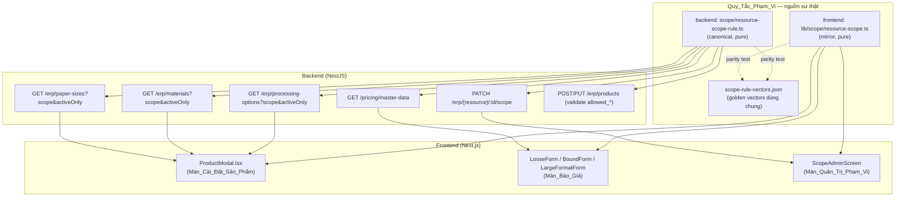

# Design Document — Phân loại phạm vi tài nguyên dùng chung (Resource Scope Config)

## Overview

Tài liệu này đặc tả thiết kế kỹ thuật cho việc thiết lập **một Quy_Tắc_Phạm_Vi (Scope Rule) duy nhất** — nguồn sự thật chung — để phân loại Tài_Nguyên_Dùng_Chung (Gia_Công `processing_options`, Vật_Tư `materials`, Khổ_Giấy `paper_sizes`) theo Phạm_Vi áp dụng (`offset`, `loose`, `bound`, `large_format`) dựa trên các Cờ_Phạm_Vi `scope_*` sẵn có.

Mục tiêu cốt lõi: **thứ tick được ở Màn_Cài_Đặt_Sản_Phẩm phải hiển thị được ở Màn_Báo_Giá tương ứng**. Triệu chứng "tick rồi mà không hiện" hiện nay xuất phát từ việc **hai nguồn dữ liệu dùng quy tắc lọc khác nhau**:

- `/erp/processing-options` (`ProcessingOptionsService.findAll()` / `MaterialsService.findAllProcessingOptions()`) → `repository.find()` trả **tất cả**, không lọc scope/active. Đây là nguồn `ProductModal.tsx` dùng.
- `/pricing/master-data` (`PricingFacadeService.getMasterData()`) → lọc bằng raw SQL/query builder loại Tài_Nguyên_Chỉ_Offset và lọc `is_active`.
- Frontend đã có **vá tạm** `scopedProcessing` (useMemo trong `ProductModal.tsx`) lọc lại phía client — quy tắc nằm rải rác, **không phải nguồn sự thật**.

### Nguyên tắc thiết kế cốt lõi

- **Một Quy_Tắc_Phạm_Vi thuần (pure function), là nguồn sự thật duy nhất.** Mọi nơi đọc tài nguyên (master-data, erp endpoints, ProductModal, các form báo giá, màn quản trị) đều đi qua cùng hàm phân loại.
- **KHÔNG đập đi xây lại, KHÔNG đổi schema.** Chỉ dùng các Cờ_Phạm_Vi `scope_*` và `is_active` đã tồn tại. Loại bỏ vá tạm `scopedProcessing` rải rác, thay bằng hàm chuẩn.
- **Bảo toàn giá đang đúng.** Việc phân loại không chạm số học của engine offset/digital; golden test offset chênh lệch bằng 0 (Req 6.5).
- **Chuẩn hoá khác biệt kiểu dữ liệu tại một chỗ.** `processing_options.scope_loose/bound/large_format` là `smallint` (0/1); `materials`/`paper_sizes` dùng `boolean` cho các cờ tương ứng; cả ba dùng `scope_offset` boolean. Quy_Tắc_Phạm_Vi chuẩn hoá mọi shape về một khái niệm Bật/Tắt duy nhất → quy tắc **group-agnostic** (Req 1.6, 6.2).
- **Nhất quán với `print-method-unification`.** Cùng mô hình "Tài nguyên dùng chung phân loại bằng cờ `scope_*`, offset đọc `scope_offset=true`", không nhân đôi danh mục (Req 6.1).

### Phạm vi (trong / ngoài)

| Trong phạm vi | Ngoài phạm vi |
|---|---|
| Quy_Tắc_Phạm_Vi thuần dùng chung (backend + frontend) | VAT, công thức/số học tính giá |
| Hợp nhất nguồn lọc cho erp endpoints + master-data | Thêm/đổi cột bảng (ngoài cờ scope sẵn có) |
| ProductModal đọc danh sách đã lọc + validate lưu | Tái cấu trúc engine báo giá |
| Màn_Quản_Trị_Phạm_Vi (gán cờ tường minh) | Migration dữ liệu scope (chỉ chỉnh qua UI quản trị) |

## Architecture

### Vị trí Quy_Tắc_Phạm_Vi và luồng dữ liệu



### Quyết định kiến trúc: làm sao backend và frontend KHÔNG lệch quy tắc

Đây là rủi ro chính của giải pháp "một quy tắc dùng hai phía". Đã cân nhắc ba phương án:

| Phương án | Ưu điểm | Nhược điểm | Quyết định |
|---|---|---|---|
| **A. Backend là nguồn, frontend gọi qua API** (mọi lọc/phân loại đi qua `/pricing` hoặc `/erp` đã lọc) | Một bản logic duy nhất, không thể lệch | Mất khả năng lọc tức thời client (đổi `quote_type` phải gọi lại API); phụ thuộc mạng cho thao tác UI thuần | Dùng cho **dữ liệu** (danh sách đã lọc trả từ API), KHÔNG dùng cho mọi tương tác |
| **B. Mirror logic hai phía + parity test** (canonical ở backend, bản sao frontend, golden vectors chung kiểm lệch) | Lọc client tức thời (đổi `quote_type` không cần gọi API); offline được | Có hai bản mã → cần test chống lệch | **CHỌN** |
| C. Shared npm package import cả hai phía | Một bản mã thật sự | Hạ tầng monorepo hiện chưa có shared package; chi phí thiết lập cao | Không chọn (chưa cần) |

**Giải pháp chọn (B + A cho dữ liệu):**

1. **Canonical** đặt ở backend `backend/src/modules/pricing/scope/resource-scope-rule.ts` — hàm thuần, không phụ thuộc TypeORM. Mọi endpoint backend lọc qua hàm này.
2. **Mirror** ở frontend `frontend/src/lib/scope/resource-scope.ts` — logic **giống hệt** từng dòng. ProductModal và các form dùng mirror để lọc/đánh dấu tức thời theo `quote_type` mà không gọi lại API.
3. **Chống lệch (drift guard):** một file vector chung `scope-rule-vectors.json` (danh sách `{flags, expectedScopes, expectedOffsetOnly}`) commit ở cả hai phía; **parity test hai phía** chạy toàn bộ vector qua hàm tương ứng và khẳng định kết quả trùng khớp (Property 10). Khi ai đó sửa một phía mà quên phía kia, test gãy.
4. **Dữ liệu danh sách** (số lượng tài nguyên, cờ) luôn lấy từ backend đã lọc qua canonical → frontend mirror chỉ tinh chỉnh hiển thị theo `quote_type`, không tự "phát minh" tài nguyên.

## Components and Interfaces

### 1. Quy_Tắc_Phạm_Vi (pure module) — canonical backend & mirror frontend

```typescript
// Phạm vi áp dụng
export type Scope = 'offset' | 'loose' | 'bound' | 'large_format';
// Loại sản phẩm in nhanh (tập con của Scope)
export type ProductType = 'loose' | 'bound' | 'large_format';

// Shape cờ dùng chung — chấp nhận cả smallint (processing_options) lẫn boolean (materials/paper_sizes)
export interface ScopeFlags {
  scope_loose?: number | boolean | null;
  scope_bound?: number | boolean | null;
  scope_large_format?: number | boolean | null;
  scope_offset?: boolean | number | null;
}

export interface ScopedResource extends ScopeFlags {
  id: number;
  is_active?: number | null;
}

/** Chuẩn hoá Bật/Tắt: 1 hoặc true = Bật; 0, false, null, undefined = Tắt. (Req 2.1, 6.2) */
export function isOn(flag: number | boolean | null | undefined): boolean;

/** is_active === 1 (smallint) coi là hoạt động; khác 1 hoặc null = không. (Req 3.6) */
export function isActive(is_active: number | null | undefined): boolean;

/** Tài nguyên có thuộc một Phạm_Vi cho trước không — KCK cờ tương ứng Bật. (Req 1.1, 2.2–2.5, 1.7) */
export function resourceInScope(flags: ScopeFlags, scope: Scope): boolean;

/** Tài_Nguyên_Chỉ_Offset: scope_offset Bật và cả 3 cờ in nhanh đều Tắt. (Req 2.6) */
export function isOffsetOnly(flags: ScopeFlags): boolean;

/** Trả về ĐÚNG tập các Phạm_Vi mà cờ tương ứng đang Bật (rỗng nếu tắt hết). (Req 2.7, 2.8, 6.7) */
export function classifyResource(flags: ScopeFlags): Scope[];

/** Nhãn hiển thị suy ra từ phân loại: 'Chỉ Offset' | danh sách scope in nhanh | 'Không thuộc phạm vi'. (Req 5.4) */
export function deriveScopeLabel(flags: ScopeFlags): string;
```

### 2. Lọc theo Loại_Sản_Phẩm và Trạng_Thái_Hoạt_Động (dùng chung)

```typescript
/**
 * Lọc danh sách tài nguyên cho luồng in nhanh theo một Loại_Sản_Phẩm.
 * Giữ lại r KHI VÀ CHỈ KHI: isActive(r) && resourceInScope(r, productType).
 * Hệ quả: Tài_Nguyên_Chỉ_Offset (mọi cờ in nhanh Tắt) bị loại tự nhiên.
 * Cùng một hàm được dùng ở Màn_Cài_Đặt_Sản_Phẩm và Màn_Báo_Giá. (Req 1.2–1.5, 3.1–3.6, 4.1, 4.2)
 */
export function filterForProductType<T extends ScopedResource>(
  resources: T[],
  productType: ProductType,
): T[];
```

### 3. Validate Danh_Sách_Được_Phép (ProductModal lưu sản phẩm)

```typescript
export interface AllowedValidationResult {
  ok: boolean;
  /** Các tài nguyên trong allowed nhưng KHÔNG thuộc phạm vi của productType. (Req 4.3, 4.5) */
  outOfScope: number[];
}

/**
 * Xác định ĐÚNG tập phần tử ngoài phạm vi trong một Danh_Sách_Được_Phép.
 * ok === (outOfScope.length === 0). (Req 4.3, 4.4, 4.5)
 */
export function validateAllowedList(
  allowed: number[],
  resourcesById: Map<number, ScopeFlags>,
  productType: ProductType,
): AllowedValidationResult;
```

### 4. Validate Cờ_Phạm_Vi đầu vào (Màn_Quản_Trị_Phạm_Vi)

```typescript
export interface ScopeFlagInput {
  scope_loose?: unknown;
  scope_bound?: unknown;
  scope_large_format?: unknown;
  scope_offset?: unknown;
}

export interface FlagValidationResult {
  ok: boolean;
  /** Tên cờ vi phạm: smallint khác 0/1, hoặc scope_offset khác true/false. (Req 5.8, 6.2, 6.6) */
  invalidFlags: string[];
}

/** Hợp lệ khi: 3 cờ smallint ∈ {0,1}, scope_offset ∈ {true,false}. (Req 5.8, 6.2) */
export function validateScopeFlags(input: ScopeFlagInput): FlagValidationResult;
```

### 5. Backend endpoints

**Hợp nhất nguồn đọc** — các endpoint erp nhận tham số lọc, đi qua canonical Quy_Tắc_Phạm_Vi (thay cho `repository.find()` trả tất cả):

```typescript
// GET /erp/processing-options?scope=loose|bound|large_format&activeOnly=true
// GET /erp/materials?scope=...&activeOnly=true
// GET /erp/paper-sizes?scope=...&activeOnly=true
//   - Khi có scope: trả các tài nguyên isActive && resourceInScope(r, scope) (loại Chỉ-Offset tự nhiên).
//   - Khi không có scope: hành vi tương thích ngược (trả tất cả) để không phá nơi gọi khác.
//   - Lọc luôn thực thi qua filterForProductType / resourceInScope, KHÔNG raw SQL rải rác mới.
interface ScopeListQuery { scope?: ProductType; activeOnly?: 'true' | 'false'; }

// PATCH /erp/processing-options/:id/scope   (tương tự materials, paper-sizes)
//   body: { scope_loose?: 0|1; scope_bound?: 0|1; scope_large_format?: 0|1; scope_offset?: boolean }
//   - validateScopeFlags trước khi ghi; 422 nếu không hợp lệ (giữ nguyên giá trị cũ).
//   - Trả về tài nguyên sau cập nhật + nhãn deriveScopeLabel.
interface UpdateScopeDto { scope_loose?: number; scope_bound?: number; scope_large_format?: number; scope_offset?: boolean; }

// POST/PUT /erp/products
//   - Trước khi lưu, validateAllowedList cho allowed_processing/_materials/_paper_sizes theo quote_type.
//   - Nếu có phần tử ngoài phạm vi → 422 + danh sách vi phạm, KHÔNG ghi. (Req 4.5)
```

`PricingFacadeService.getMasterData()` được refactor để lọc qua **cùng** canonical rule (thay raw SQL `NOT (scope_offset = true AND ...)` bằng lời gọi `filterForProductType`/`resourceInScope`), đảm bảo master-data và erp endpoints không còn hai quy tắc khác nhau.

### 6. Frontend — ProductModal & Màn_Quản_Trị_Phạm_Vi

- **ProductModal:** bỏ `scopedProcessing` useMemo vá tạm; thay bằng `filterForProductType(processing, form.quote_type)` (và áp dụng tương tự cho materials/paper_sizes nếu lọc theo scope). Hiển thị cảnh báo + dấu hiệu trực quan cho phần tử trong `allowed_*` mà `validateAllowedList` báo ngoài phạm vi (Req 4.3). Chặn lưu khi còn phần tử ngoài phạm vi, hiển thị lỗi nêu tên tài nguyên (Req 4.5).
- **ScopeAdminScreen (mới):** bảng tài nguyên 3 nhóm, cột cờ hiện tại + nhãn `deriveScopeLabel`; sửa cờ gọi `PATCH .../:id/scope`; cảnh báo xác nhận khi lưu tài nguyên tắt-hết-cờ (Req 5.6); toast lỗi giữ nguyên giá trị cũ khi lưu thất bại (Req 5.7).

## Data Models

**KHÔNG thay đổi cấu trúc bảng.** Chỉ dùng các cột đã tồn tại. Bảng dưới ghi rõ kiểu thật trong DB (đã xác minh):

| Bảng | Cờ in nhanh | `scope_offset` | `is_active` | Ghi chú |
|---|---|---|---|---|
| `processing_options` | `scope_loose`, `scope_bound`, `scope_large_format` — **smallint, nullable** | **boolean, nullable, default false** | **smallint default 1** | entity snake_case |
| `materials` | `scopeLoose`, `scopeBound`, `scopeLargeFormat` — **boolean** (DB snake_case) | **boolean default false** | (theo entity) | entity camelCase ↔ DB snake_case |
| `paper_sizes` | `scopeLoose`, `scopeBound`, `scopeLargeFormat` — **boolean** | **boolean default false** | (theo entity) | entity camelCase ↔ DB snake_case |

**Khác biệt kiểu được hấp thụ tại `isOn()`** — đây là điểm mấu chốt để Quy_Tắc_Phạm_Vi group-agnostic: smallint `1` và boolean `true` đều là Bật; `0`, `false`, `NULL`, thiếu đều là Tắt.

Read-model dùng chung phía ứng dụng (không phải bảng mới):

```typescript
interface ScopedResource {
  id: number;
  is_active?: number | null;       // so sánh = 1
  scope_loose?: number | boolean | null;
  scope_bound?: number | boolean | null;
  scope_large_format?: number | boolean | null;
  scope_offset?: boolean | number | null;
}
```

Ràng buộc dữ liệu (Req 6):
- `scope_offset` luôn diễn giải boolean, điều kiện offset là `scope_offset = true` (raw SQL Postgres) (Req 6.3).
- `is_active` smallint so sánh `= 1` (Req 3.6).
- Cờ smallint chỉ nhận 0/1; giá trị NULL hoặc ngoài {0,1} → coi như Tắt + phát chỉ báo lỗi dữ liệu, giữ giá đang đúng (Req 6.6).

## Correctness Properties

*Một property là một đặc tính hoặc hành vi phải luôn đúng trên mọi lần thực thi hợp lệ của hệ thống — về bản chất là một phát biểu hình thức về điều hệ thống phải làm. Property là cầu nối giữa đặc tả con-người-đọc-được và bảo đảm tính đúng đắn máy-kiểm-chứng-được.*

Sau bước prework và property reflection (gộp các tiêu chí trùng lặp về cùng một hàm thuần), tập property dưới đây là tối thiểu nhưng phủ hết các tiêu chí kiểm thử được. Mỗi property ánh xạ tới một hoặc nhiều acceptance criteria.

### Property 1: Chuẩn hoá Bật/Tắt của Cờ_Phạm_Vi

*For any* giá trị cờ thuộc {1, 0, true, false, null, undefined}, `isOn(value)` trả về true KHI VÀ CHỈ KHI value === 1 hoặc value === true; mọi giá trị còn lại (0, false, null, undefined) trả về false.

**Validates: Requirements 2.1, 6.2**

### Property 2: Thuộc Phạm_Vi khi và chỉ khi cờ tương ứng Bật

*For any* `ScopeFlags` ngẫu nhiên (gồm cả giá trị null/undefined/thiếu) và *for any* `scope` ∈ {offset, loose, bound, large_format}, `resourceInScope(flags, scope)` trả về true KHI VÀ CHỈ KHI `isOn` của cờ tương ứng với `scope` là true. Khi cờ thiếu/null/rỗng, tài nguyên không thuộc phạm vi đó.

**Validates: Requirements 1.1, 1.7, 2.2, 2.3, 2.4, 2.5, 6.3, 6.6, 6.7**

### Property 3: classifyResource trả về đúng tập các phạm vi đang Bật

*For any* `ScopeFlags` ngẫu nhiên, `classifyResource(flags)` trả về đúng tập hợp `{ s | resourceInScope(flags, s) }` — không thừa, không thiếu — và trả về tập rỗng khi và chỉ khi mọi cờ đều Tắt.

**Validates: Requirements 2.7, 2.8, 6.7**

### Property 4: Định nghĩa Tài_Nguyên_Chỉ_Offset

*For any* `ScopeFlags` ngẫu nhiên, `isOffsetOnly(flags)` trả về true KHI VÀ CHỈ KHI `scope_offset` đang Bật và đồng thời cả ba cờ `scope_loose`, `scope_bound`, `scope_large_format` đều Tắt.

**Validates: Requirements 2.6**

### Property 5: Lọc theo Loại_Sản_Phẩm chỉ giữ tài nguyên trong phạm vi và đang hoạt động

*For any* danh sách `ScopedResource` ngẫu nhiên và *for any* `productType` ∈ {loose, bound, large_format}, một tài nguyên `r` nằm trong `filterForProductType(list, productType)` KHI VÀ CHỈ KHI `isActive(r)` và `resourceInScope(r, productType)`. Hệ quả: mọi Tài_Nguyên_Chỉ_Offset và mọi tài nguyên `is_active ≠ 1` đều bị loại.

**Validates: Requirements 1.3, 1.4, 1.5, 3.1, 3.2, 3.3, 3.4, 3.5, 3.6, 4.1, 4.2**

### Property 6: Màn_Cài_Đặt và Màn_Báo_Giá cho tập trùng khớp

*For any* danh sách `ScopedResource` và *for any* `productType`, tập tài nguyên hiển thị tại Màn_Cài_Đặt_Sản_Phẩm và tập tại Màn_Báo_Giá là bằng nhau (cả hai cùng đi qua `filterForProductType` với cùng tham số).

**Validates: Requirements 1.2**

### Property 7: Quy_Tắc_Phạm_Vi bất biến theo kiểu cờ (group-agnostic)

*For any* tập cờ logic ngẫu nhiên (4 giá trị Bật/Tắt), khi biểu diễn dưới dạng smallint (0/1, như `processing_options`) và dưới dạng boolean (false/true, như `materials`/`paper_sizes`), `classifyResource` cho ra kết quả phân loại trùng khớp hoàn toàn.

**Validates: Requirements 1.6**

### Property 8: Validate Danh_Sách_Được_Phép xác định đúng phần tử ngoài phạm vi

*For any* Danh_Sách_Được_Phép `allowed` và *for any* `productType`, `validateAllowedList(allowed, resourcesById, productType)` có `outOfScope` bằng đúng tập `{ id ∈ allowed | not resourceInScope(resource(id), productType) }`, và `ok === (outOfScope.length === 0)`. Hàm không làm thay đổi dữ liệu đầu vào.

**Validates: Requirements 4.3, 4.4, 4.5**

### Property 9: Validate giá trị Cờ_Phạm_Vi đầu vào

*For any* `ScopeFlagInput` ngẫu nhiên, `validateScopeFlags(input)` có `ok === true` KHI VÀ CHỈ KHI `scope_offset` ∈ {true, false} (hoặc vắng mặt) và mỗi cờ smallint `scope_loose`/`scope_bound`/`scope_large_format` ∈ {0, 1} (hoặc vắng mặt); ngược lại `ok === false` và `invalidFlags` liệt kê đúng các tên cờ vi phạm.

**Validates: Requirements 5.8, 6.2**

### Property 10: Quy tắc backend và frontend không lệch nhau (drift guard)

*For any* `ScopeFlags` trong tập vector dùng chung `scope-rule-vectors.json`, hàm canonical phía backend và hàm mirror phía frontend cho ra `classifyResource` và `isOffsetOnly` trùng khớp hoàn toàn.

**Validates: Requirements 1.1, 1.2**

### Property 11: Bảo toàn giá Offset sau khi áp dụng phân loại

*For any* bộ dữ liệu đầu vào báo giá Offset trong tập golden, kết quả giá sau khi áp dụng phân loại phạm vi bằng đúng kết quả giá trước khi áp dụng, với chênh lệch bằng 0.

**Validates: Requirements 6.5**

## Error Handling

| Tình huống | Xử lý | Tiêu chí |
|---|---|---|
| Cờ smallint NULL hoặc ngoài {0,1}; `scope_offset` NULL | Coi như Tắt (không thuộc phạm vi); **phát log cảnh báo dữ liệu** nêu rõ `resourceId` + tên cờ vi phạm; **không** chặn luồng, giữ nguyên giá đang đúng | 6.6, 1.7 |
| PATCH scope với giá trị không hợp lệ (`validateScopeFlags.ok === false`) | Trả `422 Unprocessable Entity` kèm `invalidFlags`; **không** ghi DB; giữ nguyên giá trị cờ hiện tại | 5.8 |
| Lưu sản phẩm khi `allowed_*` còn phần tử ngoài phạm vi | Trả `422` kèm danh sách `outOfScope` (mã/tên tài nguyên vi phạm); **không** ghi; dữ liệu chưa lưu được giữ nguyên ở client | 4.5 |
| PATCH scope thất bại ở tầng DB (lỗi ghi) | Trả lỗi `500`; frontend giữ nguyên giá trị cờ trước khi lưu và hiển thị toast lỗi | 5.7 |
| Lưu tài nguyên với toàn bộ cờ Tắt | Không phải lỗi; frontend hiển thị cảnh báo "tài nguyên sẽ không thuộc phạm vi nào" và yêu cầu Admin xác nhận trước khi gửi PATCH | 5.6 |
| Endpoint erp gọi không có tham số `scope` | Hành vi tương thích ngược (trả tất cả) — không phá nơi gọi cũ; chỉ các nơi cần lọc mới truyền `scope`/`activeOnly` | — |
| `master-data` truy vấn processing_options lỗi | Bắt lỗi, log, trả mảng rỗng cho nhóm đó (giữ hành vi hiện tại) | — |

Quy ước: lỗi 422 trả `{ success: false, error, details }` để frontend hiển thị thông báo nêu đích danh tài nguyên/cờ vi phạm.

## Testing Strategy

### Cách tiếp cận kép

- **Property-based tests**: phủ các property phổ quát (P1–P11) trên không gian đầu vào lớn.
- **Unit/example tests**: phủ các tiêu chí UI/persistence không kiểm được bằng property — `1.8` (đổi cờ→báo giá lần tải sau), `5.1`–`5.3`, `5.5`–`5.7` (render bảng quản trị, lưu+xác nhận 3s, ngữ nghĩa phiên, cảnh báo confirm, giữ giá trị khi lỗi), nhãn `5.4`.
- **Integration tests**: PATCH scope rồi GET lại để xác nhận giá trị mới phản ánh ở lần tải kế tiếp (1.8, 5.3); validate lưu sản phẩm qua `POST/PUT /erp/products` trả 422 đúng (4.5).

### Khung và cấu hình PBT

- **Thư viện**: `fast-check` (v3) + Jest — đã dùng sẵn trong `frontend/src/lib/scope/*.property.spec.ts`. Backend dùng cùng `fast-check` cho module canonical.
- **Tối thiểu 100 iteration** mỗi property (theo tiền lệ repo dùng 200).
- **Generators**: cờ scope sinh từ `fc.constantFrom(0, 1, true, false, null, undefined)` để phủ cả null/kiểu lẫn lộn; `productType` từ `fc.constantFrom('loose','bound','large_format')`; danh sách tài nguyên từ `fc.array(...)` với `id` duy nhất; `is_active` từ `fc.constantFrom(0, 1, null, 2)`.
- **Tag bắt buộc** trên mỗi property test, định dạng: `Feature: resource-scope-config, Property N: <nội dung>`.

### Ánh xạ property → test (mỗi property đúng MỘT property-based test)

| Property | Vị trí test | Ghi chú |
|---|---|---|
| P1 isOn | `resource-scope-rule.isOn.property.spec.ts` (backend) | bảng giá trị Bật/Tắt |
| P2 membership | `resource-scope-rule.in-scope.property.spec.ts` | gồm null/missing → off |
| P3 classifyResource | `resource-scope-rule.classify.property.spec.ts` | tập == đúng on-scopes |
| P4 isOffsetOnly | `resource-scope-rule.offset-only.property.spec.ts` | |
| P5 filterForProductType | `resource-scope-rule.filter.property.spec.ts` | membership ⇔ active ∧ in-scope |
| P6 setup/quote parity | `resource-scope-rule.screen-parity.property.spec.ts` | hai caller trùng tập |
| P7 group-agnostic | `resource-scope-rule.group-agnostic.property.spec.ts` | smallint vs boolean |
| P8 allowed-list validation | `validate-allowed-list.property.spec.ts` | outOfScope đúng tập |
| P9 validateScopeFlags | `validate-scope-flags.property.spec.ts` | invalidFlags đúng |
| P10 backend/frontend parity | `resource-scope-parity.property.spec.ts` (cả hai phía) | qua `scope-rule-vectors.json` |
| P11 offset price preservation | `offset-price-preservation.golden.spec.ts` | **golden test** — input cố định, so khớp baseline đã khoá |

### Golden test (Property 11)

Tập input offset đại diện được khoá trong fixtures; chạy engine offset trước/sau khi tích hợp phân loại, khẳng định **chênh lệch giá = 0**. Đây là cơ chế canh không-hồi-quy cho cam kết "bảo toàn giá đang đúng" (Req 6.5), không chạy 100+ iteration vì input là tập cố định đã xác minh.

### Unit/integration tiêu biểu (không PBT)

- ProductModal: bỏ `scopedProcessing`, render danh sách từ `filterForProductType`; hiển thị badge "ngoài phạm vi" cho phần tử `outOfScope`; chặn lưu khi có vi phạm (example).
- ScopeAdminScreen: render cờ + nhãn `deriveScopeLabel`; confirm khi tắt-hết-cờ; toast giữ giá trị cũ khi PATCH lỗi.
- Backend e2e: `PATCH /erp/processing-options/:id/scope` invalid → 422; valid → GET phản ánh; `master-data` và `/erp/processing-options?scope=loose` trả **cùng** tập (xác nhận một nguồn sự thật).
