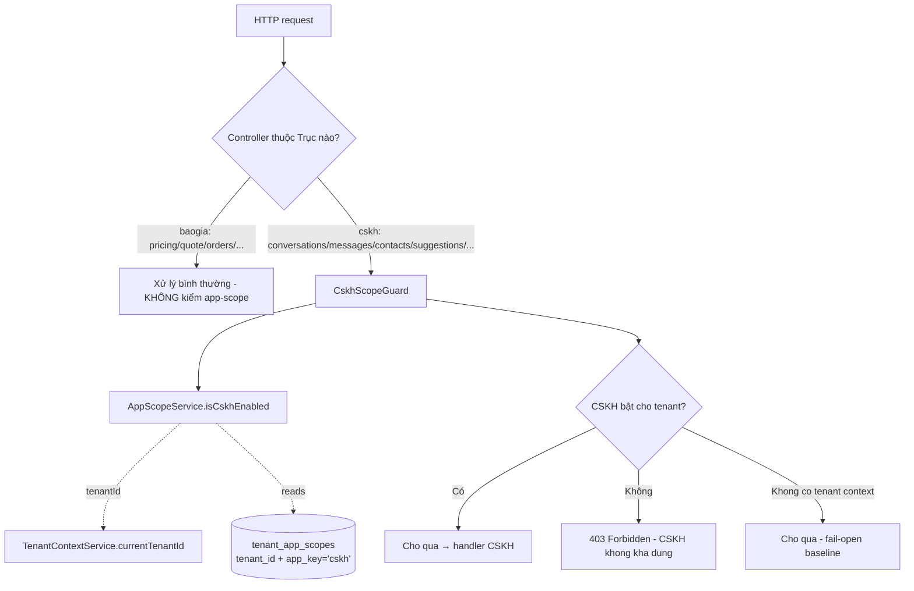

# Design Document — tenant-app-scope

## Overview

Tính năng cho phép Super_Admin cấp cho mỗi Tenant chỉ Trục **Báo_Giá** (`baogia`) hoặc cả **Báo_Giá + CSKH** (`cskh`). Báo_Giá là lõi bất khả tắt; chỉ Trục CSKH bật/tắt được.

Ba bất biến (giống `tenant-method-capability`):
- **Chỉ cổng (gate) truy cập Trục, KHÔNG đổi logic nghiệp vụ/số học giá** (Req 8).
- **Fail-closed ở backend, fail-open ở UI** — backend là lớp chặn uy tín; UI chỉ ẩn cho gọn.
- **Tương thích ngược** — Tenant chưa cấu hình giữ hành vi hiện tại (CSKH bật).

Cách tiếp cận lõi: một **bảng mới** `tenant_app_scopes(tenant_id nullable, app_key, enabled)` theo đúng mẫu baseline-inheritance đã kiểm chứng (`tenant_id IS NULL` = mặc định nền), một **resolver** đọc theo tenant context, một **Guard** dùng chung cắm vào các controller Trục CSKH, và một **hook chặn** cho đường chạy nền CSKH.

Vì sao **bảng mới** (không tái dùng `method_capabilities`): app-scope là khái niệm khác cấp (cả một Trục, không phải một phương pháp in). Hai tính năng độc lập và trực giao (một Tenant có thể vừa chỉ-Báo_Giá vừa chỉ-offset). Tách bảng giữ blast radius nhỏ và ngữ nghĩa rõ.

## Architecture

### Request → app-scope check → handler



### Component mới / thay đổi

| Component | Loại | Vai trò |
|---|---|---|
| `tenant_app_scopes` (bảng mới) | DB | Lưu Cờ_Phạm_Vi CSKH theo tenant; hàng `tenant_id IS NULL` = baseline |
| `TenantAppScope` entity | Entity mới | Ánh xạ bảng trên |
| `AppScopeService` | Service mới | Resolver tenant-aware (đọc theo context) + toggle admin |
| `CskhScopeGuard` | Guard mới | Chặn controller Trục CSKH khi tenant tắt CSKH (403) |
| Enforcement nền | Edit | message-processor / follow-up: bỏ qua an toàn khi tenant CSKH tắt |
| Super-admin app-scope endpoints + UI | Mới | Toggle CSKH theo tenant |
| `useEnabledApps` (FE) | Mới | Lấy tập Trục_Khả_Dụng theo tenant; lọc menu theo `axis` |

## Components and Interfaces

### Bảng & entity (Req 1, 7)

```sql
-- 2026-07-02_tenant_app_scope.sql  (PostgreSQL, idempotent)
CREATE TABLE IF NOT EXISTS tenant_app_scopes (
  id          SERIAL PRIMARY KEY,
  tenant_id   INTEGER NULL,                 -- NULL = baseline (mặc định nền)
  app_key     VARCHAR(30) NOT NULL,         -- hiện chỉ 'cskh' (baogia luôn bật, không lưu cờ tắt)
  enabled     BOOLEAN NOT NULL DEFAULT true,
  updated_at  TIMESTAMP NOT NULL DEFAULT now()
);

-- Baseline: CSKH bật cho mọi tenant chưa cấu hình (tương thích ngược — Req 2.2).
INSERT INTO tenant_app_scopes (tenant_id, app_key, enabled)
SELECT NULL, 'cskh', true
WHERE NOT EXISTS (SELECT 1 FROM tenant_app_scopes WHERE tenant_id IS NULL AND app_key = 'cskh');

-- Đúng-một-trạng-thái: baseline (1 hàng/app_key) + theo tenant (1 hàng/(tenant,app_key)).
CREATE UNIQUE INDEX IF NOT EXISTS uq_app_scope_baseline
  ON tenant_app_scopes (app_key) WHERE tenant_id IS NULL;
CREATE UNIQUE INDEX IF NOT EXISTS uq_app_scope_tenant
  ON tenant_app_scopes (tenant_id, app_key) WHERE tenant_id IS NOT NULL;
```

KHÔNG backfill tenant nào → mọi tenant hiện hữu "chưa cấu hình" → kế thừa baseline (CSKH bật) → 0 thay đổi hành vi (Req 7.3).

Entity: `@Column({name:'tenant_id', type:'int', nullable:true}) tenantId?: number|null;` + `app_key`, `enabled`, `@UpdateDateColumn`.

### Resolver (Req 2, 3)

```ts
type AppKey = 'baogia' | 'cskh';

@Injectable()
class AppScopeService {
  // baogia LUÔN có trong tập; cskh theo cờ (explicit → baseline).
  async resolveEnabledApps(): Promise<AppKey[]>          // đọc tenant từ context
  async isCskhEnabledForTenant(tenantId: number|null): Promise<boolean>
  async setCskhForTenant(tenantId: number, enabled: boolean): Promise<TenantAppScope>
  async getScopeForTenant(tenantId: number): Promise<{ cskh: boolean; source: 'explicit'|'inherited' }>
}
```

Phân giải xác định (Req 2.5):
1. Tenant có hàng tường minh `(tenant_id, 'cskh')` → dùng `enabled` đó.
2. Không có → kế thừa baseline `(tenant_id IS NULL, 'cskh')` = `true` (Req 2.1, 2.2).
3. (Plan phase) Tenant gán Plan liên kết scope → suy dẫn từ Plan thay bước 2 (Req 2.3) — thiết kế nhưng có thể hoãn.

Quy tắc:
- **Bỏ qua mọi định danh phạm vi từ client** (Req 3.2): chỉ dùng `TenantContextService.currentTenantId()`.
- **Không có tenant context** (null): coi CSKH bật (baseline) → cho qua. Nhất quán với quyết định của `tenant-method-capability` (null → baseline, tránh gãy khi flag mặc định OFF và cho đường nền — Req 4.6, 9.3).
- **RLS OFF** (Req 3.3): đọc qua repo mặc định, lọc theo `tenantId` ở tầng app, áp baseline cho chưa-cấu-hình.
- **RLS ON** (Req 3.4): đọc qua EntityManager theo-request (`SET LOCAL app.current_tenant`), không đọc chéo. Hàng baseline (`tenant_id IS NULL`) phải đọc được bởi mọi tenant → policy tách đọc/ghi (xem Data Models).

### Enforcement: CskhScopeGuard (Req 4)

Guard NestJS cắm vào các controller Trục CSKH. Idiomatic hơn nhúng check vào từng handler, và gate cả Trục đúng bản chất.

```ts
@Injectable()
class CskhScopeGuard implements CanActivate {
  constructor(private appScope: AppScopeService, private tenant: TenantContextService) {}
  async canActivate(ctx: ExecutionContext): Promise<boolean> {
    if (ctx.getType() !== 'http') return true;         // WS xử lý riêng (xem dưới)
    if (this.tenant.currentTenantId() == null) return true;   // fail-open khi thiếu context (Req 4.6)
    const on = await this.appScope.isCskhEnabledForTenant(this.tenant.currentTenantId());
    if (!on) throw new ForbiddenException('Trục CSKH không khả dụng cho đơn vị của bạn.');
    return true;
  }
}
```

Controller Trục CSKH cần gắn `@UseGuards(AuthGuard('jwt'), CskhScopeGuard)` (JWT phải chạy trước để có `req.user` → tenant context):

| Controller | Prefix | Ghi chú |
|---|---|---|
| `ConversationsController` | `/conversations` | inbox |
| `MessagesController` | `/conversations` (sub-routes) | tin nhắn |
| `ChatMediaController` / `MediaController` | `/chat-media`, `/media` | media chat |
| `ContactsController` | `/contacts` | danh bạ CSKH |
| `SuggestionsController` | `/suggestions` | chatbot/ai-suggest |
| `TestChatController` | `/test-chat` | thử chatbot |
| KB controllers | `/kb`, `/knowledge` | knowledge base |

**Boundary case (quyết định trong tasks):** `ProductTemplatesController` (`/product-templates`) nằm trong `suggestions` module nhưng bọc `ProductsService` (dữ liệu Báo_Giá). KHÔNG gate controller này — nó phục vụ catalog sản phẩm, không phải bề mặt CSKH. Gate ở cấp controller (không cấp module) để tránh chặn nhầm.

Không đụng route Trục Báo_Giá (Req 4.2): pricing/quote/orders/products/materials/customers... không gắn guard.

### Đường chạy nền CSKH (Req 4.6, 9.3)

Zalo inbound (`message-processor.service`), cron follow-up (`follow-up.service`), sla-monitor... chạy ngoài request người dùng. Các đường này ĐÃ có `tenantId` (resolve từ `channels.tenant_id` / job payload — theo tenant-data-isolation). Thêm guard mềm: trước khi xử lý cho một tenant, kiểm `isCskhEnabledForTenant(tid)`; nếu tắt → **bỏ qua an toàn** (log + return), KHÔNG throw (không phá loop nền của tenant khác).

```ts
// trong processInbound / forEachTenant callback
if (!(await this.appScope.isCskhEnabledForTenant(tenantId))) {
  this.logger.debug(`[cskh-scope] tenant ${tenantId} tắt CSKH — bỏ qua inbound`);
  return;
}
```

Gated sau `TENANT_RLS_ENABLED`? KHÔNG — app-scope hoạt động độc lập với RLS (giống method-capability). Nhưng khi flag mặc định (chưa tenant nào tắt CSKH) thì check luôn trả `true` → 0 thay đổi hành vi.

### WebSocket (events.gateway) — Req 9.6

Socket đã join room `tenant:<id>`. Không cần gate cứng ở WS: tenant tắt CSKH sẽ không mở UI inbox nên không subscribe. Giữ nguyên; cô lập đã có qua room + FE ẩn menu. (Nếu sau cần gate cứng: từ chối join room CSKH khi scope tắt — ngoài phạm vi bản này.)

### Admin surface (Req 6)

Backend (super-admin module), `@Roles(SUPER_ADMIN)`:
```
GET  /super-admin/tenants/:id/app-scope           → { cskh: boolean, source: 'explicit'|'inherited' }
PUT  /super-admin/tenants/:id/app-scope/cskh      body {enabled} → 200
```
KHÔNG có endpoint tắt `baogia` (Req 6.3). Không có ràng buộc "last app" như method-capability vì baogia luôn bật → tắt cskh luôn hợp lệ.

Frontend: mục "Phạm vi ứng dụng" trên modal tenant ở `/super-admin` (cạnh nút "Năng lực" của method-capability) — 1 toggle **CSKH**, hiện nguồn (kế thừa/tường minh). Báo_Giá hiển thị dạng khoá-bật (không toggle được).

### Frontend phản ánh phạm vi (Req 5)

- Hook mới `useEnabledApps()` → `GET /me/app-scope` (hoặc tái dùng payload capabilities) trả `{ enabledApps: ['baogia', ...] }` theo tenant token.
- `PricingSidebar` / IA: lọc menu theo `axis` của `scope-registry.json` — nếu `cskh` không trong `enabledApps` thì ẩn mọi entry `axis==='cskh'`. Tái dùng `axisMatchesApp` ([ia-resolver.ts:43](frontend/src/lib/scope/ia-resolver.ts#L43)) + thêm 1 tầng lọc theo app-scope (song song với lọc theo role hiện có).
- **Fail-open** (Req 5.4): lỗi/đang tải → không ẩn. `axis==='baogia'|'shared'` luôn hiện (Req 5.3).
- Điều hướng trực tiếp tới route CSKH khi tắt → guard FE (giống `guardMethodRoute`) chuyển hướng/hiện "không khả dụng" (Req 5.6).

## Data Models

Bảng `tenant_app_scopes` (trên). Hai không gian: baseline (`tenant_id IS NULL`) + theo tenant.

**RLS policy (Req 7.4)** — áp dụng bài học từ `method_capabilities`: TÁCH đọc/ghi để tenant UPDATE không đụng baseline (tránh lỗi "row violates RLS"):
```sql
CREATE POLICY app_scope_read ON tenant_app_scopes FOR SELECT
  USING (current_setting('app.bypass',true)='on'
         OR tenant_id IS NULL
         OR tenant_id = nullif(current_setting('app.current_tenant',true),'')::int);
CREATE POLICY app_scope_write ON tenant_app_scopes FOR ALL
  USING (current_setting('app.bypass',true)='on'
         OR tenant_id = nullif(current_setting('app.current_tenant',true),'')::int)
  WITH CHECK (current_setting('app.bypass',true)='on'
         OR tenant_id = nullif(current_setting('app.current_tenant',true),'')::int);
ALTER TABLE tenant_app_scopes ENABLE ROW LEVEL SECURITY;
ALTER TABLE tenant_app_scopes FORCE ROW LEVEL SECURITY;
```
KHÔNG đưa `tenant_app_scopes` vào vòng lặp NOT-NULL/auto-set của Phase B (baseline là NULL). Ghi vào runbook.

## Correctness Properties

Property 1: Xác định — `resolveEnabledApps()` cho một tenant luôn trả đúng một tập: `baogia` luôn có; `cskh` = hàng tường minh nếu có, ngược lại baseline.
**Validates: Requirements 2.5**

Property 2: baogia bất khả tắt — với mọi cấu hình, `baogia ∈ resolveEnabledApps()`.
**Validates: Requirements 1.2**

Property 3: Không ảnh hưởng chéo tenant — đổi cờ tenant A không đổi tập của tenant B.
**Validates: Requirements 1.5, 9.5**

Property 4: Tương thích ngược — tenant chưa cấu hình hành xử như trước (CSKH bật).
**Validates: Requirements 2.2, 8.2**

Property 5: Chặn nhất quán — CSKH tắt → mọi Route_CSKH bị chặn giống nhau (403); route baogia không bị đụng.
**Validates: Requirements 4.4, 4.2**

## Error Handling

| Tình huống | Phản hồi | Req |
|---|---|---|
| CSKH tắt, route CSKH (HTTP) | `403 Forbidden`, chỉ nêu Trục bị chặn | 4.1, 4.5 |
| CSKH tắt, đường nền | Bỏ qua an toàn (log, return), không throw | 4.6, 9.3 |
| Thiếu tenant context | Cho qua (fail-open baseline) | 4.6 |
| Cố tắt baogia | Endpoint không tồn tại; nếu gọi → từ chối | 6.3 |
| RLS ON, đọc scope | Chỉ baseline + hàng tenant hiện hành | 3.4, 9.5 |

## Testing Strategy

Verify (cwd `backend/`): `npx tsc --noEmit` + `npx jest app-scope cskh --runInBand`.

| Nhóm | Phủ |
|---|---|
| Unit — resolver | explicit off/on; chưa cấu hình → baseline (cskh on); baogia luôn có |
| Guard | CSKH off + tenant context → 403; CSKH on → pass; null context → pass (fail-open) |
| Enforcement route | tenant off gọi `/conversations`,`/suggestions`,`/contacts` → 403; `/pricing/*` không bị đụng |
| Nền | tenant off: inbound Zalo bị bỏ qua (không throw); tenant khác vẫn xử lý |
| Migration | idempotent (chạy 2 lần); không backfill; tenant chưa cấu hình vẫn cskh on |
| Isolation | RLS ON: tenant A không đọc/bị ảnh hưởng cờ tenant B; baseline đọc được bởi mọi tenant; tenant UPDATE baseline → 0 hàng, không lỗi |
| Regression | test CSKH (inbox/messages/suggestions) + giá giữ xanh |
| Type check | `tsc --noEmit` = 0 lỗi |

## Rollout & Backward Compatibility

1. Migration tạo bảng + baseline `cskh=true` (idempotent, không backfill) → mọi tenant kế thừa baseline → **0 thay đổi khi chưa cấu hình**.
2. Deploy backend: resolver + guard + endpoints. Baseline bật CSKH → không chặn ai cho tới khi admin tắt.
3. Deploy FE: `useEnabledApps` lọc menu (không đổi UI khi CSKH còn bật).
4. Admin tắt CSKH cho tenant chỉ-Báo_Giá khi cần. Policy RLS thêm vào runbook, bật cùng lộ trình `TENANT_RLS_ENABLED`.

Rollback: gỡ guard (bảng để lại vô hại; baseline giữ hành vi cũ).

## Requirements Traceability

| Requirement | Design section |
|---|---|
| 1. Mô hình phạm vi | Bảng & entity; Resolver |
| 2. Mặc định tương thích ngược | Bảng (baseline row); Resolver (quy tắc) |
| 3. Phân giải backend | Resolver (bỏ qua client, RLS OFF/ON) |
| 4. Enforce route CSKH | CskhScopeGuard; Đường nền |
| 5. Frontend phản ánh | Frontend phản ánh phạm vi |
| 6. Quản trị | Admin surface |
| 7. Migration | Data Models (idempotent, RLS policy tách đọc/ghi) |
| 8. Bảo toàn nghiệp vụ | Chỉ gate; Testing (regression) |
| 9. Ca biên | Resolver (null context), Đường nền, WS, Error Handling |
