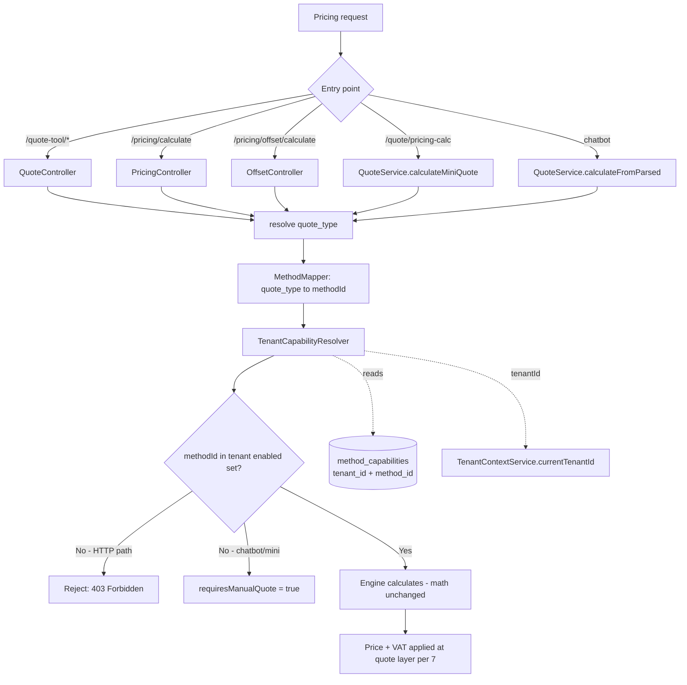

# Design Document — tenant-method-capability

## Overview

This feature enables per-tenant toggling of each **Print Method** (`digital` = quick print, `offset`) and **enforces** that capability across **all pricing entry points** — not only the unified `/quote-tool/*` flow.

The design follows three invariants:
- **Gate access only, never touch price/VAT math** — the VAT single-source invariant (audit-rules §7) is preserved; no engine math changes (Req 8).
- **Fail-closed on the backend, fail-open in the UI** — the backend is the authoritative access gate; the UI only hides for clarity.
- **Backward compatible** — an unconfigured tenant keeps current behavior (both methods enabled).

Core approach: extend `method_capabilities` with a nullable `tenant_id` column (keeping `unit_id` for compatibility), add a single **capability resolver** that reads by tenant context, a single shared **`quote_type → methodId` mapper**, and a small reusable **guard** plugged into each pricing entry point.

## Architecture

### Request → capability check → engine



### New / changed components

| Component | Kind | Role |
|---|---|---|
| `method_capabilities.tenant_id` | DB column (new, nullable) | Binds a capability flag to a tenant |
| `resolveMethodForQuoteType()` | Pure function (new) | Single source of truth for `quote_type → methodId` |
| `CapabilityService` (extended) | Service | Tenant-aware read/write; resolves tenant from context |
| `assertMethodEnabled()` | Helper (new) | Consistent check + error for HTTP paths |
| Enforcement hooks | Edit | Digital facade, offset controller, mini, chatbot |
| Super-admin capability endpoints + UI | New | Per-tenant enable/disable management |
| `useEnabledMethods` (FE) | Edit | Resolve by current tenant (drop `unitId='default'`) |

## Components and Interfaces

### Method mapping (Req 5)

Single source of truth at `backend/src/quote/method-mapping.ts`:

```ts
export const DIGITAL_QUOTE_TYPES = ['loose', 'bound', 'large_format'] as const;
export const OFFSET_QUOTE_TYPES  = ['to_roi','bi_thu_folder','sp_khac','hop_giay','tui_giay'] as const;

/** quote_type → methodId; null if unrecognized (Req 5.4). */
export function resolveMethodForQuoteType(quoteType?: string): MethodId | null {
  if (!quoteType) return null;
  if ((DIGITAL_QUOTE_TYPES as readonly string[]).includes(quoteType)) return 'digital';
  if ((OFFSET_QUOTE_TYPES  as readonly string[]).includes(quoteType)) return 'offset';
  return null;
}
```

Existing duplicated `DIGITAL_QUOTE_TYPES` constants (in `quote.service.ts` and plugins) are re-pointed at this file to keep one source (Req 5.5). Values are unchanged, so no behavior change. An unrecognized `quote_type` is rejected as "unrecognized product type", kept distinct from the "method disabled" error (Req 5.4, 10.2).

### Capability resolver (Req 2, 3, 10)

Extend `CapabilityService` with tenant-aware methods, keeping the old signatures for backward compatibility:

```ts
async getEnabledMethodsForTenant(tenantId: number | null): Promise<MethodId[]>
async isEnabledForTenant(tenantId: number | null, methodId: MethodId): Promise<boolean>
async setFlagForTenant(tenantId: number, methodId: MethodId, enabled: boolean): Promise<MethodCapability>
async listFlagsForTenant(tenantId: number | null): Promise<MethodCapability[]>

/** Runtime resolver: reads tenant from context. */
async resolveEnabledMethods(): Promise<MethodId[]> {
  const tenantId = this.tenantCtx?.currentTenantId() ?? null;
  return this.getEnabledMethodsForTenant(tenantId);
}
```

Deterministic resolution (Req 2.5):
1. Tenant has ≥1 explicit row (`tenant_id=<id>`) → use that set (ignore baseline).
2. Tenant has no rows → **inherit the baseline** = global row (`tenant_id IS NULL`), currently `{digital, offset}` (Req 2.1, 2.2).
3. (Plan phase) Tenant assigned a Plan with `capabilities` → default derived from the Plan instead of step 2 (Req 2.3). Linkage designed but can be phased.

Rules:
- **Ignore client-supplied `unitId`** (Req 3.2): new paths use only `TenantContextService`.
- **Controlled fail-closed (Req 3.3):** with RLS OFF (default), an authenticated request still carries tenant context (set by the interceptor). If `currentTenantId()` returns `null` (running outside a valid scope), treat as no capability → reject. Internal jobs run inside `withTenant/runSystem` with their own context.
- **RLS OFF (Req 3.4, 10.5):** read `method_capabilities` via the default repo, filter by `tenantId` in the app layer; apply baseline default for unconfigured tenants.
- **RLS ON (Req 3.5, 10.6):** read via the request-scoped EntityManager (already `SET LOCAL app.current_tenant`) so no cross-tenant reads. The baseline row (`tenant_id IS NULL`) must be readable by every tenant → use an RLS policy that allows reading rows where `tenant_id IS NULL` OR `tenant_id = current_tenant`. Documented in the RLS runbook.

### Enforcement points (Req 4, 10)

Shared assert helper for HTTP paths:

```ts
async function assertMethodEnabled(cap: CapabilityService, methodId: MethodId) {
  const enabled = await cap.resolveEnabledMethods();
  if (!enabled.includes(methodId)) {
    throw new ForbiddenException(`Print method '${methodId}' is not available for your unit.`);
  }
}
```

| Entry point | Hook location | On disabled |
|---|---|---|
| `/quote-tool/calculate` | switch existing `isEnabled` to tenant `resolveEnabledMethods` | 403 (unchanged — Req 4.5) |
| `/quote-tool/methods`, `/compare` | filter by tenant `resolveEnabledMethods` | filter (unchanged) |
| `POST /pricing/calculate` | `PricingController`: map `input.type→methodId`, `assertMethodEnabled` before facade | 403 (Req 4.1) |
| `POST /pricing/offset/calculate` | `OffsetController`: `assertMethodEnabled('offset')` | 403 (Req 4.2) |
| `POST /quote/pricing-calc` (mini) | `QuoteService.calculateMiniQuote`: map `product_type→methodId`; if disabled return `{requiresManualQuote:true, reason}` | manual-quote (Req 4.3) |
| chatbot `calculateFromParsed` | map `parsed.type→methodId`; if disabled return `requiresManualQuote` | manual-quote, not 403 (Req 4.4) |

All paths use the same `resolveMethodForQuoteType` + `resolveEnabledMethods` (Req 4.6). Error messages name only the blocked methodId, never another tenant's config (Req 4.7). The pre-existing `DIGITAL_QUOTE_TYPES` guard in mini/chatbot stays (it blocks "offset leaking into the digital engine"); the new check adds the tenant-capability gate before pricing.

### Capability admin service & last-method rule (Req 6)

- `setFlagForTenant(tenantId, methodId, false)` keeps **LastEnabledMethodError** but computes "last enabled method" per tenant (via `getEnabledMethodsForTenant`). If a tenant is currently inheriting the baseline (no explicit rows) and an admin disables one method, the system **materializes** the baseline into explicit tenant rows first, then applies the toggle, so state is deterministic.
- Old signatures `getEnabledMethods(unitId)` / `isEnabled(unitId,...)` / `setFlag(unitId,...)` are unchanged (existing tests and `/quote-tool` continue), internally mapping `unitId='default' → tenant_id IS NULL`.

### Admin surface (Req 6)

Backend (super-admin module), `@Roles(SUPER_ADMIN)`:
```
GET  /super-admin/tenants/:id/capabilities              → { flags[], enabledMethods[], source: 'explicit'|'inherited' }
PUT  /super-admin/tenants/:id/capabilities/:methodId    body {enabled} → 200 | 409 (LastEnabled)
```
(Plan phase) `POST /super-admin/plans/:id/capabilities` assigns a default set to a Plan; assigning a Plan to a tenant derives the default (Req 2.3, 6.4) — designed but phased. If Admin_Tenant management is enabled (Req 6.5), the tenant-scoped endpoint acts only on the caller's own tenant (tenantId from context, not a param).

Frontend: a "Quote capabilities" section on the tenant detail page in `/super-admin` — toggle digital/offset, show source (inherited/explicit), block disabling the last method (surface 409).

### Frontend reflects per-tenant capability (Req 9)

- `useEnabledMethods`: drop `unitId='default'`; call `GET /quote-tool/capabilities` (no unitId) — the backend resolves by the token's tenant context. `enabledMethods` is now per tenant.
- `filterMenuByCapability` / `guardMethodRoute`: logic unchanged, only the data source changes.
- **Fail-open UI (Req 9.3):** on error / while loading → do not hide; backend still fail-closes.

## Data Models

Add `tenant_id INTEGER NULL` to `method_capabilities`, keeping `unit_id` to preserve old data/behavior.

Why "add a column" over a new table:
- Reuses the existing entity, service, and tests (small blast radius — audit §4).
- `tenant_id NULL` represents the legacy unit/global config (`unit_id='default'`) and acts as the **baseline default** when a tenant is unconfigured.
- RLS compatibility: `tenant_id` matches other org-scoped tables and can join an RLS policy later without structural change.

Two separated spaces:
- Baseline (global): `tenant_id IS NULL`, `unit_id='default'` — seeded `digital=true, offset=true`.
- Per-tenant: `tenant_id = <id>`, that tenant's explicit config.

Unique constraints: keep the old `UNIQUE (unit_id, method_id)` for baseline rows; add a partial unique index for tenant rows (Postgres allows multiple NULLs, so a plain unique on `tenant_id` would not serve).

```sql
-- 2026-07-01_tenant_method_capability.sql  (PostgreSQL, idempotent)
ALTER TABLE method_capabilities ADD COLUMN IF NOT EXISTS tenant_id INTEGER NULL;
CREATE UNIQUE INDEX IF NOT EXISTS uq_method_cap_tenant_method
  ON method_capabilities (tenant_id, method_id) WHERE tenant_id IS NOT NULL;
-- Baseline global rows unchanged (already seeded 'default'); NO tenant backfill
-- → every existing tenant is "unconfigured" = inherits baseline (both enabled).
```

Entity change: add `@Column({ name:'tenant_id', type:'int', nullable:true }) tenantId?: number | null;` and keep `@Unique(['unitId','methodId'])`; the per-tenant uniqueness is enforced by the DB partial index (not redeclared in the entity to avoid a duplicate index).

## Correctness Properties

Property 1: Determinism — for any tenant, `resolveEnabledMethods()` returns exactly one well-defined set: explicit rows if present, else baseline.
**Validates: Requirements 2.5**

Property 2: No cross-tenant influence — toggling tenant A never changes tenant B's enabled set.
**Validates: Requirements 1.5, 10.6**

Property 3: Consistent enforcement — a disabled method is blocked identically across every pricing entry point.
**Validates: Requirements 4.6**

Property 4: Backward compatibility — an unconfigured tenant behaves exactly as before the feature (both methods enabled) for identical inputs.
**Validates: Requirements 2.2, 8.3**

Property 5: Price/VAT invariance — enabling a method returns prices byte-identical to pre-feature for golden-locked cases; VAT remains single-sourced at the quote layer.
**Validates: Requirements 8.1, 8.2, 8.3**

Property 6: Mapping totality — every known `quote_type` maps to exactly one methodId; an unknown value maps to null and is rejected distinctly.
**Validates: Requirements 5.3, 5.4**

## Error Handling

| Situation | Response | Requirement |
|---|---|---|
| Method disabled, HTTP pricing path | `403 ForbiddenException`, names blocked method only | 4.1, 4.2, 4.7 |
| Method disabled, chatbot/mini | `requiresManualQuote = true` with reason (no throw) | 4.3, 4.4 |
| Missing/invalid tenant context | Reject (fail-closed), do not default to an arbitrary tenant | 3.3 |
| Unrecognized `quote_type` | Reject "unrecognized product type" (distinct from disabled) | 5.4, 10.2 |
| Method not registered in registry | Reject "method not supported" (distinct from disabled) | 10.2 |
| Disable last enabled method | `409 Conflict` (LastEnabledMethodError), state unchanged | 6.3, 6.6 |
| Tenant with 0 enabled methods | Reject all pricing with "no method available" | 10.1 |

## Testing Strategy

Verification (cwd `backend/`): `npx tsc --noEmit -p tsconfig.json` + `npx jest pricing quote capability --runInBand`.

| Group | Coverage |
|---|---|
| Unit — mapper | `resolveMethodForQuoteType`: 3 digital→digital, 5 offset→offset, unknown→null |
| Unit — resolver | explicit config; unconfigured → inherits baseline {digital,offset}; 0-method tenant |
| Enforcement (per endpoint) | `/pricing/calculate` digital off→403; `/pricing/offset/calculate` offset off→403; mini offset off→manual; chatbot offset off→requiresManualQuote; `/quote-tool/calculate` still 403 |
| Constraint | disabling a tenant's last method→409; baseline materialization on first disable |
| Migration | idempotent (run twice), no lost rows, unconfigured tenant still both-enabled |
| Tenant isolation | RLS ON: tenant A cannot read/be affected by tenant B flags |
| Price regression | rerun golden offset + property + pricing-flow/quote → stay green (unchanged) |
| Type check | `npx tsc --noEmit` = 0 errors |

## Rollout & Backward Compatibility

1. Migration adds column + index (idempotent) — no tenant backfill → every existing tenant inherits the baseline (both enabled) → **zero behavior change while unconfigured**.
2. Deploy backend: resolver + enforcement + endpoints. Because the baseline enables both, enforcement blocks nobody until an admin disables one.
3. Deploy FE: `useEnabledMethods` per tenant (no UI change while both enabled).
4. Admin toggles per tenant as needed. The RLS policy for `method_capabilities` is added to the runbook and enabled along the `TENANT_RLS_ENABLED` rollout.

Rollback: remove enforcement hooks (the `tenant_id` column is harmless to leave; baseline rows keep old behavior).

## Requirements Traceability

| Requirement | Design section |
|---|---|
| 1. Per-tenant model | Data Models (tenant_id, per-tenant unique) |
| 2. Backward-compat default | Data Models (baseline row), Capability resolver (resolution rules) |
| 3. Backend resolution | Capability resolver (ignore client unitId, fail-closed, RLS OFF/ON) |
| 4. Enforce all paths | Method mapping, Enforcement points table |
| 5. quote_type↔method mapping | Method mapping (`method-mapping.ts`) |
| 6. Administration | Admin service (per-tenant LastEnabled), Admin surface (endpoints/UI/Plan) |
| 7. Migration | Data Models (idempotent migration, RLS-compatible) |
| 8. Price/VAT preservation | Correctness Properties #5, Testing (price regression) |
| 9. Frontend | Frontend reflects per-tenant capability |
| 10. Edge cases | Capability resolver (0-method, RLS), Method mapping (unknown→null), Error Handling |
