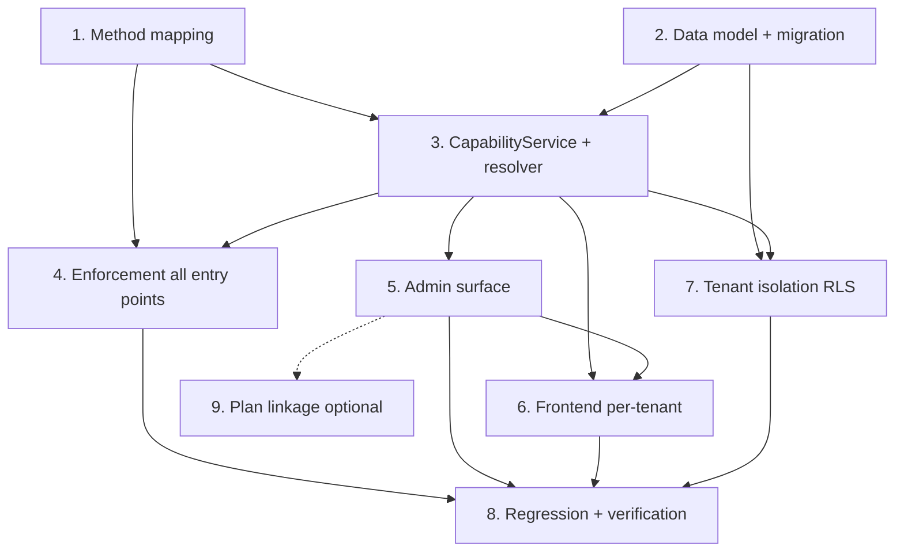

# Implementation Plan — tenant-method-capability

## Overview

Per-tenant gating of print methods (`digital`/`offset`) enforced across all pricing entry points, with a backward-compatible baseline (unconfigured tenant = both enabled) and no changes to price/VAT math. Tasks are ordered so the shared mapper and data model land first, then the resolver, then enforcement, then admin/FE, then isolation and full regression.

## Tasks

- [x] 1. Shared method mapping (single source of truth)
  - Create `backend/src/quote/method-mapping.ts` exporting `DIGITAL_QUOTE_TYPES`, `OFFSET_QUOTE_TYPES`, and `resolveMethodForQuoteType(quoteType?): MethodId | null`.
  - Re-point the duplicated `DIGITAL_QUOTE_TYPES` constant in `backend/src/modules/quote/quote.service.ts` and the plugins (`digital-method.plugin.ts`, `offset-method.plugin.ts`) to import from this file; keep values identical (no behavior change).
  - Add unit tests: 3 digital→'digital', 5 offset→'offset', unknown/empty→null.
  - _Requirements: 5.1, 5.2, 5.3, 5.4, 5.5_

- [x] 2. Data model: tenant scoping for method_capabilities
  - [x] 2.1 Migration `backend/db/2026-07-01_tenant_method_capability.sql`
    - `ALTER TABLE method_capabilities ADD COLUMN IF NOT EXISTS tenant_id INTEGER NULL`.
    - `CREATE UNIQUE INDEX IF NOT EXISTS uq_method_cap_tenant_method ON method_capabilities (tenant_id, method_id) WHERE tenant_id IS NOT NULL`.
    - No tenant backfill (existing tenants inherit baseline). Idempotent, PostgreSQL.
    - _Requirements: 7.1, 7.2, 7.3, 7.5_
  - [x] 2.2 Update entity `backend/src/entities/method-capability.entity.ts`
    - Add `tenantId?: number | null` mapped to `tenant_id`; keep existing `@Unique(['unitId','methodId'])` (per-tenant uniqueness handled by DB partial index).
    - _Requirements: 1.1, 7.5_
  - [x] 2.3 Migration idempotency + schema test
    - Test: running the migration twice yields the same schema, no duplicate index, no lost baseline rows.
    - _Requirements: 7.2, 7.3_

- [x] 3. Tenant-aware CapabilityService + resolver
  - [x] 3.1 Add tenant-aware methods
    - Add `getEnabledMethodsForTenant`, `isEnabledForTenant`, `setFlagForTenant`, `listFlagsForTenant` to `backend/src/quote/capability.service.ts`.
    - Keep old `unitId`-based signatures intact (map `unitId='default' → tenant_id IS NULL`).
    - Inject `TenantContextService` (optional) and add `resolveEnabledMethods()` reading `currentTenantId()`.
    - _Requirements: 3.1, 3.2, 6.2_
  - [x] 3.2 Deterministic resolution + baseline inheritance
    - Explicit tenant rows → use them; else inherit baseline (`tenant_id IS NULL`, currently {digital, offset}).
    - Fail-closed when tenant context missing (`currentTenantId()` null) on protected paths.
    - _Requirements: 2.1, 2.2, 2.5, 3.3, 3.4, 10.1_
  - [x] 3.3 Last-method rule per tenant + baseline materialization
    - `setFlagForTenant(..., false)`: if tenant inherits baseline, materialize baseline into explicit rows first, then apply; throw `LastEnabledMethodError` when disabling the last enabled method of an operating tenant.
    - _Requirements: 6.3, 6.6_
  - [x] 3.4 Unit tests for resolver/service
    - explicit config; unconfigured→baseline; 0-method tenant; last-method 409; materialization on first disable.
    - _Requirements: 2.2, 2.5, 6.3, 10.1_

- [x] 4. Enforcement across all pricing entry points
  - [x] 4.1 Shared `assertMethodEnabled(cap, methodId)` helper (throws 403)
    - Place in `backend/src/quote/`; uses `resolveEnabledMethods()`; error names only the blocked method.
    - _Requirements: 4.6, 4.7_
  - [x] 4.2 Enforce on `POST /pricing/calculate`
    - In `PricingController.calculatePrice`: map `input.type→methodId` via mapper; `assertMethodEnabled('digital')` (unknown type → distinct "unrecognized" error); then call facade unchanged.
    - _Requirements: 4.1, 5.4, 10.2, 10.4_
  - [x] 4.3 Enforce on `POST /pricing/offset/calculate`
    - In `OffsetController.calculate`: `assertMethodEnabled('offset')` before engine.
    - _Requirements: 4.2, 10.3_
  - [x] 4.4 Enforce on mini `calculateMiniQuote`
    - Map `product_type→methodId`; if disabled return `{requiresManualQuote:true, reason}` (no throw).
    - _Requirements: 4.3, 10.3, 10.4_
  - [x] 4.5 Enforce on chatbot `calculateFromParsed`
    - Map `parsed.type→methodId`; if disabled return `requiresManualQuote` with clear reason (not 403).
    - _Requirements: 4.4, 10.3, 10.4_
  - [x] 4.6 Switch `/quote-tool/*` to tenant resolution
    - `QuoteController` calculate/methods/compare use `resolveEnabledMethods()` (tenant) instead of `unitId`; preserve existing 403/filter behavior.
    - _Requirements: 4.5, 4.6_
  - [x] 4.7 Enforcement integration tests (per endpoint)
    - digital off→403 on `/pricing/calculate`; offset off→403 on `/pricing/offset/calculate`; mini offset off→manual; chatbot offset off→requiresManualQuote; `/quote-tool/calculate` still 403; unregistered method → distinct error.
    - _Requirements: 4.1, 4.2, 4.3, 4.4, 4.5, 4.6, 10.2_

- [x] 5. Admin surface (super-admin)
  - [x] 5.1 Backend endpoints
    - `GET /super-admin/tenants/:id/capabilities` → `{ flags, enabledMethods, source }`; `PUT /super-admin/tenants/:id/capabilities/:methodId` → 200|409. Guard `@Roles(SUPER_ADMIN)`.
    - _Requirements: 6.1, 6.2, 6.3_
  - [x] 5.2 Controller/service tests
    - view returns source explicit/inherited; toggle persists; last-method→409; role restricted to SUPER_ADMIN.
    - _Requirements: 6.1, 6.2, 6.3_
  - [x] 5.3 Frontend management UI
    - Add "Quote capabilities" section on tenant detail in `/super-admin`: toggle digital/offset, show source, surface 409 on last-method.
    - _Requirements: 6.1, 6.2, 6.3_

- [x] 6. Frontend capability reflection per tenant
  - Update `frontend/src/lib/scope/use-enabled-methods.ts` to call `GET /quote-tool/capabilities` without `unitId` (backend resolves by tenant); keep `filterMenuByCapability`/`guardMethodRoute` fail-open.
  - Update/adjust related FE tests.
  - _Requirements: 9.1, 9.2, 9.3, 9.4_

- [x] 7. Tenant isolation (RLS) for capability reads
  - Ensure per-tenant reads respect tenant context; add RLS policy note/entry for `method_capabilities` allowing `tenant_id IS NULL OR tenant_id = current_tenant`; document in `backend/db/TENANT-RLS-RUNBOOK.md`.
  - Add tenant-isolation test (RLS ON): tenant A cannot read/be affected by tenant B flags.
  - _Requirements: 3.5, 10.5, 10.6_

- [x] 8. Price/VAT regression + full verification
  - Run `npx tsc --noEmit -p tsconfig.json` (backend) → 0 errors.
  - Run `npx jest pricing quote capability --runInBand` and confirm golden offset + property + pricing-flow tests stay green (no number/tolerance changes).
  - Frontend: `npx tsc --noEmit` + affected `npx jest`.
  - _Requirements: 8.1, 8.2, 8.3, 8.4_

- [ ]* 9. (Optional, phased) Plan → capability linkage
  - `POST /super-admin/plans/:id/capabilities`; assigning a Plan to a tenant derives default capabilities (used only when tenant has no explicit rows).
  - _Requirements: 2.3, 6.4_

## Task Dependency Graph

```json
{
  "waves": [
    { "wave": 1, "tasks": ["1", "2"] },
    { "wave": 2, "tasks": ["3"] },
    { "wave": 3, "tasks": ["4", "5", "7"] },
    { "wave": 4, "tasks": ["6"] },
    { "wave": 5, "tasks": ["8"] },
    { "wave": 6, "tasks": ["9"] }
  ],
  "dependencies": {
    "1": [],
    "2": [],
    "3": ["1", "2"],
    "4": ["1", "3"],
    "5": ["3"],
    "6": ["3", "5"],
    "7": ["2", "3"],
    "8": ["4", "5", "6", "7"],
    "9": ["5"]
  }
}
```



## Notes

- **Backward compatibility:** no tenant backfill in the migration → every existing tenant inherits the baseline (both methods enabled), so enforcement blocks nobody until an admin disables a method.
- **VAT/price invariant (§7):** this feature only gates access; no engine math changes. Golden/property price tests must stay green with no number/tolerance edits.
- **Fail-closed backend, fail-open UI:** backend rejects disabled methods (403 for HTTP, `requiresManualQuote` for chatbot/mini); the UI only hides menus and fails open on load errors.
- **RLS gating:** works with `TENANT_RLS_ENABLED` OFF (default) and ON; baseline row (`tenant_id IS NULL`) must remain readable by all tenants via policy.
- Task 9 is optional (`*`) and can be deferred; core feature is complete after tasks 1–8.
