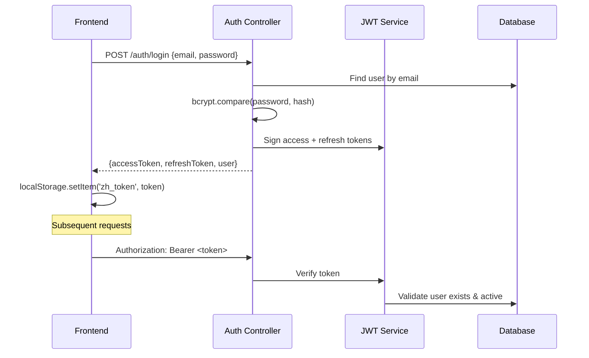
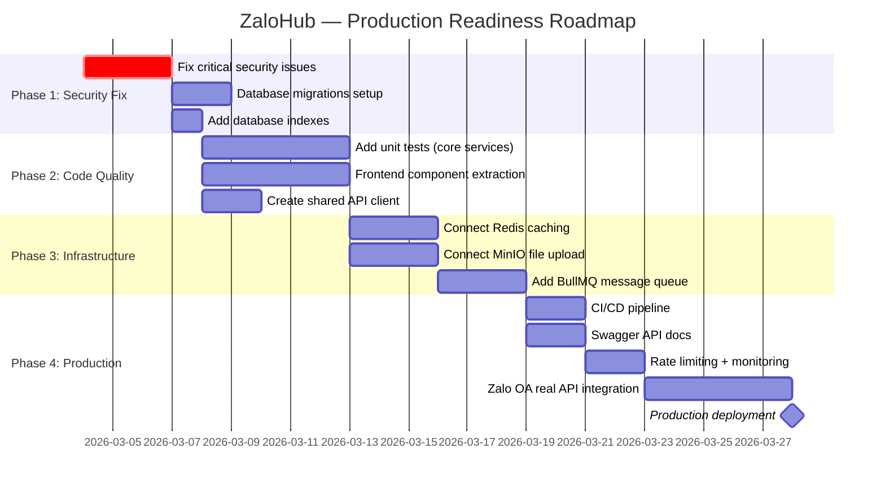

# 🔍 ZaloHub — Comprehensive Project Review

> **Review Date**: 2026-03-03  
> **Reviewer**: AI Code Review Agent  
> **Project**: ZaloHub — AI Agent Assist cho CSKH ngành In ấn  
> **Tech Stack**: NestJS + TypeORM + SQLite/Postgres | Next.js 16 + React 19 | Socket.IO | Docker Compose

---

## Mục lục

1. [Kiến trúc tổng quan](#1-kiến-trúc-tổng-quan)
2. [Backend Review](#2-backend-review)
3. [Frontend Review](#3-frontend-review)
4. [Tính năng chính](#4-tính-năng-chính)
5. [DevOps & Infrastructure](#5-devops--infrastructure)
6. [Code Quality](#6-code-quality)
7. [Security](#7-security)
8. [Performance](#8-performance)
9. [Những thứ còn thiếu](#9-những-thứ-còn-thiếu)
10. [Điểm mạnh](#10-điểm-mạnh)
11. [Điểm yếu (theo mức độ ưu tiên)](#11-điểm-yếu)
12. [Action Items](#12-action-items)
13. [Điểm đánh giá tổng](#13-điểm-đánh-giá-tổng)
14. [Roadmap đề xuất](#14-roadmap-đề-xuất)

---

## 1. Kiến trúc tổng quan

### 1.1 Sơ đồ kiến trúc hệ thống

```mermaid
graph TB
    subgraph "Frontend — Next.js 16 + React 19"
        FE_Login["Login Page"]
        FE_Layout["App Layout<br/>(Sidebar + Header)"]
        FE_Inbox["Inbox Page"]
        FE_Contacts["Contacts Page"]
        FE_Dashboard["Dashboard"]
        FE_KB["Knowledge Base"]
        FE_QuickReply["Quick Replies"]
        FE_Quote["Quote Tool"]
        FE_Pricing["Pricing Settings"]
        FE_Reports["Reports"]
        FE_Settings["Settings"]
        FE_Auth["AuthContext<br/>(JWT localStorage)"]
        FE_Socket["SocketContext<br/>(Socket.IO)"]
    end

    subgraph "Backend — NestJS 10"
        BE_Auth["Auth Module<br/>(JWT + bcrypt)"]
        BE_Users["Users Module"]
        BE_Conversations["Conversations Module"]
        BE_Messages["Messages Module"]
        BE_Suggestions["Suggestions Module<br/>(OpenAI + Fallback)"]
        BE_KB["Knowledge Base Module"]
        BE_Quote["Quote Module<br/>(Parser + Calculator)"]
        BE_Pricing["Pricing Data Controllers<br/>(110+ endpoints)"]
        BE_Dashboard["Dashboard Module"]
        BE_Gateway["WebSocket Gateway<br/>(Socket.IO)"]
        BE_Channels["Channels Module<br/>(Webhook + Adapters)"]
        BE_CannedResp["Canned Responses"]
        BE_Reports["Reports Module"]
        BE_Audit["Audit Module"]
        BE_Notes["Notes Module"]
    end

    subgraph "Database"
        DB_SQLite["SQLite (Dev)"]
        DB_Postgres["PostgreSQL 16<br/>+ pgvector"]
    end

    subgraph "Infrastructure — Docker Compose"
        Redis["Redis 7<br/>(Cache/Queue)"]
        MinIO["MinIO<br/>(S3 Storage)"]
        Grafana["Grafana<br/>(Monitoring)"]
    end

    subgraph "External"
        ZaloOA["Zalo OA API"]
        OpenAI["OpenAI GPT-4"]
    end

    FE_Auth --> BE_Auth
    FE_Socket --> BE_Gateway
    FE_Inbox --> BE_Conversations
    FE_Inbox --> BE_Messages
    FE_Inbox --> BE_Suggestions
    FE_Quote --> BE_Quote
    FE_Pricing --> BE_Pricing
    FE_Dashboard --> BE_Dashboard

    BE_Auth --> DB_SQLite
    BE_Auth --> DB_Postgres
    BE_Conversations --> DB_SQLite
    BE_Conversations --> DB_Postgres
    BE_Suggestions --> OpenAI
    BE_Channels --> ZaloOA
    BE_Quote --> DB_SQLite
```



### 1.2 Module Map

| Module             | Files | Mô tả                                                   |
| ------------------ | ----- | ------------------------------------------------------- |
| `auth`             | 6     | JWT login/refresh, Passport strategy, role guard        |
| `users`            | 4     | User CRUD                                               |
| `channels`         | 8     | Zalo OA adapter, webhook controller, mock endpoint      |
| `conversations`    | 4     | Conversation lifecycle, state machine transitions       |
| `messages`         | 4     | Message CRUD, idempotency key, message processor        |
| `suggestions`      | 4     | AI suggestion pipeline (OpenAI + template fallback)     |
| `knowledge-base`   | 3     | Document upload, chunking, search                       |
| `quote`            | 28    | Pricing calculator (3 modes), extractors, seeds, parser |
| `dashboard`        | 3     | KPI aggregation                                         |
| `gateway`          | 2     | WebSocket (Socket.IO) real-time events                  |
| `canned-responses` | 3     | Quick reply templates                                   |
| `reports`          | 2     | Agent metrics, CSV export                               |
| `contacts`         | 2     | Contact management                                      |
| `notes`            | 2     | Internal notes on conversations                         |
| `audit`            | 3     | Audit logging                                           |

### 1.3 Đánh giá Separation of Concerns

| Tiêu chí                      | Đánh giá     | Chi tiết                                                                                                            |
| ----------------------------- | ------------ | ------------------------------------------------------------------------------------------------------------------- |
| Module isolation              | ✅ Tốt        | Các module NestJS tách biệt rõ ràng                                                                                 |
| Entity-Service-Controller     | ✅ Tốt        | Tuân thủ MVC pattern                                                                                                |
| Frontend-Backend separation   | ✅ Tốt        | Giao tiếp qua REST API + WebSocket                                                                                  |
| Business logic location       | ⚠️ Trung bình | `pricing-data.controller.ts` (666 lines, 110+ endpoints) chứa nhiều CRUD trực tiếp trong controller thay vì service |
| Frontend component extraction | ❌ Yếu        | Tất cả page là single monolithic file (quote=917 lines, pricing=880 lines)                                          |

---

## 2. Backend Review

### 2.1 Entities (32 files)

**Ưu điểm:**
- Sử dụng TypeORM decorators đúng chuẩn (`@Entity`, `@Column`, `@ManyToOne`, `@OneToMany`)
- Column naming convention nhất quán (`snake_case` cho DB, `camelCase` cho TS)
- UUID cho primary key ở các entity chính (User, Conversation, Message, Contact)
- Enum types được define rõ ràng (`ConversationStatus`, `UserRole`, v.v.)
- `simple-json` type cho metadata fields — phù hợp với cả SQLite và Postgres

**Vấn đề:**

| Mức độ   | Vấn đề                                                                                                                  | File                |
| -------- | ----------------------------------------------------------------------------------------------------------------------- | ------------------- |
| ⚠️ High   | Không có `@Index` decorator trên bất kỳ entity nào — sẽ gây chậm khi data lớn                                           | Tất cả entity files |
| ⚠️ Medium | `Product` dùng `PrimaryGeneratedColumn()` (auto-increment number) trong khi các entity khác dùng UUID — không nhất quán | `product.entity.ts` |
| ⚠️ Medium | Thiếu soft-delete (`deletedAt` column) cho các entity quan trọng                                                        | Hầu hết entities    |

### 2.2 Modules & Services

**Ưu điểm:**
- `ConversationsService`: Triển khai state machine transitions với `VALID_TRANSITIONS` map — rất tốt
- `QuoteService`: Engine báo giá 3 modes (loose/bound/large_format) hoàn chỉnh, 745 lines code logic
- `AiSuggestService`: Dual strategy — OpenAI API + template fallback khi không có API key
- `MessagesService`: Idempotency key check — pattern tốt
- `WebhookController`: Dùng `setImmediate()` để async processing, trả 200 ngay cho Zalo

**Vấn đề:**

| Mức độ     | Vấn đề                                                                                                                                      | File                                       |
| ---------- | ------------------------------------------------------------------------------------------------------------------------------------------- | ------------------------------------------ |
| 🔴 Critical | `pricing-data.controller.ts` = 666 lines, 110+ endpoints, 10+ controllers trong 1 file. Vi phạm Single Responsibility, khó maintain và test | `modules/quote/pricing-data.controller.ts` |
| ⚠️ High     | `QuoteService` = 745 lines — nên tách thành `QuoteCalculatorService`, `QuoteSeedService`, v.v.                                              | `modules/quote/quote.service.ts`           |
| ⚠️ Medium   | `findBreachedSla()` — load ALL conversations rồi filter in-memory thay vì dùng WHERE clause                                                 | `conversations.service.ts` line 133-139    |
| ⚠️ Medium   | `DashboardService.getKpi()` — gọi 12+ COUNT queries riêng biệt thay vì batch query                                                          | `dashboard.service.ts`                     |
| ℹ️ Low      | Thiếu DTO validation cho `pricing-data.controller.ts` — dùng `Partial<Entity>` trực tiếp                                                    | `pricing-data.controller.ts`               |

### 2.3 API Conventions

| Tiêu chí          | Đánh giá                                                  |
| ----------------- | --------------------------------------------------------- |
| RESTful naming    | ✅ `/api/v1/conversations`, `/api/v1/messages`             |
| Versioning        | ✅ `/api/v1/` prefix                                       |
| Pagination        | ✅ Có trong `findAll()`                                    |
| Validation        | ⚠️ `ValidationPipe` global nhưng nhiều endpoint thiếu DTO  |
| Error handling    | ✅ `NotFoundException`, `BadRequestException` được sử dụng |
| HTTP status codes | ✅ `@HttpCode` được set đúng                               |

### 2.4 Authentication Flow



**Vấn đề Auth:**

| Mức độ     | Vấn đề                                                                                          |
| ---------- | ----------------------------------------------------------------------------------------------- |
| 🔴 Critical | Logout không invalidate token (chỉ return success message) — token vẫn valid cho đến khi expire |
| ⚠️ High     | Refresh token không có rotation — cùng 1 refresh token dùng mãi trong 7 ngày                    |
| ⚠️ High     | `expiresIn: 3600` hardcoded trong response thay vì tính từ cấu hình                             |
| ⚠️ Medium   | Debug `console.log` lộ password hash type info (`auth.service.ts` line 29)                      |

### 2.5 WebSocket

**Ưu điểm:**
- JWT authentication cho WebSocket connections
- Room-based architecture: `user:{id}`, `conversation:{id}`
- Proper cleanup khi disconnect (remove from `connectedUsers` map)
- Multiple tabs support (Set of socket IDs per user)

**Vấn đề:**

| Mức độ     | Vấn đề                                                               |
| ---------- | -------------------------------------------------------------------- |
| 🔴 Critical | `cors: { origin: '*' }` — cho phép mọi domain kết nối WebSocket      | `events.gateway.ts` line 17 |
| ⚠️ Medium   | `connectedUsers` Map lưu in-memory — không scale được multi-instance | `events.gateway.ts`         |

### 2.6 Seed Data & Migration

- Seed data từ JSON files trong `modules/quote/seeds/` — tốt, dễ maintain
- `synchronize: true` cho cả SQLite lẫn Postgres — **NGUY HIỂM cho production** (auto-alter tables)
- Không có migration files — chỉ dùng auto-sync

---

## 3. Frontend Review

### 3.1 Pages Overview

| Page                     | Lines | Complexity                                           |
| ------------------------ | ----- | ---------------------------------------------------- |
| `quote/page.tsx`         | 917   | 🔴 Rất cao — 3 tabs, calculation logic, form handling |
| `pricing/page.tsx`       | 880   | 🔴 Rất cao — 10+ CRUD tabs, modal forms               |
| `inbox/page.tsx`         | 563   | ⚠️ Cao — 3-pane layout, real-time, AI panel           |
| `settings/page.tsx`      | 302   | ⚠️ Trung bình                                         |
| `contacts/page.tsx`      | 249   | ✅ Hợp lý                                             |
| `kb/page.tsx`            | 222   | ✅ Hợp lý                                             |
| `quick-replies/page.tsx` | 184   | ✅ Tốt                                                |
| `dashboard/page.tsx`     | 168   | ✅ Tốt                                                |
| `reports/page.tsx`       | 157   | ✅ Tốt                                                |

### 3.2 Component Structure

| Tiêu chí             | Đánh giá                                                  |
| -------------------- | --------------------------------------------------------- |
| Component extraction | ❌ Yếu — Tất cả logic + UI dồn vào 1 page file             |
| Reusable components  | ❌ Không có shared component library riêng                 |
| Type definitions     | ⚠️ Types define inline trong mỗi page file, không shared   |
| Shared utilities     | ⚠️ Chỉ `pricing/shared.tsx` có `Modal`, `Field`, `Toolbar` |

### 3.3 State Management

| Pattern       | Sử dụng                                                       |
| ------------- | ------------------------------------------------------------- |
| React Context | `AuthContext`, `SocketContext` — đủ dùng cho scope hiện tại   |
| Local state   | `useState` cho mọi page — phù hợp                             |
| Server state  | Fetch trực tiếp bằng `fetch()` — chưa dùng SWR/React Query    |
| Data fetching | ⚠️ Mỗi page tự quản lý `useEffect` + fetch — nhiều boilerplate |

### 3.4 Responsive Design & Accessibility

| Tiêu chí               | Đánh giá                                                     |
| ---------------------- | ------------------------------------------------------------ |
| Responsive breakpoints | ⚠️ Chỉ 1 breakpoint `768px` trong `globals.css`               |
| Mobile sidebar         | ✅ Sidebar thu nhỏ thành 60px trên mobile                     |
| AI pane mobile         | ⚠️ AI pane bị `display: none` trên mobile — mất tính năng     |
| Accessibility (a11y)   | ❌ Không có ARIA labels, role attributes, keyboard navigation |
| Semantic HTML          | ⚠️ Sử dụng `<div>` thay vì `<main>`, `<section>`, `<article>` |
| Focus management       | ❌ Không có visible focus indicators                          |

### 3.5 Error Handling & Loading States

| Tiêu chí           | Đánh giá                                          |
| ------------------ | ------------------------------------------------- |
| Loading indicators | ⚠️ Có nhưng không nhất quán giữa các page          |
| Error display      | ⚠️ Một số page hiện error, một số swallow silently |
| Error boundaries   | ❌ Không có React Error Boundary                   |
| Retry logic        | ❌ Không có automatic retry cho failed requests    |
| Empty states       | ✅ Đa số page có empty state message               |

### 3.6 UX/UI

**Ưu điểm:**
- Design system tokens trong `globals.css` — colors, spacing, radius, shadows đều consistent
- Sidebar navigation rõ ràng với emoji icons
- Chat bubble UI đẹp, phân biệt customer/agent rõ ràng
- AI suggestion panel có confidence bar
- Vietnamese UI text throughout

**Vấn đề:**
- Login page có hardcoded credentials mặc định (`admin@zalohub.vn / admin123`)
- Notification bell dropdown inline styles thay vì CSS classes
- Rất nhiều inline styles xuyên suốt code (thay vì CSS modules/classes)

---

## 4. Tính năng chính

| #   | Tính năng            | Trạng thái      | Chi tiết                                                                                                                                    |
| --- | -------------------- | --------------- | ------------------------------------------------------------------------------------------------------------------------------------------- |
| 1   | **Inbox** (Zalo OA)  | ✅ Hoạt động     | 3-pane layout, real-time WebSocket, AI suggestions                                                                                          |
| 2   | **Contacts**         | ✅ Hoạt động     | CRUD, search, tag filter, CSV export stub                                                                                                   |
| 3   | **Dashboard**        | ✅ Hoạt động     | KPI cards, status breakdown, SLA metrics                                                                                                    |
| 4   | **Knowledge Base**   | ✅ Hoạt động     | Upload docs, chunking, search by tags                                                                                                       |
| 5   | **Quick Replies**    | ✅ Hoạt động     | CRUD templates, shortcut "/" trigger trong inbox                                                                                            |
| 6   | **Pricing Settings** | ✅ Hoạt động     | 10+ tabs: Materials, Paper Sizes, Pricing Tiers, Processing, Accessories, Large Format, Products, Quick Prices, Print Tech, Production Cost |
| 7   | **Quote Tool**       | ⚠️ Hoạt động 80% | Tab "Tờ rời" OK, "Đóng cuốn" + "Khổ lớn" có UI nhưng cần verify calculation                                                                 |
| 8   | **Reports**          | ✅ Hoạt động     | Agent performance, summary stats, CSV export                                                                                                |
| 9   | **Settings**         | ✅ Hoạt động     | Channel config, audit log, system info                                                                                                      |

---

## 5. DevOps & Infrastructure

### 5.1 Docker Compose

| Service    | Image                    | Status                        |
| ---------- | ------------------------ | ----------------------------- |
| PostgreSQL | `pgvector/pgvector:pg16` | ✅ Healthcheck, named volume   |
| Redis      | `redis:7-alpine`         | ✅ AOF + maxmemory config      |
| MinIO      | `minio/minio:latest`     | ✅ S3-compatible storage       |
| Grafana    | `grafana/grafana:latest` | ⚠️ Admin credentials hardcoded |

**Vấn đề:**

| Mức độ     | Vấn đề                                                                          |
| ---------- | ------------------------------------------------------------------------------- |
| 🔴 Critical | Grafana: `GF_AUTH_ANONYMOUS_ENABLED: "true"` — ai cũng truy cập được monitoring |
| ⚠️ High     | Grafana: password mặc định `admin/admin`                                        |
| ⚠️ Medium   | MinIO credentials hardcoded trong docker-compose                                |
| ⚠️ Medium   | Thiếu NestJS backend service trong compose — chỉ chạy manual                    |
| ⚠️ Medium   | Thiếu Next.js frontend service trong compose                                    |
| ℹ️ Low      | `version: '3.8'` deprecated trong Docker Compose mới                            |

### 5.2 .env.example

| Tiêu chí              | Đánh giá                                                                            |
| --------------------- | ----------------------------------------------------------------------------------- |
| DB config             | ✅ Đầy đủ                                                                            |
| JWT secrets           | ✅ Có, với placeholder rõ ràng                                                       |
| OpenAI                | ✅ Có                                                                                |
| Zalo OA               | ✅ Có                                                                                |
| S3/MinIO              | ⚠️ `S3_ACCESS_KEY=minioadmin` không match docker-compose (`MINIO_ROOT_USER=zalohub`) |
| Frontend URL          | ✅ Có                                                                                |
| `NEXT_PUBLIC_API_URL` | ❌ Thiếu — frontend không biết khi nào cần config khác                               |

### 5.3 .gitignore

✅ Đầy đủ: `node_modules/`, `.env`, `*.sqlite`, `dist/`, `.next/`, `uploads/`, Docker volumes

---

## 6. Code Quality

### 6.1 Code Duplication

| Vấn đề                                                                                                       | Vị trí             |
| ------------------------------------------------------------------------------------------------------------ | ------------------ |
| `STATUS_LABELS`, `STATUS_COLORS` duplicate giữa `inbox/page.tsx` và `dashboard/page.tsx`                     | Frontend           |
| Type definitions (Material, PaperSize, PricingTier...) duplicate giữa `quote/page.tsx` và `pricing/page.tsx` | Frontend           |
| `const API = process.env.NEXT_PUBLIC_API_URL \|\| 'http://localhost:4000/api/v1'` lặp lại ở **mỗi page**     | Frontend — 9 files |
| Fetch pattern (headers + token) duplicate ở mọi page                                                         | Frontend           |

### 6.2 Console.log Cleanup

**Backend (`backend/src/`):**
| File                 | Line | Content                                                             |
| -------------------- | ---- | ------------------------------------------------------------------- |
| `auth.service.ts`    | 29   | `console.log('DEBUG login: user found, passwordHash exists:', ...)` |
| `auth.service.ts`    | 125  | `console.log('✅ Seeded admin user: ...')`                           |
| `auth.service.ts`    | 53   | `console.error('LOGIN ERROR:', ...)`                                |
| `events.gateway.ts`  | 59   | `console.log('🔌 WS connected: ...')`                                |
| `events.gateway.ts`  | 73   | `console.log('🔌 WS disconnected: ...')`                             |
| `main.ts`            | 25   | `console.log('🚀 ZaloHub API running on ...')`                       |
| `zalo-oa.adapter.ts` | 96   | `console.log('[ZaloOA MOCK] Send to ...')`                          |

**Frontend (`frontend/src/`):**
| File                 | Line | Content                                   |
| -------------------- | ---- | ----------------------------------------- |
| `socket-context.tsx` | 47   | `console.log('🔌 WebSocket connected')`    |
| `socket-context.tsx` | 52   | `console.log('🔌 WebSocket disconnected')` |

### 6.3 TODO/FIXME Items

| File                     | Line | Content                                                                  |
| ------------------------ | ---- | ------------------------------------------------------------------------ |
| `suggestions.service.ts` | 28   | `// TODO: Sprint 5 — AI pipeline integration`                            |
| `messages.service.ts`    | 68   | `// TODO: Sprint 1 — Enqueue outbound message to BullMQ → Zalo Send API` |

### 6.4 TypeScript Strictness

- `tsconfig.json` có `strict: true` ở backend ✅
- Nhiều chỗ dùng `any` type: `metadata: Record<string, any>`, `@Body() body: any`
- Inline type assertions: `(data.contentType as any)` trong `messages.service.ts`

### 6.5 Naming Conventions

- ✅ Backend: camelCase methods, PascalCase classes, snake_case DB columns — nhất quán
- ⚠️ Frontend: Emoji icons thay vì icon library — khó maintain
- ⚠️ Mix Vietnamese + English trong code comments

---

## 7. Security

### 7.1 Phân tích bảo mật

| Mức độ     | Vấn đề                                   | File                       | Chi tiết                                          |
| ---------- | ---------------------------------------- | -------------------------- | ------------------------------------------------- |
| 🔴 Critical | `synchronize: true` trên Postgres        | `app.module.ts:44`         | Có thể xóa data/columns trong production          |
| 🔴 Critical | WebSocket CORS `origin: '*'`             | `events.gateway.ts:17`     | Cho phép mọi website kết nối WebSocket            |
| ⚠️ High     | Token không bị invalidate khi logout     | `auth.controller.ts:33`    | Attacker có token sẽ dùng được cho đến khi expire |
| ⚠️ High     | Hardcoded admin credentials              | `auth.service.ts:117`      | `admin@zalohub.vn / admin123`                     |
| ⚠️ High     | Credentials hiển thị trên login page     | `login/page.tsx:10-11`     | Default values + demo text                        |
| ⚠️ High     | Grafana anonymous access enabled         | `docker-compose.yml:71`    | Ai cũng xem được monitoring data                  |
| ⚠️ Medium   | JWT secret có default fallback           | `jwt.strategy.ts:16`       | Nếu quên set env, dùng secret mặc định            |
| ⚠️ Medium   | Webhook signature verification skippable | `webhook.controller.ts:47` | Bỏ qua verify nếu không set `webhookSecret`       |
| ⚠️ Medium   | Không rate limiting trên API             | `main.ts`                  | Vulnerable to brute-force attacks                 |
| ℹ️ Low      | `localStorage` cho JWT tokens            | `auth-context.tsx`         | Vulnerable to XSS (httpOnly cookie tốt hơn)       |

### 7.2 SQL Injection Protection

✅ **Tốt** — TypeORM parameterized queries được sử dụng đúng:
```typescript
qb.andWhere('msg.created_at < :before', { before });
```

### 7.3 Input Validation

- ✅ Global `ValidationPipe` với `whitelist: true`, `forbidNonWhitelisted: true`
- ⚠️ Nhiều endpoint dùng `@Body() body: Partial<Entity>` thay vì validation DTO
- ✅ `LoginDto` có proper validation

---

## 8. Performance

### 8.1 N+1 Query Issues

| Vấn đề                      | File                           | Chi tiết                                                                         |
| --------------------------- | ------------------------------ | -------------------------------------------------------------------------------- |
| `DashboardService.getKpi()` | `dashboard.service.ts`         | 12+ separate COUNT queries — nên batch bằng single query                         |
| `findBreachedSla()`         | `conversations.service.ts:135` | Load ALL conversations → filter in-memory. Nên dùng `WHERE sla_deadline < NOW()` |
| Status breakdown loop       | `dashboard.service.ts:41-43`   | `for (const s of Object.values(ConversationStatus))` → 8 COUNT queries           |

### 8.2 Database Indexing

❌ **Không có `@Index` decorator nào** trên 32 entity files.

Các cột cần index:
| Entity          | Column                                   | Lý do                                          |
| --------------- | ---------------------------------------- | ---------------------------------------------- |
| `conversations` | `status`                                 | Filter/count by status                         |
| `conversations` | `assignee_id`                            | Filter by agent                                |
| `conversations` | `last_message_at`                        | Sort by recent                                 |
| `conversations` | `sla_deadline`                           | SLA breach detection                           |
| `messages`      | `conversation_id`                        | Message lookup                                 |
| `messages`      | `created_at`                             | Pagination                                     |
| `contacts`      | `channel_id, external_user_id`           | Unique constraint (exists nhưng không indexed) |
| `pricing_tiers` | `material_id, print_side, quantity_from` | Pricing lookup                                 |

### 8.3 Frontend Performance

| Vấn đề                                                                   | File               |
| ------------------------------------------------------------------------ | ------------------ |
| Inbox: không dùng `useMemo` chofiltered conversation list                | `inbox/page.tsx`   |
| Quote page: re-render toàn bộ 917 lines khi bất kỳ state thay đổi        | `quote/page.tsx`   |
| Pricing page: load ALL pricing data on mount (880 lines component)       | `pricing/page.tsx` |
| Không dùng `React.memo` cho list items                                   | Tất cả pages       |
| API URL tạo mới mỗi render: `const API = ...` bên ngoài component thì OK | OK                 |

### 8.4 WebSocket Memory

- `connectedUsers` Map: Proper cleanup on disconnect ✅
- Socket event listeners: Proper cleanup với `return () => socket.off(...)` ✅
- ⚠️ Notification items capped ở 10 items: OK nhưng không persist

---

## 9. Những thứ còn thiếu

### 9.1 Incomplete Features

| Feature                      | Status           | Chi tiết                                         |
| ---------------------------- | ---------------- | ------------------------------------------------ |
| BullMQ message queue         | ❌ Chưa implement | `// TODO: Sprint 1 — Enqueue outbound message`   |
| AI pipeline integration      | ❌ Chưa implement | `// TODO: Sprint 5 — AI pipeline integration`    |
| Zalo OA real API integration | ⚠️ Mock only      | `zalo-oa.adapter.ts` chỉ log, không gọi API thật |
| File upload to MinIO         | ❌ Chưa connect   | MinIO service có nhưng code không sử dụng        |
| Redis cache                  | ❌ Chưa sử dụng   | Redis container có nhưng không dùng trong code   |
| Database migrations          | ❌ Không có       | Chỉ dùng `synchronize: true`                     |
| Unit/Integration tests       | ❌ Không có       | 0 test files trong project                       |
| Contact CSV export           | ⚠️ Stub           | `handleExportCSV` là empty function              |
| Error Boundary               | ❌ Không có       | Frontend crash sẽ white-screen                   |

### 9.2 Đề xuất tính năng bổ sung

1. **Rate Limiting** — `@nestjs/throttler` cho API protection
2. **Request Logging** — HTTP request/response middleware
3. **Health Check** — `/api/v1/health` endpoint cho monitoring
4. **File Upload** — Connect MinIO cho image/file attachments
5. **Caching** — Redis cache cho dashboard KPI, pricing data
6. **Queue** — BullMQ cho async jobs (message sending, AI processing)
7. **CI/CD Pipeline** — GitHub Actions cho build/test/deploy
8. **API Documentation** — Swagger/OpenAPI integration

---

## 10. Điểm mạnh

1. **Kiến trúc module tốt** — NestJS modules tách biệt rõ ràng, dependency injection đúng chuẩn
2. **Entity design solid** — TypeORM decorators, proper relations, naming conventions
3. **Dual database support** — SQLite cho dev (zero-config), Postgres cho production
4. **Conversation state machine** — `VALID_TRANSITIONS` map — professional pattern
5. **Real-time architecture** — WebSocket + JWT auth + room-based messaging
6. **AI integration smart** — OpenAI primary + template fallback — graceful degradation
7. **Quote engine comprehensive** — 3 calculation modes, seed from JSON files, ERP-aligned
8. **Idempotency protection** — Message sending với idempotency key
9. **Webhook pattern** — `setImmediate()` cho async processing — correct pattern
10. **CSS Design System** — Consistent tokens, variables, clean design language
11. **Documentation** — 8 detailed design docs (PRD, system design, data model, API spec, wireframes, AI prompt, backlog, test plan)

---

## 11. Điểm yếu

### 🔴 Critical

1. **`synchronize: true` cho production DB** — Có thể xóa columns/data khi entity thay đổi
2. **WebSocket CORS `origin: '*'`** — Bất kỳ website nào cũng kết nối được
3. **Logout không invalidate token** — Security gap nghiêm trọng
4. **Grafana anonymous access** — Monitoring data public

### ⚠️ High

5. **Không có database indexes** — Query chậm khi data > 1000 records
6. **Không có unit/integration tests** — Zero test coverage
7. **Monolithic frontend pages** — 900+ lines per file, không thể maintain
8. **Hardcoded credentials** — Login page, seed function, docker-compose
9. **Không có database migrations** — Không rollback được schema changes
10. **Refresh token không rotate** — Token reuse vulnerability

### ⚠️ Medium

11. **N+1 queries** — Dashboard KPI, SLA check
12. **pricing-data.controller.ts** — 666 lines, 110+ endpoints trong 1 file
13. **Thiếu DTOs** — Nhiều endpoint accept `Partial<Entity>` thay vì validated DTO
14. **Frontend code duplication** — Types, constants, fetch patterns
15. **Không có Error Boundary** — Frontend crash = white screen
16. **Không có rate limiting** — API vulnerable to abuse
17. **Accessibility** — Không có ARIA labels, keyboard navigation
18. **Redis/MinIO không sử dụng** — Infra có nhưng code chưa connect

### ℹ️ Low

19. **Console.log cleanup** — 9 instances chưa xóa
20. **Inline styles** — Frontend dùng nhiều inline styles
21. **Emoji icons** — Khó thay đổi, không consistent
22. **`any` type usage** — Vài chỗ bypass TypeScript

---

## 12. Action Items

### 🔴 Critical (Sprint tiếp theo)

- [ ] **`backend/src/app.module.ts`** — Thay `synchronize: true` → `migrations: [...]` cho Postgres config
- [ ] **`backend/src/modules/gateway/events.gateway.ts:17`** — Đổi `cors: { origin: '*' }` → `origin: process.env.FRONTEND_URL`
- [ ] **`backend/src/modules/auth/auth.service.ts`** — Implement token blacklist (Redis) cho logout
- [ ] **`docker-compose.yml:71`** — Set `GF_AUTH_ANONYMOUS_ENABLED: "false"`
- [ ] **`docker-compose.yml:69-70`** — Đổi Grafana credentials thành env vars

### ⚠️ High (Sprint tiếp theo + 1)

- [ ] **`backend/src/entities/`** — Thêm `@Index` decorators cho các cột hay query
- [ ] **Tạo migration files** — `npm run typeorm migration:generate`
- [ ] **Tách `pricing-data.controller.ts`** → `material-types.controller.ts`, `materials.controller.ts`, `paper-sizes.controller.ts`, v.v.
- [ ] **Frontend: Tách components** — Extract `ConversationList`, `ChatPane`, `AiPanel` từ `inbox/page.tsx`
- [ ] **Frontend: Tách quote components** — `LooseTab`, `BoundTab`, `LargeFormatTab`
- [ ] **Frontend: Shared types** — Tạo `frontend/src/types/` cho shared interfaces
- [ ] **Frontend: API client** — Tạo `frontend/src/lib/api.ts` thay vì fetch trực tiếp
- [ ] **Thêm unit tests** — Ít nhất cho `QuoteService`, `AuthService`, `ConversationsService`
- [ ] **Xóa hardcoded credentials** — `login/page.tsx:10-11`, `auth.service.ts:117`
- [ ] **Implement refresh token rotation**

### ⚠️ Medium (Backlog)

- [ ] **`backend/src/modules/dashboard/dashboard.service.ts`** — Batch COUNT queries
- [ ] **`backend/src/modules/conversations/conversations.service.ts:135`** — Fix `findBreachedSla()` query
- [ ] **Add DTOs** cho `pricing-data.controller.ts` endpoints
- [ ] **Add React Error Boundary** — `frontend/src/app/(app)/error.tsx`
- [ ] **Add `@nestjs/throttler`** — Rate limiting
- [ ] **Add health check endpoint** — `/api/v1/health`
- [ ] **Implement Redis caching** — Dashboard KPI, pricing config
- [ ] **Connect MinIO** — File upload for KB documents, chat attachments
- [ ] **Add ARIA labels** — Accessibility improvement
- [ ] **Responsive design** — Thêm breakpoints cho tablet

### ℹ️ Low (Nice to have)

- [ ] **Xóa console.log** — 9 instances (list ở mục 6.2)
- [ ] **Xóa `// TODO` comments** hoặc tạo issues
- [ ] **Replace emoji icons** → icon library (Lucide, Heroicons)
- [ ] **Swagger/OpenAPI** — API documentation
- [ ] **CI/CD pipeline** — GitHub Actions
- [ ] **`.env.example` sync** — Fix S3 credentials mismatch

---

## 13. Điểm đánh giá tổng

| #   | Hạng mục                | Điểm (1-10) | Nhận xét                                                          |
| --- | ----------------------- | ----------- | ----------------------------------------------------------------- |
| 1   | **Kiến trúc tổng quan** | **7/10**    | Module separation tốt, nhưng frontend monolithic                  |
| 2   | **Backend**             | **7.5/10**  | Entities + services solid, nhưng thiếu indexes, migrations, tests |
| 3   | **Frontend**            | **5.5/10**  | Chức năng đầy đủ nhưng code structure yếu, pages quá lớn          |
| 4   | **Tính năng chính**     | **7/10**    | 8/9 features hoạt động, nhưng nhiều mock/stub                     |
| 5   | **DevOps**              | **6/10**    | Docker Compose có nhưng chưa production-ready, thiếu CI/CD        |
| 6   | **Code Quality**        | **5.5/10**  | Nhiều duplication, thiếu tests, console.log cleanup               |
| 7   | **Security**            | **4.5/10**  | Có JWT + bcrypt nhưng nhiều lỗ hổng critical                      |
| 8   | **Performance**         | **6/10**    | N+1 queries, no indexes, frontend re-render issues                |
| 9   | **Completeness**        | **6.5/10**  | Nhiều tính năng incomplete (BullMQ, Redis, MinIO, tests)          |

### **Tổng điểm: 6.2/10** — *Solid prototype, chưa production-ready*

---

## 14. Roadmap đề xuất



### Phase 1: Security & Stability (1 tuần)
1. Fix tất cả Critical issues (synchronize, CORS, token invalidation, Grafana)
2. Setup database migrations
3. Add database indexes
4. Remove hardcoded credentials

### Phase 2: Code Quality (2 tuần)
1. Add unit tests cho core services (target: 60% coverage)
2. Extract frontend components (Inbox → 5 components, Quote → 4 components)
3. Create shared API client + error handling
4. Add React Error Boundary
5. Tách `pricing-data.controller.ts`

### Phase 3: Infrastructure (1-2 tuần)
1. Connect Redis → cache dashboard KPI, pricing data
2. Connect MinIO → file upload cho KB, chat attachments
3. Implement BullMQ → async message sending pipeline
4. Add rate limiting (`@nestjs/throttler`)

### Phase 4: Production Launch (2 tuần)
1. CI/CD pipeline (GitHub Actions)
2. Swagger/OpenAPI documentation
3. Monitoring (connect Grafana → app metrics)
4. Zalo OA real API integration (replace mock adapter)
5. Load testing + production deployment

---

> **Kết luận**: ZaloHub là một prototype rất promising với kiến trúc backend solid và tính năng phong phú. Tuy nhiên, cần đầu tư thêm vào security, testing, frontend refactoring, và infrastructure integration trước khi đưa lên production. Ước tính **4-6 tuần** development để đạt production-ready.
