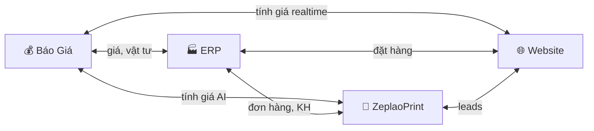

# Kprint Ecosystem — Proposal

## Tầm Nhìn

Một hệ sinh thái **4 dịch vụ độc lập**, mỗi dịch vụ giải quyết một bài toán riêng, nhưng có thể **kết nối linh hoạt** với nhau qua API. Bất kỳ dịch vụ nào cũng có thể vận hành một mình hoặc phối hợp cùng các dịch vụ khác.



---

## 💰 Dịch Vụ Báo Giá

> Engine tính giá trung tâm — mọi nơi cần giá đều gọi tới đây.

### Quản lý dữ liệu gốc

| Dữ liệu          | Vai trò                                                                                                 |
| ---------------- | ------------------------------------------------------------------------------------------------------- |
| **Vật tư**       | Giấy, decal, film, canvas, bạt, phụ kiện — mỗi loại có giá vốn, giá bán, GSM, format (tờ/cuộn), tồn kho |
| **Kích thước**   | Các khổ giấy chuẩn và custom, kèm lề in                                                                 |
| **Định mức giá** | Bảng giá theo: vật tư × khổ × mặt in × loại in × khoảng số lượng → giá/tờ                               |
| **Gia công**     | Bọ gốc, bế khuôn, gấp tờ, keo gáy, phủ UV, ép nhũ, đóng ghim, cán màng...                               |
| **Sản phẩm**     | Namecard, tờ rơi, catalogue, banner, decal... — phân loại và cấu hình mặc định                          |

### 3 Engine tính giá

| Engine        | Input                                       | Logic                                           | Output                     |
| ------------- | ------------------------------------------- | ----------------------------------------------- | -------------------------- |
| **Tờ rời**    | Vật tư, khổ giấy, kích thước SP, SL, mặt in | Grid layout → số tờ → tra định mức → + gia công | Tổng giá, giá/SP, chi tiết |
| **Đóng cuốn** | Vật tư bìa + ruột, số trang, kiểu đóng, SL  | Bìa riêng + ruột riêng + chi phí đóng cuốn      | Tổng giá, giá/cuốn         |
| **Khổ lớn**   | Vật tư cuộn, rộng×cao, loại in              | Diện tích × giá/m² + finishing                  | Tổng giá, giá/tấm          |

### Điểm kết nối

- `POST /quote/calc` — tính giá (ai gọi cũng được: ERP, ZeplaoPrint, Website)
- `GET /materials` — danh sách vật tư + giá
- `GET /pricing-tiers` — bảng định mức
- `GET /products` — danh mục sản phẩm
- CRUD API đầy đủ cho mọi entity
- Admin UI web — quản lý trực quan tại chỗ

---

## 🏭 ERP

> Quản lý toàn bộ vận hành — từ nhận đơn → sản xuất → giao hàng → thu tiền.

### Các module

| Module          | Chức năng                                                       |
| --------------- | --------------------------------------------------------------- |
| **Báo giá**     | Tạo báo giá cho khách, in/xuất PDF. Gọi Pricing Service để tính |
| **Đơn hàng**    | Chuyển báo giá → đơn hàng, phân công sản xuất                   |
| **Job Ticket**  | Phiếu sản xuất chi tiết: vật tư, máy, thời gian, barcode        |
| **Kho**         | Nhập/xuất vật tư, tồn kho realtime, cảnh báo hết, BOM           |
| **Khách hàng**  | CRM: leads, customer, nhóm giá, lịch sử mua                     |
| **Giao hàng**   | Phiếu giao, xác nhận, tracking                                  |
| **Kế toán**     | Hóa đơn điện tử, công nợ, thu chi, thanh toán                   |
| **AI**          | Auto-quote từ text, phân tích keyword, suggest sản phẩm         |
| **Báo cáo**     | Doanh thu, top SP, hiệu suất nhân viên, lãi/lỗ                  |
| **Super Admin** | Quản lý license, multi-tenant, cấu hình hệ thống                |

### Điểm kết nối

- Gọi **Pricing Service** khi cần giá → không lưu giá cục bộ
- Nhận leads từ **ZeplaoPrint** (khách nhắn Zalo → tạo lead trong ERP)
- Nhận đơn hàng từ **Website** (khách đặt online → tạo order trong ERP)
- Cung cấp trạng thái đơn cho **Website** (tracking)
- Đồng bộ danh sách khách hàng với **ZeplaoPrint**

---

## 💬 ZeplaoPrint

> Trung tâm giao tiếp đa kênh — nhận tin nhắn, tự động báo giá, chăm sóc khách hàng.

### Các module

| Module             | Chức năng                                                        |
| ------------------ | ---------------------------------------------------------------- |
| **Inbox**          | Hội thoại realtime đa kênh: Zalo OA, Facebook, email             |
| **Contacts**       | Danh bạ khách hàng, tags, ghi chú, lịch sử liên hệ               |
| **Quote**          | Tạo báo giá nhanh ngay trong hội thoại — gọi Pricing Service     |
| **AI Suggestions** | Gợi ý câu trả lời dựa trên knowledge base + ngữ cảnh             |
| **AI Auto-Quote**  | Khách nhắn "in 500 namecard" → AI trích xuất → tự tính → trả giá |
| **Knowledge Base** | FAQ, chính sách giá, quy trình — phục vụ AI + nhân viên          |
| **Quick Replies**  | Templates tin nhắn mẫu                                           |
| **Dashboard**      | Metrics: thời gian phản hồi, hội thoại mở, hiệu suất             |
| **Reports**        | Thống kê hội thoại, nguồn khách, tỷ lệ chuyển đổi                |

### Pipeline AI Auto-Quote

```
📱 Khách: "In 500 namecard Couche 300gsm, 2 mặt, cán bóng"
                    │
                    ▼
        ┌───────────────────────┐
        │  🔍 Material Extractor │ → qty=500, material=couche_300
        │  📐 Size Extractor     │ → product=namecard (90×55)
        │  ⚙️ Option Extractor   │ → side=double, finishing=cán bóng
        └───────────────────────┘
                    │
                    ▼
        ┌───────────────────────┐
        │  💰 Pricing Service    │ → POST /quote/calc
        │  type=loose            │
        │  material_id + qty...  │
        └───────────────────────┘
                    │
                    ▼
        ┌───────────────────────┐
        │  📋 Format kết quả     │
        │  "500 namecard = 250k" │
        │  + chi tiết breakdown  │
        └───────────────────────┘
                    │
                    ▼
        📱 Auto-reply hoặc gợi ý nhân viên duyệt
```

### Điểm kết nối

- Gọi **Pricing Service** để tính giá (manual quote + AI auto-quote)
- Đẩy leads sang **ERP** khi khách tiềm năng
- Nhận thông tin đơn hàng từ **ERP** để cập nhật khách trong hội thoại
- Đồng bộ contacts với **ERP** customer list
- Nhận thông báo từ **Website** khi có form liên hệ mới

---

## 🌐 Website

> Mặt tiền online — khách hàng tự tính giá, đặt hàng, không cần gọi điện.

### Các tính năng

| Tính năng             | Mô tả                                                                     |
| --------------------- | ------------------------------------------------------------------------- |
| **Danh mục sản phẩm** | 29+ sản phẩm phân loại: In cơ bản, Brochure, Sách, Khổ lớn...             |
| **Tính giá online**   | 3 tab giống Pricing Admin: chọn vật tư, nhập thông số → xem giá instantly |
| **Thiết kế online**   | Upload file thiết kế, preview, chọn thông số kỹ thuật                     |
| **Giỏ hàng**          | Thêm nhiều sản phẩm đã tính giá, tổng hợp đơn                             |
| **Checkout**          | Điền thông tin → thanh toán → tạo đơn                                     |
| **Theo dõi đơn**      | Xem trạng thái: chờ xác nhận → sản xuất → giao hàng                       |
| **Tài khoản**         | Đăng ký, lịch sử đặt, nhóm giá riêng                                      |
| **Blog/SEO**          | Nội dung marketing, hướng dẫn                                             |
| **Chat**              | Nút chat kết nối ZeplaoPrint                                                  |

### Điểm kết nối

- Gọi **Pricing Service** để tính giá realtime (không qua ERP)
- Gửi đơn hàng sang **ERP** khi checkout
- Mở chat → kết nối **ZeplaoPrint** (Zalo OA widget)
- Lấy trạng thái đơn từ **ERP**

---

## Ma Trận Kết Nối

Mỗi mũi tên là một API call hoặc webhook — bất kỳ kết nối nào cũng **tùy chọn**, hệ thống vẫn chạy độc lập nếu thiếu.

| Từ ↓ / Đến →  | 💰 Báo Giá         | 🏭 ERP                | 💬 ZeplaoPrint            | 🌐 Website      |
| ------------- | ----------------- | -------------------- | -------------------- | -------------- |
| **💰 Báo Giá** | —                 | Webhook giá thay đổi | Webhook giá thay đổi | —              |
| **🏭 ERP**     | Lấy giá, tính giá | —                    | Gửi đơn + KH         | Trạng thái đơn |
| **💬 ZeplaoPrint** | Tính giá AI       | Đẩy leads, KH        | —                    | —              |
| **🌐 Website** | Tính giá realtime | Đặt hàng             | Chat widget          | —              |

> **Nguyên tắc**: Pricing Service là read-heavy (ai cũng gọi đến). ERP là write-heavy (quản lý dữ liệu vận hành). ZeplaoPrint là event-driven (phản hồi tin nhắn). Website là stateless (gọi API, render).
